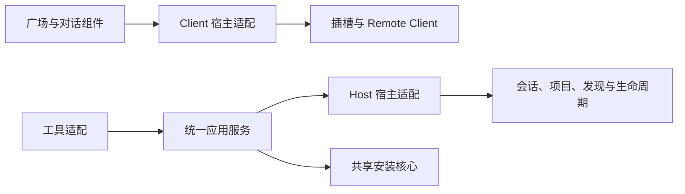

# DSH 版本兼容性设计

## 1. 支持策略

首版采用单一精确 DSH 版本作为开发、构建和发布验收基线，保留薄宿主适配层以便后续升级。首版不承担多发行线兼容、最低到最高版本区间覆盖或并行维护多个插件版本线。

| 支持等级 | 定义 | 产品行为 |
| --- | --- | --- |
| 完整支持 | 必需接口及全部首期功能通过验收 | 开放对应功能 |
| 部分可用 | 已验证的核心链路可用，部分独立 UI 扩展不可用 | 明确缺失功能；可用入口保留，不声明完整支持 |
| 未验证 | 不在已验证组合内，无法确认宿主契约 | 显示未验证状态，默认不开放文件写操作 |
| 不兼容 | 必需协议缺失或版本明确不受支持 | 不开放依赖该协议的功能，给出支持版本说明 |

### 1.1 首版基线决策

首选候选为 DSH `0.2.0-rc.2`。它是 RC 版本，不标记为稳定版；在通过 M0 前只作为验证候选，不列为已支持版本。开发环境使用精确版本，不跟随 latest/next/alpha 标签自动变更。

M0 验证 Bundle 加载、Client 页面、Remote 生成和挂载、对话工具及卡片、可信用户/项目上下文和发现观察。全部必需能力通过后，将该版本确认为唯一首版支持基线，并锁定对应发行依赖组合。

如果候选缺少必需能力，先判断能否使用该版本的官方接口完成相同功能。若不能，记录具体缺口与调整成本，再评估替换为 `0.2.1-alpha.2` 等明确候选。基线替换须同步本设计、依赖、适配和验收，并重新通过 M0；不静默转向 Alpha，不在首版同时维护两套协议。

现有技术分册中的宿主 API 设计须与选定发行产物逐项核对。若固定源码中的接口在候选发行版不存在，不能直接以源码接口作为实现依据。

### 1.2 固定的研发与验收组合

| 项目 | 固定值 |
| --- | --- |
| DSH 主发行版 | `0.2.0-rc.2`，预发布版本 |
| 官方源码对应 | [dsh-v0.2.0-rc.2 发布记录](https://github.com/deepseek-ai/deepseek-harness/releases/tag/dsh-v0.2.0-rc.2)所关联的源码标签 |
| DSH Host peers、Client 模块和 Typert 生成器 | `0.2.0-rc.2`；完整清单以插件 package.json 和宿主基线检查为准 |
| Cordis | `4.0.4` |
| Node | `>=24.2.0 <25` |
| Host 产物 | Node ESM，安装核心随插件打包 |
| Client 产物 | DSH ModuleLoader factory，React 与 react/jsx-runtime 由宿主提供 |
| Remote 产物 | 使用锁定的官方 Typert 生成器生成 Host/Client 描述与声明 |

此组合固定开发和验收目标，不等于首版已可公开发布。正式支持声明仍需完成平台、真实技能使用、模型交互和升级回退验收。早期调研使用的 Alpha.2 源码不能替代本发行版契约；实现以固定 npm 发行产物及对应 RC.2 源码为准。发行包完整性和本地内容核对记录放在 verification.md，不混入产品流程。

### 1.3 后续扩展

新增宿主版本支持单独进行需求评估和回归；首版交付不以第二个版本通过为前提。不因版本号更高而自动兼容，发布声明和 peers 不使用 `*` 或未经验证的宽范围。

### 1.4 M0 能力与已有证据

下表汇总固定 RC.2 组合的能力验证，不将不同阶段的开发包报告视作同一最终候选的完整验收，也不改变当前支持状态。完整过程和环境边界以 [verification.md](verification.md) 为准。

| M0 能力 | 已验证结果 | 证据 |
| --- | --- | --- |
| 发行依赖与生成器 | RC.2 源码清单、发行包及本地依赖对应；官方生成器生成独立 Host/Remote 产物 | [发行对应](../../../docs/research/dsh-native-plugin-2026-10-12/rc2-release-mapping-result.json)、[生成器验证](../../../docs/research/dsh-native-plugin-2026-10-12/m0-release-probe.md) |
| Bundle 与 Host/Client 生命周期 | 干净 Web Profile 使用实际安装的 Client；两轮禁用/启用移除并恢复服务、工具和 Client 图 | [Bundle 生命周期](../../../docs/research/dsh-native-plugin-2026-10-12/loader-identity-lifecycle-result.json) |
| Client 页面与 Remote 挂载 | 浏览器原生页面收到 Host 连接结果，后续对话详情通过 scoped 调用读取 | [M0 页面](../../../docs/research/dsh-native-plugin-2026-10-12/m0-browser-result.json)、[上下文调用](../../../docs/research/dsh-native-plugin-2026-10-12/m2-target-policy-result.json) |
| 工具与结果卡片 | 真实模型只搜索不写入及明确安装通过；官方流事件夹具覆盖 preparing/start/result 和纯展示元数据 | [只读搜索](../../../docs/research/dsh-native-plugin-2026-10-12/real-model-readonly-search-result.json)、[明确安装](../../../docs/research/dsh-native-plugin-2026-10-12/real-model-explicit-install-result.json)、[卡片阶段](../../../docs/research/dsh-native-plugin-2026-10-12/windows-tool-phases-result.json) |
| 可信用户/项目上下文 | 官方工具传入可信会话 cwd；用户/项目读取和项目隔离通过 | [目标上下文](../../../docs/research/dsh-native-plugin-2026-10-12/m2-target-policy-result.json) |
| 匿名下载、完整资源与发现观察 | 真实 Registry 技能安装及文件核验；干净包同会话发现和资源读取通过，操作展示仍可保持 unconfirmed | [真实包安装](../../../docs/research/dsh-native-plugin-2026-10-12/registry-resource-install-result.json)、[同会话发现](../../../docs/research/dsh-native-plugin-2026-10-12/clean-installed-discovery-result.json) |

M0 必需能力已有上述分项证据；任务 10.1/10.5 的最终结论仍须结合平台 CI、宿主与回退结果确认。发布前保留以下处置门禁：

- 最终提交的 Linux/Windows 平台 CI 完成并保留产物；macOS 产品验收继续后置，不因 CI 通过自动声明支持。
- 对历史 Linux 基线偶发断言和 Windows 间歇安装失败形成明确处置记录：补充可核验归因与修复证据，或明确影响范围、剩余风险及发布决策。后续成功不作为问题已解决的证明。原记录见 verification.md 的“已安装 Profile 的真实宿主版本往返”和“兼容性实现任务统一审计”。
- 独立远程 Host、当前服务端部署及实际发布包的缺口继续按 [验收门禁](acceptance.md) 跟踪，不由本表豁免。

## 2. 兼容对象

| 层次 | 验证内容 | 风险处理 |
| --- | --- | --- |
| DSH 发行组合 | 主包、Profile 实际依赖及插件加载器 | 使用发行组合，不分别安装子包 latest |
| Host | Cordis 生命周期、工具上下文、技能目标及发现机制 | 统一经宿主适配层调用 |
| Remote | Typert 元数据、生成器、挂载、lookup、错误返回 | 生成产物必须与目标协议兼容 |
| Client | ModuleLoader、React external、main/sidebar/config/ToolView | 明确导出和槽位，按功能降级 |
| 运行时 | Node 版本、操作系统、路径与文件锁 | engines 与测试矩阵一致 |
| Registry | 匿名必需 API 与可选模块 | 与 DSH 兼容性分开判定 |

开发依赖及构建生成器锁定精确版本；首版发布 peers 对应经验证的精确依赖版本。插件不打包另一套 DSH/Cordis/React 来规避宿主依赖冲突。宿主依赖树混装或实际协议与版本声明不符时，按不兼容处理。

## 3. 适配边界

业务服务不读取 DSH 版本号、不按版本分叉安装事务。版本差异集中在现有 dsh-adapter、Remote 装配及 Client 注册入口。首版只实现选定基线的适配器，不增加多版本选择器或兼容分支。

适配器输出统一的可信上下文、目标、发现结果和 UI 能力。Remote 产物仅针对选定基线生成和验证。后续扩展发现协议不兼容时，另行确定替换基线或维护新版本线的方案；该决策不属于首版交付范围。

## 4. 能力检测与功能边界

版本检查在依赖安装/加载阶段约束支持范围；运行时检测用于确认服务、方法、槽位与协议是否实际可用。检测不触发技能写操作，也不替代真实兼容测试。

| 缺失或不兼容能力 | 行为 |
| --- | --- |
| Bundle/Host 入口无法加载 | 使用 DSH 插件管理器的加载错误；插件自身 UI 不保证可显示 |
| Remote 必需协议或可信调用上下文不可用 | 禁止依赖该上下文的文件写入；不退回无校验 HTTP 或 shell |
| 用户根/锁/事务要求无法满足 | 禁止安装、升级、卸载 |
| 可信项目上下文不可用 | 禁用项目级；用户级仅在其独立兼容检查通过时可用 |
| main/sidebar 或 ToolView 不可用 | 缺失入口不可用；另一入口须已独立验证；标记部分可用 |
| 配置保存接口不可用 | 不提供失效的保存按钮；未配置有效来源时不能继续使用 |
| 发现观察不可用 | 文件安装可完成，发现状态保持 unconfirmed |
| 评论/审核等 Registry 模块不可用 | 按 detailTabs 规则处理，不归为 DSH 版本故障 |

部分可用是异常处理能力，不降低首期完整交付标准：每个声明完整支持的宿主版本都必须通过广场和对话双入口验收。依赖过硬导致整个包无法加载时不能承诺局部降级；M0 必须验证对应贡献能否独立装配。

## 5. 测试矩阵

| 维度 | 发布要求 |
| --- | --- |
| 宿主版本 | M0 确认的单一精确版本，双入口完整回归 |
| 预发布属性 | 保留所选版本的 RC/alpha 标识，不能表述为稳定版兼容 |
| 平台 | Linux/macOS/Windows 只声明实际通过的版本组合 |
| 拓扑 | 本地主机与远程单用户 Host，验证文件位置和上下文归属 |
| 生命周期 | 初装、重载、禁用、重新启用、插件升级及兼容回退 |
| Registry | 开源必需 API；SaaS 仅在其契约同步验收后加入支持矩阵 |

每个支持组合至少覆盖：加载与配置、匿名搜索详情、两种 UI 入口、用户级/项目级安装、幂等、更新/卸载、工具结果恢复、归属校验和禁用清理。平台特有的文件路径、锁、rename 和恢复必须在该平台运行。

CI 使用单一 DSH 基线与受支持平台的矩阵作为发布门禁。新发行版前瞻检查为后续可选工作，不是首版发布前提，也不自动扩大 peers 或支持清单。失败归因到宿主适配、协议生成、业务逻辑或环境差异后处理，禁止靠捕获所有异常返回成功来兼容。

## 6. 升级与发布约束

1. 发布说明列出插件版本、唯一 DSH 精确基线版本、Node、操作系统及 Registry 契约组合。
2. DSH 升级超出支持范围时，停止新写入并显示不受支持状态；已接受操作依原日志恢复规则处理。
3. 适配新宿主先完成候选验证，再更新 peers、支持清单和文档；不直接修改现有发布包。
4. 插件包内 Host/Client/Remote 成套发布。插件版本回退先核验操作日志及安装记录兼容性。
5. 安装器与加载器可以在插件运行前拒绝不兼容依赖，此时由安装文档提供可选的受支持版本。

### 6.1 首版回退决策

首版没有可承诺兼容的旧正式插件版本时，故障处置采用**禁用插件并保留数据**，不默认退到开发包，也不为验证回退而另行发布第二个版本。

1. 停止新写入；存在已接受操作时先核验原操作及待恢复状态，按已验证的关闭/恢复流程处理，不把禁用视为取消或回滚。
2. 通过 DSH Plugins 开关禁用插件，保留已安装技能、inventory、操作日志及宿主身份。后续只在兼容版本恢复启用或进行明确的修复操作。
3. 指定开发包的替换/回退仅用于隔离测试。已有[完成历史往返](../../../docs/research/dsh-native-plugin-2026-10-12/plugin-artifact-roundtrip-result.json)和[待恢复事务回退](../../../docs/research/dsh-native-plugin-2026-10-12/pending-plugin-artifact-rollback-result.json)验证字节身份与数据保留，但两包版本均为 `0.0.0-m0`，不构成不同正式版本的兼容承诺。
4. 后续出现旧正式版本时，在将其列为回退目标前验证对应日志和安装记录兼容性；不识别的日志阻止新写和恢复写入，保留原数据，使用兼容修复版本。已有[包外核心测试](../../../plugins/dsh/test/local-core-package.test.ts)验证未知 schema 的拒绝与数据不变，不替代具体正式版本之间的演练。

真实宿主升级后的拒绝与回退另有[完成历史](../../../docs/research/dsh-native-plugin-2026-10-12/completed-history-roundtrip-result.json)和[待恢复升级](../../../docs/research/dsh-native-plugin-2026-10-12/pending-upgrade-host-roundtrip-result.json)证据。上述策略不改变精确 peers/engines，不绕过官方加载器，也不关闭任务 9.5/10.5。

## 7. 开发交付项

兼容实现包括：统一宿主适配边界、版本及能力结果、固定依赖和构建生成器、单基线平台 CI 矩阵、隔离 Profile 测试夹具、用户可读的支持说明。新增 DSH 版本支持属于有验收的适配变更，不需要改写安装、升级和卸载的业务规则。

## 8. Host 依赖门禁实现

插件从自身 Host 模块位置，通过宿主 pluginPackages 服务读取 DSH 主程序、app-boot 和九项 Host 依赖的运行时解析 name/version；通过 clientModules 服务定位七项声明注入的 Client 模块文件并核对所属包清单。每次核验重新读取当前服务及 Client 图，并从 Host 返回的 manifestPath 读取当前磁盘清单；缓存元数据和磁盘清单均须匹配候选精确基线。缺包、无法读取、名称不符或版本不符均拒绝新写请求的准备阶段；已受理请求先按持久记录查重，返回原回执，不因依赖不匹配丢失查询能力或重放写操作。恢复涉及文件写入，也须通过依赖门禁后重新验证当前目标和策略。

`getCompatibility` 返回依赖基线结果及候选版本，用于页面提示和重新核验；不返回模块路径或加载异常。`localWritesAllowed` 仅表示依赖门禁通过，实际写入仍受会话、文件系统、策略、事务和业务校验限制。

此检查不证明浏览器已经执行这些 Client 文件，也不覆盖所有传递依赖、Node/平台和完整功能验收。宿主包元数据由官方服务缓存，磁盘复核用于发现同路径清单变化。候选宿主的解析配置更新禁止替换或删除已有包映射；允许新增映射时，已经加载的模块保持原实例。宿主依赖版本变更必须重启进程后重新核验，不将插件禁用/启用视为 Node 模块缓存清空。原地修改代码但保留包版本不属于本检查可证明的范围；真实宿主升级、混装和完整平台矩阵仍需完成，不能将 dependencyBaseline=matched 用作正式支持声明。

客户端安装、升级、卸载和恢复控件共享 Host 依赖核验查询。初次读取中、读取失败或不匹配时禁用新写入口与确认按钮，并提供重新核验操作；只读浏览、更新检查、原请求查询和结果关闭保留。对话详情内安装控件使用同一限制。客户端禁用不是权限边界，Host 仍在新请求准备及恢复写入前独立核验。

## 9. Node 候选运行范围

首期范围为 `>=24.2.0 <25`，与插件 package.json engines、Host 新写/恢复检查保持一致。CI 三平台分别检查 24.2.0 下界及当前 Node 24，制品名包含系统和 Node 版本。其他 Node 主版本不作为首期支持承诺。

Node 24.0.0 实测无法启动候选 DSH CLI：其入口依赖 import.meta.main，该字段在此版本为 undefined。官方 Node 文档标明该能力于 24.2.0 / 22.18.0 加入，见 [ESM 文档](https://nodejs.org/api/esm.html#importmetamain)。本项目没有因此自动承诺 Node 22。Linux 的 24.2.0、24.17.0 已通过宿主启动和插件基线检查；最低版本测试与跨平台 CI 不替代完整产品实机验收。

## 10. 兼容验证环境约束

生命周期验收必须确认实际 Client 文件来自隔离 Profile 安装的插件包。所有 Host observer 均复制到插件包外加载；即使 observer 跳过执行，将其从插件包内部加载仍可能被宿主识别为该包的另一个 Client 来源，使 Bundle 禁用测试失真。

清理验证环境后，当前候选的官方 Bundle 禁用/启用、Host 服务及工具移除恢复、Client 模块图移除恢复和浏览器唯一入口恢复已通过。该结果不替代未完成的跨平台、依赖混装及重载、请求订阅释放和正式支持基线验收。

## 11. Client 入口可用性提示

Client 通过官方槽位声明生命周期与 layout/configForms 服务依赖跟踪广场主面板、侧栏、对话卡片和配置入口。某入口不可用时，在仍可呈现的广场或对话卡片顶部显示“SkillHub 部分功能暂不可用”，列出缺失入口；仅在另一入口可用时提供替代路径。配置入口缺失时说明当前来源设置保持不变。未配置来源时，空状态同时说明必须先恢复配置功能，不再引导打开不可用的配置页；入口恢复后在同一页面恢复配置步骤。入口恢复后自动移除对应提示，全部恢复后不显示提示。

该状态只描述 Client 入口可用性，不替代 Host 版本检查或文件写入授权，也不表示 Registry 可访问。主模块无法加载、全部呈现入口同时缺失或渲染本身失败时，插件不能保证显示自己的提示，仍由 DSH 的加载错误及安装说明提供诊断。
