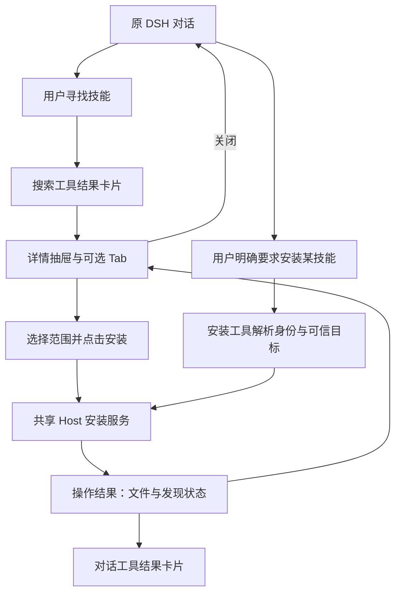
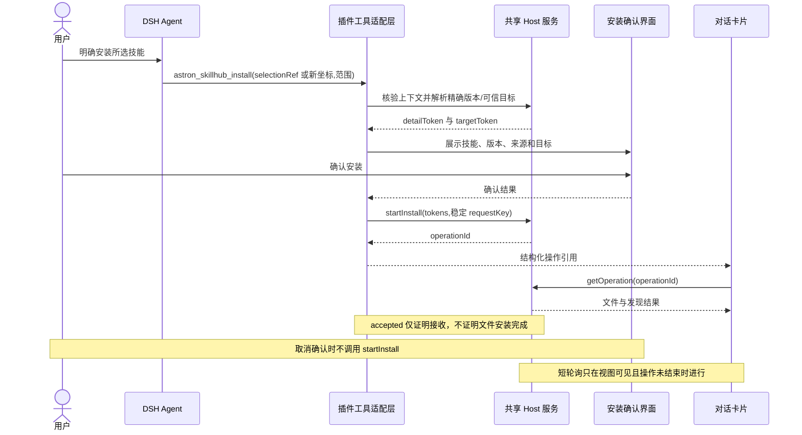
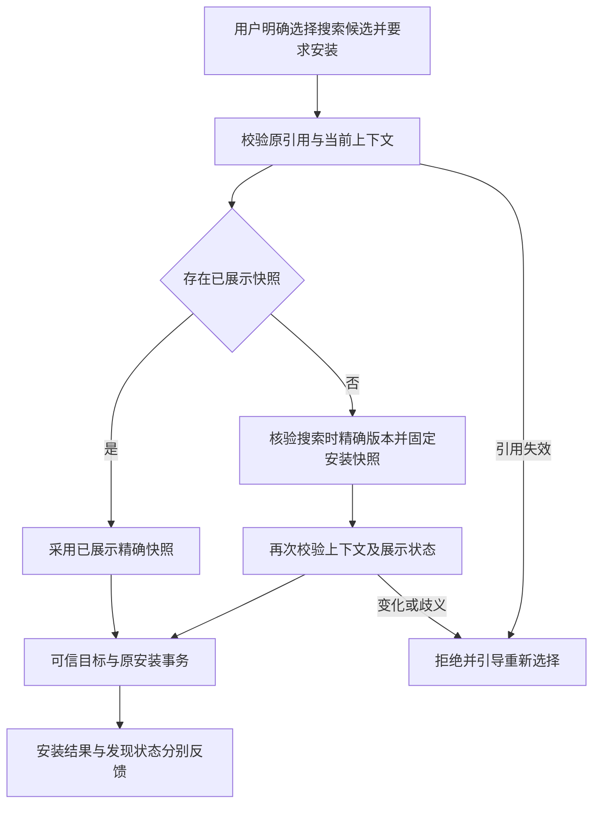

# 对话内搜索、详情与安装设计

本文定义对话内搜索卡片、详情抽屉和显式安装交互。工具与内部数据契约属于插件设计；宿主扩展机制遵循 DSH 原生接口。

## 1. 产品形态与边界

插件提供“技能广场”和“对话内找技能”两个入口。用户说“找一个处理 PDF 的技能”，DSH 调用搜索工具并在原对话展示卡片；用户可打开详情抽屉、选范围、安装，也可以明确要求 Agent 安装某个技能。插件不创建自己的聊天页面，不切换模型，不向当前会话自动发送技能执行指令。

用户明确要求安装唯一搜索候选时，不要求先打开详情页。Host 使用原搜索引用校验来源、会话和项目，并核验搜索时的精确版本，形成独立安装快照；已经展示的详情仍以其固定快照为准。后台版本核验不等于用户查看详情，不调用展示确认、不标记 viewed。引用失效或版本无法核验时阻断，不替换为新坐标或 latest。

首期对话工具仅包含搜索和安装。升级、卸载、完整已安装列表继续由广场承载；对话结果可提供“在已安装中查看”入口，不额外承诺对话升级卸载工具。安装工具不兼作升级器，其他版本占用时引导到已有受保护升级流程。

## 2. C1：对话搜索结果卡片

| 元素 | 展示及交互 |
| --- | --- |
| 标题 | “SkillHub 搜索结果”，显示关键词、来源、返回范围；不把首批 20 条当全库 |
| 条目 | 专属紧凑横向卡片，32px头像、名称、完整坐标、版本、最多两行摘要及明确的“查看技能详情”；常规桌面目标100–132px，不复用广场固定高度；无可靠数据不展示评分/下载量/认证 |
| 操作 | 明确的“查看详情”按钮进入抽屉，文字保持可选择；不在搜索卡片放未经详情核验的一键安装按钮 |
| 底部 | 独立操作栏，按钮间隔8–12px；“打开技能广场”为次要描边操作，“查看调用详情”为弱化操作。原会话保持选中，返回恢复位置 |
| 状态 | 工具运行时显示搜索中；零结果提供修改关键词；失败显示原因及重试，不伪装零结果 |

多候选选择按搜索实际返回数量展示，不固定为单个技能。用户通过名称、坐标、用途摘要和版本比较候选；每个“查看详情”入口绑定该条目的引用。关闭详情返回原结果，再查看其他候选；浏览候选不产生安装。候选不合适时，用户可继续在 DSH 输入框描述更具体的需求，或打开技能广场。当前不提供批量勾选安装。演示验收须包含至少三个用途不同的候选，并分别验证非首项的详情身份与取消确认零写入。

搜索是只读行为，不因模型推荐、技能说明或工具结果内的安装指令触发写入。连续多次搜索的卡片各自绑定 toolCallId、原始来源和关键词，不被较晚结果整体替换。搜索卡片中的版本只是当时结果；打开详情后以 Host 重新 resolve 的精确版本为准。

用户可见说明使用技能坐标、版本、摘要和状态。`selectionRef`、`sourceRevision`、`operationId`、`hostInstanceId`、`toolCallId` 是工具参数或关联字段，不要求用户阅读或复制。模型工具说明明确该规则，引用仍保留在工具协议中；该指引不构成模型输出的强制过滤。

## 3. C2：会话上的详情抽屉

宽屏从聊天内容区右侧打开详情抽屉，保留背景对话与宿主侧栏；采用宿主可用容器，不能假设存在特定 Drawer API。窄屏占满内容区，顶部仍保留关闭/返回对话。只有一个活跃详情容器，打开另一个技能会切换内容，不叠加多层抽屉。

- 顶部：关闭、名称、完整坐标、来源、精确版本。
- 中间：详情 / 版本 / 安全审核 / 评论，完全共用广场的 auto/show/hide、匿名访问及版本规则。
- 底部操作区：当前 DSH 主机、用户级或可信项目级目标、安装按钮；内容较长时操作区不能遮挡正文。
- 安装期间：禁用重复提交和目标切换；可关闭抽屉，已接受操作继续。
- 结果：保留文件结果、DSH 发现状态、错误和重试入口；关闭再打开仍可按 operationId 查询。
- 焦点：打开后到标题，Tab 在模态容器内循环，Esc/关闭恢复触发卡片焦点；关闭不代表撤销安装。

共享 DetailContent 和安装控制器；广场外层为子页面，聊天外层为抽屉。广场“左上角返回”与抽屉“关闭”仅是容器导航差异。

## 4. C3：Agent 安装工具与授权语义

用户明确说“安装 @namespace/slug”，或在当前搜索语境中唯一指明“安装第二个”时，Agent 才可请求安装。单纯“找一个”“这个怎么样”不表示安装。不能只靠 prompt 承担文件保护：Host 对所有入口执行相同的来源、目标、版本、归属、锁和幂等检查，宿主策略步骤继续生效。

- 坐标有歧义时让用户选择，不猜测同名技能。
- 默认用户级；用户明确要求当前项目且 Host 能提供可信项目根时使用项目级，否则不降级成用户级安装。
- 按当前来源重新读取可安装快照；若用户依据先前详情指定了版本，保留该精确版本，不能静默换成最新版。绑定版本不可用则停止并展示原因。
- 来源或项目已切换时，历史卡片与旧请求不能自动迁移到新上下文；提示重新选择后再安装。
- 多个候选匹配而用户仅说“那个技能”等模糊指代时，先询问命名空间/slug 或结果编号，不选择第一项或任意引用；明确要求安装不等于目标已经明确。该规则由工具指引传达，Host 不宣称能强制识别自然语言意图。
- 模型不可提交任意路径、下载 URL、Registry 地址、force 或覆盖参数。
- 明确安装请求先显示技能身份、精确版本、来源和目标范围，用户确认后才提交新安装；取消或关闭确认框不发送写请求。DSH 自身要求的批准仍由宿主处理。
- 页面按钮和 Agent 工具在确认后调用同一个 startInstall 服务。页面取消确认时焦点回到按钮；对话详情内取消时保留抽屉。Agent 工具调用使用独立的安装结果卡片。

## 5. C4：安装过程和持久结果卡片

为安装工具提供自定义结果卡片：技能身份、固定版本、来源、主机/目标标签、操作阶段、文件结果、发现状态、错误恢复说明。默认收起技术详情，可复制 operationId。该卡片是正式交付项，不以通用 JSON 工具输出作为最终产品设计。

| 状态 | 主文案 | 可用动作 |
| --- | --- | --- |
| 提交尚未接受 | 正在检查安装请求 | 查看详情，不显示虚假百分比 |
| 已接受 | 正在安装 | 查看详情；无取消或再次安装 |
| 文件与记录完成 | 已安装 | 查看详情、在已安装中查看；发现未确认时单独标注 |
| 同版本完整存在 | 已安装，无需重复安装 | 查看已安装目标 |
| 失败且可重试 | 安装失败及具体原因 | 重新核验后重试；未知是否接受时使用原 requestKey 查询 |
| 状态无法证明 | 安装状态待核验 | 查询状态；禁止自动重放写入 |
| 旧来源/旧主机记录 | 历史操作结果 | 保留原文与时间，不能展示成当前主机的实时状态 |

历史聊天保存工具返回时的 accepted、context 和 operationId。终态由 Host 操作记录提供，Client 轮询不改写原始工具结果。重开聊天先显示“历史已接收”，在当前 Host 确认记录归属后查询结果；日志过期或缺失时显示“结果无法核验”，不重放写操作，也不保证永久保存完成状态。工具等待被取消与已接受文件操作分开：取消等待不承诺回滚安装，恢复查看时查询原操作。

第一版不新增“安装并自动运行”按钮，不把“文件已安装”写成“技能已执行”。如果自定义 ToolView 在目标 DSH 版本尚未验证，M0 保留阻塞项，不能用静态图片宣称交付。

## 6. 工具与服务契约

| 工具 | 输入 | 返回 | 服务复用 |
| --- | --- | --- | --- |
| astron_skillhub_search | q 字符串 | 来源快照、查询、items（含 Host 签发的 selectionRef）、total/returned/limit、展示类型和协议版本 | listSkills；只读，Host 注入来源 |
| astron_skillhub_install | scope=user/project；selectionRef 或明确新输入的 namespace、slug（二选一） | accepted：operationId、调用/主机标识、技能身份/固定版本、来源/目标标签及接收时间；not-confirmed：调用标识与错误代码。文件和发现终态不包含在工具回执中 | getSkillDetail + startInstall；Client 另经 getOperation 查询终态 |

工具名称与 schema 分别定义于插件的 search-tool.ts 和 install-tool.ts，注册时拒绝同名冲突；这些是 DSH Agent 工具，不是外部 HTTP API。scope 默认 user。sourceRevision、targetToken、requestKey 由可信适配层生成，不能信任模型构造的 token 或历史卡片 HTML 属性。selectionRef 由 Host 签发并保存，绑定来源修订、会话、搜索条目坐标和项目上下文；搜索阶段可只有候选版本，详情打开后另签发绑定精确版本/fingerprint 的引用。引用不是模型可编辑的字段集合。基于搜索卡片、详情或“第二个”等历史选择安装必须提交 selectionRef；Host 保存搜索引用到最近一次成功展示所用详情快照的关联；有已展示快照时必须提升到该快照，没有已展示快照时由 Host 按搜索时精确版本核验并固定安装快照，两者均不得重新解析 latest。若同一搜索引用关联多个不同固定版本且无法确定用户所指，则阻断并重新选择。Host 校验归属、时效、来源、项目和已有固定版本，失败返回 CONTEXT_STALE，不回退到最新版本。只有用户在当前上下文明示一个新的完整坐标时才可走无引用入口；工具引导与适配上下文须区分新输入和引用选择，不能把缺失或过期的选择引用改写为新坐标安装。该解析歧义无法消除时先让用户重新选择。

展示数据以结构化 envelope 传递，搜索与安装使用各自的 schema，不假设字段相同。搜索结果包含 kind、schemaVersion、查询、来源标签/修订、创建时间、数量与候选快照；toolCallId 由宿主 ToolView props.callId 提供。安装结果使用 §9 的 accepted/not-confirmed 两种结构，只有 accepted 包含 operationId。Host 保留本地记录归属；Client 不接收带凭证 URL、内部下载 URL 或可执行命令。工具通过 output.presentationMeta 提供结构化结果；Client 在 tool.call.toolview 插槽按工具名注册，从 props.block.meta 解析并校验。无法识别的历史格式显示只读提示，不触发安装。

工具适配层按持久 hostInstanceId、会话、toolCallId 映射稳定 requestKey（进程重启不改变 hostInstanceId）；相同工具调用重新等待不能重新写入。不同 toolCallId 的重复请求仍由共享目标锁、内容检查和 inventory 幂等处理，不能只做 UI 禁用。

该映射使用持久 hostInstanceId 作为 UUID v5 命名空间，名称为 JSON 数组 `["skillhub-conversation-install-v1", sessionId, callId]`；通过结构化编码避免字段拼接歧义。模型不提供 requestKey。参数变化不能产生另一个键以绕开冲突检查：原始 selectionRef 或新坐标及 scope 必须参与日志参数摘要，先查已有接受记录，再解析可能过期的引用。请求键用于幂等关联，不作为授权凭证。

## 7. 实现与验收边界

- Host 增加两个薄工具适配器和最小引导说明，不执行 PATH CLI；Registry 走 HTTP，文件写入复用内置 CLI 核心。
- Client 增加 SearchToolView、InstallToolView、ConversationDetail 容器；详情内容、可选 Tab、目标选择、状态展示复用广场组件。
- 普通搜索/详情不会下载安装包；安装工具不重复实现 ZIP、锁、metadata 或恢复逻辑。
- 插件卸载/禁用时释放工具、ToolView、监听和轮询；已经安装的技能保留。
- 覆盖：只搜索不安装；同名澄清；来源/项目变化；抽屉焦点；双入口并发；响应丢失；工具等待取消；历史重开；发现未知；Registry 拒绝；插件禁用。

## 8. 视觉要求

卡片与抽屉沿用 DSH 宿主主题和字体，保留原会话内容与输入区。窄屏采用内容区全宽布局；焦点、加载、错误和结果展示遵循产品设计中的可访问性要求。

### 宿主内展示关系

搜索结果位于原会话工具区域，保留宿主侧栏与输入框；候选卡片提供详情入口，也支持用户直接按序号明确安装。详情在右侧抽屉打开，关闭后恢复原焦点。安装结果用紧凑卡片展示技能、版本/范围和一句结果，技术记录默认折叠。模型回答不能替代结构化操作状态，历史完成也不代表当前仍安装。

验证范围与限制统一见[验证摘要](verification.md)。

## 9. 工具返回与操作完成的界线

安装工具先完成上下文核验和持久接收，成功返回 accepted/operationId；它不长时间阻塞到整个下载结束。工具返回文案必须是“已开始安装”，不能返回“安装成功”。InstallToolView 通过共享 getOperation 展示后续阶段，操作进入 completed/failed/recovery-required/unknown 后停止自动轮询。工具适配失败且尚未接受时返回结构化错误，不创建虚假操作。

模型看到 accepted 只能说明任务已接收，不得断言技能可用或立即执行依赖该技能的动作。首期不增加后台向对话自动发消息的机制，也不新增第三个操作查询工具；最终状态由持久结果卡片展示。用户需在结果确认后自行继续任务。M0 必须证明 DSH 能保存 accepted payload 并让 ToolView 后续查询；不成立则记录兼容阻塞，修改本契约前复审。

页面请求与工具请求共用 OperationStore。一次事务更新按 operationId 通知当前挂载视图；只刷新相同 Host、来源、技能和目标的投影，旧来源完成不刷新新来源列表。界面切换不能丢掉运行中操作引用。插件 Client 卸载停止轮询，Host 保留任务及日志。

### 引用有效性

selectionRef/detailToken/targetToken 的可用条件是 Host 内仍有记录、绑定上下文匹配、版本可复核；首期不另加任意分钟 TTL，升级/卸载 plan 的 5 分钟 TTL 保持独立。Host 重启清空引用，历史卡片只读展示；用户点击“重新查看详情”后签发新引用并明确展示当前来源/版本，不自动提交旧安装请求。

客户端可以保存引用用于关联，但它不是认证凭证；执行时必须由 Host 重新查表。模型无法证明一段自然语言是否授权安装，Host 也不能声称已验证用户真实意图；显式请求解析是 Agent/宿主策略责任，文件、上下文、归属、幂等保护是 Host 强制责任。

### 历史搜索的显式重新查看

旧引用失效时，抽屉提供“重新查看详情”，不自动重开，也不对已失效引用提供无效重试。调用会话作用域 `reopenConversationDetail(callId, selectionRef, signal)`；客户端只提交原调用标识和旧引用，不提交技能坐标或来源。

Host 从当前会话的持久日志读取匹配且唯一的成功搜索调用/结果，核验会话、项目、工具名、调用归属、协议版本与原来源。拒绝其他会话、继承事件、失败或重复结果、来源改变及无法核验的记录。候选坐标和精确版本仅从可信结果取得，按当前来源重新读取；固定版本不可用时提示失败，不替换成最新版。

读取期间重新校验当前 Agent、项目、来源和查询服务。成功后签发全新引用和详情 token，并通过现有展示确认机制处理；旧引用仍然失效。抽屉主区域展示实际版本；原搜索来源和当前详情来源放入正文末尾默认收起的“来源信息”，展开后可核对，不在正常详情顶部重复显示地址。失效或来源异常的阻断提示保持可见。重新查看与展示确认不授权安装、不创建安装操作，用户仍需明确发起新安装。普通网络错误保留重试；历史无法核验则提示重新搜索。

### 搜索引用与已查看详情的关联

抽屉调用 openConversationDetail(selectionRef)，Host 核验原来源/会话/项目后读取精确详情并返回 detailToken、固定版本 selectionRef 和展示快照。Client 完成该快照展示后调用 acknowledgeConversationDetail(selectionRef, detailToken)；Host 才将原搜索引用标记为对应已查看快照。安装按钮使用新 detailToken。该确认只记录展示关联，不授权安装、不变更文件。

Agent 在下一次明确安装请求中仍可传原搜索引用，Host 根据关联解析到已查看版本，Client 无需向对话插入工具消息。不允许新版本发布导致重新 resolve latest。未成功展示的新快照不覆盖旧关联；一次来源/项目变化使整个引用链失效。历史快照的重新查看会展示新来源/版本，用户须重新发起安装。原引用关联多版本有歧义时返回 CONTEXT_STALE，由用户重新选择。

### 安装请求未确认的结果

安装工具的结果 envelope 使用互斥的 `accepted` 与 `not-confirmed` 两种状态。后者仅包含 schemaVersion、kind、toolCallId、code，不附加虚构 operationId 或原始诊断。已知错误代码为 CONTEXT_STALE、REQUEST_CONFLICT、SOURCE_NOT_CONFIGURED、SOURCE_DENIED、SKILL_UNAVAILABLE、RATE_LIMITED、SOURCE_UNAVAILABLE、TARGET_UNAVAILABLE；未识别异常使用 UNCONFIRMED。

Client 校验代码后显示本地定义的原因和处理提示，不从错误记录查询或提交操作。参数格式或宿主执行上下文缺失仍属于工具调用错误。工具执行框架的 isError=false 只表示产生了符合 schema 的结果，业务成功须检查 status；not-confirmed 不表示已安装，也不能证明没有任何写入。接受后发生的下载或落盘失败继续通过原 operationId 查询，不改写接受记录。

### 历史安装回执与当前记录

安装结果卡片将原操作结果与当前会话可见的安装记录分开展示。原操作完成不推导当前仍安装该版本；当前记录按用户/项目范围分别显示版本与文件状态。读取不完整或失败不显示“已无记录”。只有原回执身份、主机、来源修订和目标标签匹配时才读取当前清单；来源或会话变化导致读取失败时保留原回执并提示无法核验。卡片只提供查询及跳转已安装，不根据历史结果重新发起安装。

原操作为 completed，或为 failed 且恢复状态明确为 not-needed/restored 时，允许独立查询当前安装记录。失败卡片保留“本次安装未完成”及恢复状态，并说明本次请求失败不代表技能未安装；例如页面入口已经成功安装、对话入口发生并发冲突时，下方展示当前有效安装记录，不将对话操作改写为成功。原操作未知、仍需恢复、读取失败或身份不匹配时，不展示可核验的当前记录区域及其跳转入口。

## 15. 对话结果的视觉层级与演示边界

搜索卡优先展示关键词、匹配数量和可打开的技能；来源与完整查询时间属于辅助信息，可展开查看，可见日期使用可读格式，不将原始 ISO 时间串作为主标题行。技能详情入口突出，其余操作留出间距。深浅主题、单条/多条/空结果和窄屏均需保持清晰。

安装结果优先展示原操作状态及独立核验的当前安装记录；技术明细默认折叠且可自由收起。失败、恢复待核验、历史不可确认和库存异常的必要警告与操作入口保持可见，不自动展开整段技术记录，不以视觉简化改变安装意图确认、版本绑定或恢复语义。

交互演示应包含用户消息、必要的助手说明及工具结果，避免只有工具事件造成“没有提问”的误解。由夹具生成的会话须明确标为演示，不声称经过真实模型推理；产品不自动补写用户消息，不自动提出或执行未获确认的安装。

## 16. 无需打开详情的对话安装

用户在搜索后明确选择“第二个”并要求安装时，模型传递该条目原有 selectionRef 和 scope。Host-only 安装解析区分已展示快照与后台核验快照，不新增 Remote 或模型工具。

- 已展示：复用现有固定详情与内容指纹；关联多个内容身份有歧义时拒绝，不降级到未展示分支。
- 未展示：从可信搜索记录取得坐标与精确版本，读取该版本详情并校验身份、versionId 和 fingerprint；固定所得安装快照，不使用 latest，不把模型传入坐标作为回退。
- 核验前后检查引用仍存在、来源修订、会话与项目未改变；核验失败不留下可安装的半成品。同引用并发复用核验，成功快照可复用，失败后允许重新核验；并发发生详情展示时优先已展示快照或拒绝歧义。
- 后台核验不调用 acknowledgeConversationDetail、不设置 viewed、不打开客户端抽屉。展示确认仅表达真实展示，不再充当所有对话安装的前置条件。
- 两个分支均进入原有目标核验、请求去重、锁、归档校验、事务及发现流程；搜索本身仍只读。

## 17. 紧凑安装状态卡

结果卡主区按“技能身份 → 状态 → 版本与范围 → 一句结果 → 核验状态/查看已安装”组织，状态以文字和颜色共同表达。时间、来源、原请求、复制ID、各查询控件进入“安装记录”。真实当前范围/版本与库存匹配前不展示无条件的当前已安装结论；未完成查询不等同不存在，发现完成不等同执行技能。

技术记录默认折叠且可自由收起。历史操作完成但当前缺失、版本不同、来源变化或读取失败时，主区明确提示历史或待核验。失败和恢复待核验的必要警告与操作入口保持可见，不自动展开整段技术记录。模型工具返回结构、Host事务与安装状态来源不变。
