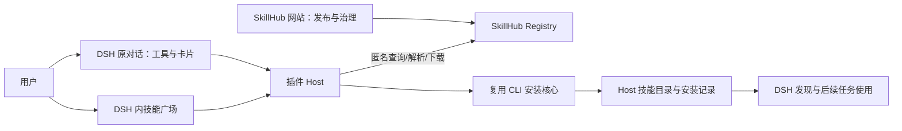
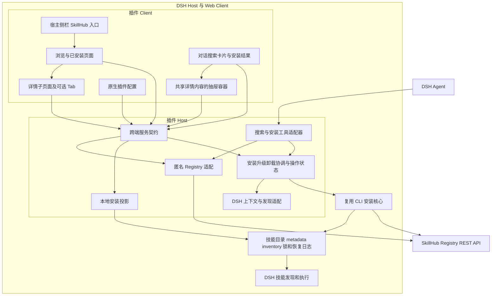

# SkillHub DSH 插件：详细方案与架构设计

本文定义广场管理与对话搜索安装的总体架构。
产品与需求见 [product-design.md](product-design.md)，精确契约见 [interface-design.md](interface-design.md)，开发拆分见 [implementation-design.md](implementation-design.md)，验收以 specs 为准，任务见 [tasks.md](tasks.md)。

## Context

本期提供匿名浏览、详情、安装、已安装管理、升级卸载，以及对话搜索和安装。

SkillHub 仍负责技能发布、版本和服务端规则；本插件只提供 DSH 内的匿名消费入口。DSH 负责工作区、会话、模型和运行策略，插件不复制这些产品能力。

## Goals / Non-Goals

目标：从技能广场或原 DSH 对话发现技能 → 看详情或明确提出安装请求 → 安装到 DSH Host → 查看真实结果；广场继续提供已安装、升级与卸载。
不建设登录、账号、权限管理、私有技能访问或 DSH 插件市场。已安装 Tab 支持检查更新、受保护升级与精确卸载；详情支持可配置的版本、安全审核、评论模块。
不主动修改 SkillHub 服务端访问规则，不建立额外审批；现有拒绝按错误处理。

## Decisions

### 1. 一个宿主入口、目录与详情子页面

保留 DSH 品牌、工作区/会话树及设置。SkillHub 通过已核对的 `sidebar.panellist` 和同 id 的 `main` 进入主内容区。广场提供“浏览技能 / 已安装”Tab；卡片打开独立详情子页面，左上角返回原列表。详情有详情/版本/安全审核/评论 Tab，后面三项按实例配置与匿名能力决定。无插件双市场，无账号/权限页面。
需要修改来源地址或可选 Tab 时提供最小配置表单，可挂载于宿主 `plugins.bundle.config`；不建设连接测试中心与登录页。
上述扩展点来自已核对的官方源码基线，运行版兼容仍须 M0 实测。

### 2. 匿名访问单一实例

从 `0.2.1` 起，Host 配置 Schema 在缺少 `registryUrl` 时使用 `https://skill.xfyun.cn`；显式空串或仅空白仍断开，已有自定义来源保留。初始化和读取配置本身不访问网络；Client 不另设回退来源。

Host 对指定 SkillHub 发起无 Token、无 Cookie 的请求；不读取或复用 CLI 凭证。不做 Device Flow、API Token、账号状态或凭证持久化。
地址变化取消旧查询、使旧安装计划失效，旧响应不得进入新实例的列表。网络失败保留查询并提供重试。
匿名可见不等于匿名可下载；安装前重新 resolve。需要身份或被拒绝时提示“此来源或技能暂不支持匿名访问”，当前版本不提供登录补救入口。

### 3. 现有代码依据与接口缺口

| 已核对来源 | 已存在的能力 | 实施注意 |
| --- | --- | --- |
| cli/src/clients/skillhub-client.ts | search 的 q/limit、坐标/版本/摘要；resolve、下载 | 无完整分页、标签与浏览卡片所需的全部字段 |
| server/.../controller/cli/CliSkillController.java | q 可省略、搜索/解析/下载端点 | 空 q 返回及匿名下载仍须实测 |
| server/.../controller/portal/SkillSearchController.java | Web 搜索支持命名空间、标签、分页、排序 | 已核对 /api/web/skills 的匿名读取策略；使用发布版本和公开统计，SaaS 部署仍须单独验证 |
| web/src/shared/hooks/use-skill-queries.ts | 详情、版本、资源读取 | 网站会话请求不直接复制到插件 |
| web/src/features/skill/skill-card.tsx | 命名空间、说明、版本、统计展示 | 插件只显示实际接口提供且有含义的字段 |

首版必需字段为完整坐标、说明、可安装版本；名称缺失时以 slug 呈现。详情只展示可匿名读取的信息；卡片可展示服务端提供的下载量、收藏数、评分，并按服务端支持的维度排序。不提供评分写操作、独立榜单或无真实契约的分类。
广场使用匿名目录接口每页 12 项，点击“加载更多”读取下一页，保留查询、排序与详情返回位置。若首批目录路由返回 404/405，回退旧 CLI 首批搜索并明确范围限制；其余错误正常呈现，不伪造全量目录或无限滚动。

展示层使用 shadcn/ui Radix 组件源码与插件独有 CSS 前缀，映射 DSH 主题变量；React/React DOM 保留宿主 external，不向宿主注入全局 reset。界面改造复用既有 Host 生命周期协议。

### 4. 同仓库独立包与内部复用

```text
plugins/dsh/
  package.json
  cordis.patch.yml
  src/host/     # 来源、查询、可信目标、安装适配
  src/client/   # 广场、详情、安装结果
  src/shared/   # 非敏感交互契约
  test/
  README.md
```

增加 `cli/src/integrations/` 的最小内部消费入口，构建进插件，不导入 CLI main、不调用 PATH CLI、不新发 SDK 包。Host 与 Client 产物及 bundle patch 一起发布；独立构建不依赖用户仓库。
复用 `install-service.ts`、archive/download、installed-skill-metadata、inventory-store、skill-target-lock。不需要 AuthService；升级可复用 upgrade-service 的计划/执行分层，卸载需补精确 target 的受保护入口，不直接沿用 removeLocalSkill 的 Agent 级选择。

### 5. 安装目标与边界

默认用户级，使用 Host 解析的 DSH 用户根；可选项目级只接受宿主真实项目根。无项目时不能猜测路径。远程场景文件落在远程 Host。
操作绑定 Registry、坐标、精确版本、可信目标及相关会话上下文；需要宿主策略时沿用其真实机制，不绕过、不新增权限管理 UI。
下载完整包，暂存检查路径/数量/大小/指纹，以及目标版本 DSH 的名称和 invocation 格式；不兼容时拒绝提交，不改写原包。安装不执行包内脚本。
同一目标/来源/版本已安装则返回已安装；首次安装遇到不同来源、本地修改或其他版本占用时阻断；可信已有安装使用独立升级计划。多目标共享版本保留，只有全部目标都在管理范围且用户确认完整集合时一起升级；其他情况阻断。

### 6. 提交与发现分别报告

复用 CLI 同一目标锁，提交前重新校验。文件与 inventory 写入失败时尝试既有恢复，报告实际结果，不能把未确认状态伪装成回滚成功。
安装后按真实宿主接口观察发现结果。显示“已安装”和“当前会话已发现/待确认/发现失败”两个独立事实，不自动重启或执行技能。
本期观察所安装技能，并以本地 metadata/inventory 提供当前来源、用户与当前项目范围的列表及明确升级/卸载；不实现全量多来源管理或自动目录修复。禁用连接插件不删除已安装技能。

## Architecture



## Risks / Trade-offs

- 实例如果完全禁止匿名访问，本版无法使用；该限制明确展示，不能私自放开后端。
- 目录格式合法不等于 DSH 可加载，兼容检查与发现观察不可省略。
- 升级/卸载通过精确不可变计划执行；本地修改、共享所有权、未知身份和计划陈旧时拒绝，不能变成强制覆盖。
- 默认安装版本、详情内容与排序必须来自实际接口，不能将“公开”当作固定保证。
- 首版仍面向 Linux/macOS/Windows DSH Web；桌面截图仅作视觉参考，不承诺桌面专项适配。

## Verification / Rollout

M0 验证 DSH 版本、页面挂载、匿名接口及隔离临时目录中的技能发现探针，不调用尚未完成的插件安装事务。M2 完成受保护写操作后，M4 通过插件在测试目录安装并使用至少一个带资源技能，完成 CLI 回归、干净 tarball 和平台验收。


## References

宿主源码与素材依据继续使用 [DSH 接入设计](dsh-integration-design.md)。原生入口和构建要求均需固定实际版本；发行兼容性通过集成验收确认。

## Detailed Architecture

### A. 系统组成与责任



浏览器只传技能身份和 Host 发出的不透明目标引用。读取、下载、文件写入都在 Host，避免浏览器跨域和本地/远程路径混淆。无需在 SkillHub 服务端增加安装任务队列；安装是 DSH 主机本地行为。

### B. 数据存放与生命周期

| 数据 | 权威位置 | 生命周期 |
| --- | --- | --- |
| 技能、版本、评论、审核 | SkillHub Registry | 原服务维护，本插件只读 |
| Registry 与 Tab 开关 | 宿主插件配置 | 按 DSH 配置机制保存 |
| 搜索词、选中 Tab、返回位置 | Client 面板状态 | Client 生命周期，刷新后可重载 |
| detailToken、targetToken、selectionRef | Host 内存 | 绑定来源/项目/会话，重启清空；已接受操作查持久记录，不重放失效引用 |
| 对话结果快照 | DSH 对话持久化内容 | 保存工具返回的 accepted/context/操作引用；完成结果查询 Host 日志，重开须核验 |
| Mutation operation | Host 内存与本地原子 JSON 日志 | 支持同 key 恢复和崩溃核验，未解决恢复状态不自动过期；不建任务数据库 |
| 已安装文件与 metadata | 实际 DSH 目标目录 | 安装后保留，不随插件禁用删除 |
| inventory 和锁 | 现有 CLI 约定 | 与 CLI 共用，不能另起不互斥锁 |

不缓存完整远端技能库。可选 Tab 的缓存与能力判断绑定当前实例，报告绑定 versionId、评论绑定 skillId。安装版本冻结，网页刷新或发布新版本不得改变已有操作目标。

### C. 版本、安全审核与评论边界

版本列表可显式选择可下载版本并重新获取精确详情凭据；升级仍走已安装目标计划，既有目标不被直接覆盖，不加入降级或批量跨技能同步。当前安全审核服务拒绝匿名用户，因而首版当前实例的 auto 模式隐藏审核 Tab；不能通过 Host 代填管理员凭证。评论只读公开投影，不提供发表或管理功能。

展示开关是 UI 产品配置，不授予数据访问权。show 可显示不可访问原因，hide 不请求模块；网络失败不能冒充模块不存在。完整配置优先级与错误语义在 interface-design.md 中唯一维护。

### D. 技术事实与待实现接缝

| 事项 | 当前事实 | 尚需实施/验证 |
| --- | --- | --- |
| DSH 主面板 | 官方固定提交 ui-layout 说明 main keyed slot 和 selectPanel | 实际选定 npm 发行版的打包与注册 |
| CLI 查询 | 当前 client/controller 已有搜索、resolve、下载 | 无认证调用的测试 Registry 验收 |
| 详情/版本/评论 | 当前 portal controllers 有 /api/v1 读取端点 | 实例开放状态、响应解析与匿名策略 |
| 安全审核 | 当前 canViewAudit(null) 为 false | 仅可选只读 UI；公开摘要另议 |
| 本地已安装 | metadata/inventory helper 已有 | 有界本地投影与部分失败状态 |
| 安装核心 | 已有暂存、fingerprint、锁、记录和恢复 | DSH 格式验证、幂等检查和结构化错误适配 |

### E. 取舍与替代方案

采用同仓库独立包：CLI 安装核心可在同一提交下调整和回归，DSH 只安装构建产物，与仓库是否独立无关。包名未核实前不写可复制的发布安装命令。

不嵌入网站 iframe：网站身份与导航不适合本期匿名宿主体验，也不能直接完成 Host 安装。不开远端 provider 挂载全库：只把用户选定的包安装到 Host，便于明确版本、资源和冲突。

不新增详情聚合 REST API：先用已有 /api/v1 和 /api/cli/v1，由 Host 归一化；如果 M0 发现目标 SaaS 缺口，记录最小增量而非重新设计整个平台。

### F. 关键风险与处理

1. DSH 官方仍处于快速迭代，设计固定源码提交仅提供接口依据，发行兼容必须实测。
2. 已安装记录可能残留或仅部分可读，页面必须报告异常/不完整；不做自动修复。
3. 匿名请求受实例策略限制，可选模块降级不得影响基本浏览；主技能不可访问则禁用安装。
4. 包格式兼容不保证模型会调用；文件、发现、加载、执行分开验收。
5. 同名不同 namespace 最终可能占用同一 slug 目录；检查实际目标，不靠坐标不同忽略文件冲突。
6. 远程 Host 的路径、DNS、下载可达性与浏览器不同，错误反馈指向实际 Host。


## Source Index

相关实现文件：

- [CLI HTTP client 与响应类型](../../../cli/src/clients/skillhub-client.ts)
- [CLI 搜索/解析/下载 Controller](../../../server/skillhub-app/src/main/java/com/iflytek/skillhub/controller/cli/CliSkillController.java)
- [CLI 搜索业务适配：newest、第 0 页](../../../server/skillhub-app/src/main/java/com/iflytek/skillhub/service/cli/CliSkillAppService.java)
- [详情/版本/原始文件 Controller](../../../server/skillhub-app/src/main/java/com/iflytek/skillhub/controller/portal/SkillController.java)
- [评论读取 Controller](../../../server/skillhub-app/src/main/java/com/iflytek/skillhub/controller/portal/SkillReviewController.java)
- [安全审核读取与匿名限制](../../../server/skillhub-app/src/main/java/com/iflytek/skillhub/controller/portal/SecurityAuditController.java)
- [现有安装事务与锁接入](../../../cli/src/services/install-service.ts)
- [已安装 metadata 解析](../../../cli/src/services/installed-skill-metadata.ts)
- [DSH 默认目录 profile](../../../cli/src/agents/profiles/dsh.ts)
- [有界包下载](../../../cli/src/platform/download.ts)


## Lifecycle and Native Integration

受保护升级、精确卸载、多目标 shared version、Suite 所有权、计划失效、锁顺序、隔离提交和崩溃恢复均以 [lifecycle-design.md](lifecycle-design.md) 为唯一细则。产品操作不调用 SkillHub 服务端删除接口。

具体 Bundle/Remote/Client/Slot/配置层次和 disposer 约定见 [dsh-integration-design.md](dsh-integration-design.md)。采用官方 Typert Remote，第三方产物挂载仍是 M0 必验条件。

补充实际代码依据：[升级计划与执行](../../../cli/src/services/upgrade-service.ts)、[版本比较](../../../cli/src/services/skill-version-order.ts)、[现有卸载服务](../../../cli/src/services/remove-service.ts)、[共享 inventory](../../../cli/src/stores/inventory-store.ts)。

## 对话入口与共享架构

对话搜索与安装纳入首期。Host 工具适配器和 Client 广场 Remote 适配器调用相同应用服务：Registry API 获取内容，内置 CLI 核心写入文件；不执行 PATH CLI。Client 共用 DetailContent，分别装入广场子页面与对话抽屉。安装操作归属、锁、日志与幂等不因入口改变；详见 [对话设计](conversation-design.md)。
