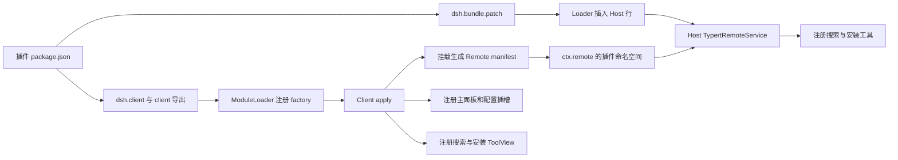
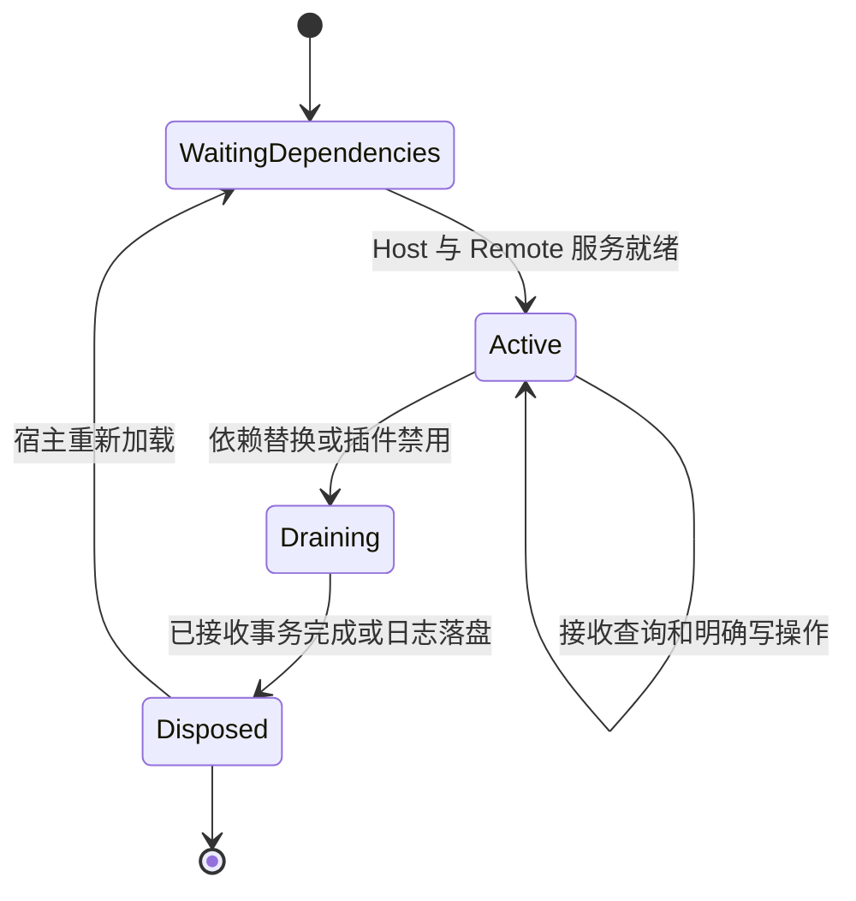

# DSH 原生接入设计

完整装配与实施顺序见 [详细设计实现方案](engineering-blueprint.md)。

本文定义插件分发、Remote 通信、UI 插槽、配置持久化与生命周期集成规则。

## 1. 选择的原生形态

**一个 Bundle、一个 Host 服务、一个 Web Client 贡献包、一个全局 SkillHub 主面板。** Host 提供匿名目录与本地技能生命周期服务，Client 提供页面和配置。默认采用官方 Typert Remote 跨端通信，不以 settings 文档充当消息队列，不 patch 官方页面，不 shadow 官方插件管理器，不开独立 HTTP 服务。

Bundle 是分发和加载方式，不是 SkillHub Registry 中的技能包。用户安装本插件的 npm 包与用户在广场里安装技能是两个不同生命周期：卸载连接插件不等于卸载已下载技能。

## 2. 分发契约

| manifest 项 | 定义 | 本插件要求 |
| --- | --- | --- |
| `dsh.bundle.patch` | 指向 patch 文件或有序文件列表 | 随 tarball 包含真实文件 |
| `exports["."]` | Host 入口 | 只加载 Host 代码，无浏览器副作用 |
| `exports["./client"]` | 已构建浏览器入口 | 原生 ModuleLoader 可消费，不发布裸 TSX |
| `dsh.client.platform` | Client 平台 | 使用已验证的 web 声明 |
| `dsh.client.external` | 浏览器外部依赖 | 明确 React/宿主依赖，不能带第二份不兼容运行时 |
| `exports["./typert"]` | Host Remote 元数据产物 | 由官方生成流程输出，不手写协议字段 |
| `exports["./remote"]` | Client Remote manifest/类型产物 | 用于 Client 显式挂载 |
| peers / engines | 实际兼容运行依赖 | M0 验证后填写，不照抄参考资料范围 |

patch 的禁用字段为 `disabled`，不是 `disable`。各标识按下面的契约使用，不自动互转：

| 标识 | 当前取值 | 用途 |
| --- | --- | --- |
| npm 包名 / Client module ID | `@astron-team/skillhub-dsh` | 安装包与 Client 加载 |
| Loader entry ID | `astron-skillhub` | Bundle 插入行、手写 patch 定位 |
| Host service key / Remote namespace | `skillhub` | 服务注入与跨端调用 |
| main panel ID | `skillhub` | 广场导航 |
| 广场子插槽 | `skillhub.catalog` | 页面内容注册 |
| 对话工具 / ToolView key | `astron_skillhub_search`、`astron_skillhub_install` | 工具调用与对应结果展示 |

参考包 `@cocofhu/skillhub@0.2.16` 使用 Loader ID `skillhub`，本插件不得占用或修改该行。旧开发 Profile 若存在针对 `id: skillhub` 的自定义 patch，须先核对所属包，仅将本插件对应配置改为 `astron-skillhub`。包标识区分不能替代两包的实际共存验收。

完整包验收必须在仓库外的干净目录进行：tarball 内有 Host、Client、patch、Remote 生成物和必要资源，不依赖仓库源码、用户额外 CLI、开发时 node_modules 路径或 Bun 运行时。

## 3. Host 服务与 Remote 协议

官方现行方式为 `TypertRemoteService` 派生类，对导出方法标记 `@Remote`，生成 Host/Client 产物；Client 显式 `$mount()`，实际调用者声明 remote 依赖。不能只写 `inject:['typert']` 就假设客户端获得所有方法。

本插件 Remote namespace 下暴露 [interface-design.md](interface-design.md) 中的查询、prepare/execute 和操作查询方法。文件系统适配不直接成为 Remote 服务，防止暴露任意读写路径。

| 层 | 返回/错误约定 |
| --- | --- |
| Host 领域服务 | 返回业务 DTO；可返回 blocked/unchanged 计划作为正常业务结果 |
| Host Remote 适配 | 调用无效、计划过期等使用官方 RemoteError，错误码拟议为 `skillhub/<reason>` |
| Client carrier | 接收官方 `RemoteResult`；先处理 carrier 成败，再解释业务 DTO |
| Registry HTTP | JSON data 包装或原始流，与 RemoteResult 是两种协议，不混用 |
| 进行中的写操作 | 接受后返回 operationId；最终失败放入 operation，不用断开 RPC 表示回滚 |

RemoteErrorDetailsMap 在插件产生错误的模块中声明；不得复制 `gateway/*` 错误表。当前 interface-design.md 中业务错误枚举是插件内部语义，Remote 适配映射为 `skillhub/anonymous-access-denied` 等 namespaced codes，Client 不匹配 CLI 英文字符串。

读请求可使用末位 AbortSignal 协作取消；已接收的安装/升级/卸载独立于一次 HTTP/RPC 连接存活，不能将浏览器返回动作解释为回滚。

## 4. Client 注册与 UI 插槽

| 用途 | 官方扩展点 | 本插件行为 |
| --- | --- | --- |
| SkillHub 入口 | `sidebar.panellist` | 注册一个独立入口，保留工作区与会话树 |
| 主页面 | 同 id 的 root `main` keyed slot | 内部切换浏览/已安装/详情，不开外站 |
| 返回会话 | `ctx.layout.selectPanel(null)` | 保留当前 Session，未选会话时不伪造返回目标 |
| Registry 和 Tab 配置 | `plugins.bundle.config` keyed/root | 按包名定位，在宿主插件详情中呈现 |
| 临时操作确认 | Client 内部对话框组件 | 展示升级/卸载精确影响，不替换宿主全局布局 |

配置页面使用 `plugins.bundle.config`；导航统一使用全局主面板入口。

Client 握手 `window.__ModuleLoader__.load({id,factory})` 是加载协议，不是完整构建方案。模块 materialize 后再执行副作用，注册均绑定当前 Loader row 生命周期；不要在顶层创建绕过 dispose 的全局监听。

## 5. 配置层次与持久化

官方加载顺序为 bundle patches → profile patch → `$DSH_HOME/cordis.patch.yml` → 命令行 patches。`dsh.profile.bundles` 是有序加载清单，不应作为额外配置层。patch 替换整个 `config`，不是递归深合并。

因此本插件配置保存必须通过目标发行版已验证的 Loader/settings 更新能力，保留完整已知配置对象，不用只含 detailTabs 的 patch 意外清掉 registryUrl。配置地址切换递增 sourceRevision；Tab 显示开关变化不使已执行文件事务迁移来源。

M0 须验证保存后重启保留、无未知字段丢失、匿名配置不引入 Token 项。配置示例须与目标发行版格式一致。

rc.2 的插件配置 Schema 使用可序列化字段，并对根对象声明 `.volatile()`；Host 保留宿主提供的引用，通过 `.get()` 读取当前值。配置页通过 `ctx.configForms.get('skillhub')` 订阅快照，使用 `mutate` 按字段路径提交修改并携带编辑开始时的 revision。冲突保留草稿并要求重新加载，不能覆盖外部更新；不可写模式禁用表单。不得把包含闭包的 Schema transform 用作跨端配置校验，地址格式在 Client 提交前和 Host 消费时分别校验。

Host 读请求开始及完成时检查来源，错误返回前也检查来源，避免把旧来源结果或错误显示在新来源下。只调整 Tab 开关不更换 sourceRevision。写入操作仍须遵守生命周期分册的提交前重校验，不能仅依赖读请求检查。

## 6. 生命周期与关闭

apply 注册服务、Remote、UI、配置监听和定时查询时，要将 disposer 归属到 fiber。禁用后不再接受新写操作；当前事务的文件提交不能随组件卸载中断。正常退出尝试完成/恢复并落盘，进程被强制终止则由下次启动恢复核验。

插件不新增 WebServer 路由，跨端调用统一通过 Remote 服务。

服务名按原字符串注册；`super(ctx,'my-service')` 不会自动变为 `ctx.myService`。本插件应使用明确 service key 和 Context 类型声明。

### 对话详情的会话作用域

对话详情读取和展示确认使用 `@RemoteScope('agent')`。生成的 agentId 边界必须采用官方 `@deepseek-ai/dsh-session/types#SessionId` codec，由 Gateway 解析现存 Agent 作用域。Host 从当前 invocation 的已验证 agentId 获取真实 Agent，核对引用保存的会话、cwd 和来源，不接收浏览器提供的目录。rc.2 中不能假定作用域服务调用存在可直接使用的 `ctx.agent`。

构建临时工作区还需注册官方 Agent/Session 声明及其原始公开类型映射；声明文件按发行包复制，不手写替代类型、不修改生成器。对外使用作用域方法，避免把完整 Agent 对象当业务 DTO 暴露。

## 7. 集成边界

插件负责匿名技能消费及本地生命周期管理；DSH 负责会话、模型、工具策略与技能发现。插件不注册远端全库 provider，不通过 settings 传递业务请求，不修改宿主源码或接管官方插件管理界面。

### 会话上下文与发现查询

rc.2 的标准 Agent 将文件系统技能提供器注册在 Agent 作用域。宿主适配器必须使用已解析的 Agent 作为 `scope`，使用其 `agent.session.header.cwd` 作为查询 cwd；调用 `ctx.skills.snapshot({ scope: agent, cwd, signal })` 取得目录与 `complete` 状态，调用 `ctx.skills.get(name, options)` 读取正文。仅在顶层 Host 调用无 scope 的目录查询不能证明当前会话发现了技能。

用户技能根遵守宿主 DSH_HOME，项目技能根遵守宿主的项目根解析规则。浏览器、模型参数和技能包内容均不能指定实际落盘路径。查询结果必须核对预期技能文件或资源根路径，不能仅凭同名条目确认安装目标已被发现。

文件落盘和目录刷新是两个结果：文件系统提供器观察变更后更新目录，插件等待有界刷新并核对结果；超时或 `complete: false` 时保留文件安装成功，发现状态为未确认。`SkillDefinition.content` 是说明正文，`resourceBase` 表示相对资源目录；发现及读取成功不代表模型已执行技能。

## 8. 集成验收

1. 独立 tarball 在固定 DSH 发行版中加载 Host/Client，不依赖源码目录。
2. 一条查询 Remote 和一条无破坏性测试操作完成 DTO 序列化、RemoteResult 错误映射和取消处理。
3. 第三方 Client 能挂载本包生成 manifest，不修改官方 api-remotes；不能挂载时先修实现方案，不静默换 settings 消息队列。
4. SkillHub 入口、主面板、返回会话、bundle 配置插槽工作；保存配置重启后有效。
5. 重载/禁用清理 Remote、slot、timer、监听；不删除技能，不遗留重复入口。
6. 验证搜索/安装工具注册、调用身份、结构化结果持久化、ToolView 渲染与操作查询；页面和工具同目标并发不重复写入。
7. 记录实际版本、命令、产物 hash 和截图，区别源码证据与运行证据。

## 9. 技术参考

DSH 官方接口与机制参考：

- [Bundle 发布与配置加载](https://github.com/deepseek-ai/deepseek-harness/blob/d743267388641bc76f17c45ce8b4c231aed1d32c/docs/user/develop/basic/publish.md)
- [Client manifest 与模块生命周期](https://github.com/deepseek-ai/deepseek-harness/blob/d743267388641bc76f17c45ce8b4c231aed1d32c/packages/client/modules/README.md)
- [官方 Remote API 开发流程](https://github.com/deepseek-ai/deepseek-harness/blob/d743267388641bc76f17c45ce8b4c231aed1d32c/docs/cookbook/adding-a-remote-api.md)
- [Remote Gateway 挂载与调用契约](https://github.com/deepseek-ai/deepseek-harness/blob/d743267388641bc76f17c45ce8b4c231aed1d32c/packages/api/gateway/README.md)
- [官方配置插槽](https://github.com/deepseek-ai/deepseek-harness/blob/d743267388641bc76f17c45ce8b4c231aed1d32c/packages/client/ui-plugin-manager/src/client/slot-contract.ts#L107)
- [Sidebar 插槽](https://github.com/deepseek-ai/deepseek-harness/blob/d743267388641bc76f17c45ce8b4c231aed1d32c/packages/client/ui-sidebar/src/client/index.ts#L83)
- [主面板与返回语义](https://github.com/deepseek-ai/deepseek-harness/blob/d743267388641bc76f17c45ce8b4c231aed1d32c/packages/client/ui-layout/README.md)
- [WebServer disposer](https://github.com/deepseek-ai/deepseek-harness/blob/d743267388641bc76f17c45ce8b4c231aed1d32c/packages/host/webserver/src/index.ts#L334)
- [Service 原名注册](https://github.com/deepseek-ai/deepseek-harness/blob/d743267388641bc76f17c45ce8b4c231aed1d32c/vendor/cordis/src/service.ts#L39)
- [disabled 字段](https://github.com/deepseek-ai/deepseek-harness/blob/d743267388641bc76f17c45ce8b4c231aed1d32c/vendor/loader/src/config/entry.ts#L20)
- [effect 与 fiber 清理](https://github.com/deepseek-ai/deepseek-harness/blob/d743267388641bc76f17c45ce8b4c231aed1d32c/docs/cordis-api/fiber.md)

首版单一版本基线、依赖锁定、能力检测及平台验收遵循 [DSH 兼容性设计](compatibility-design.md)。
