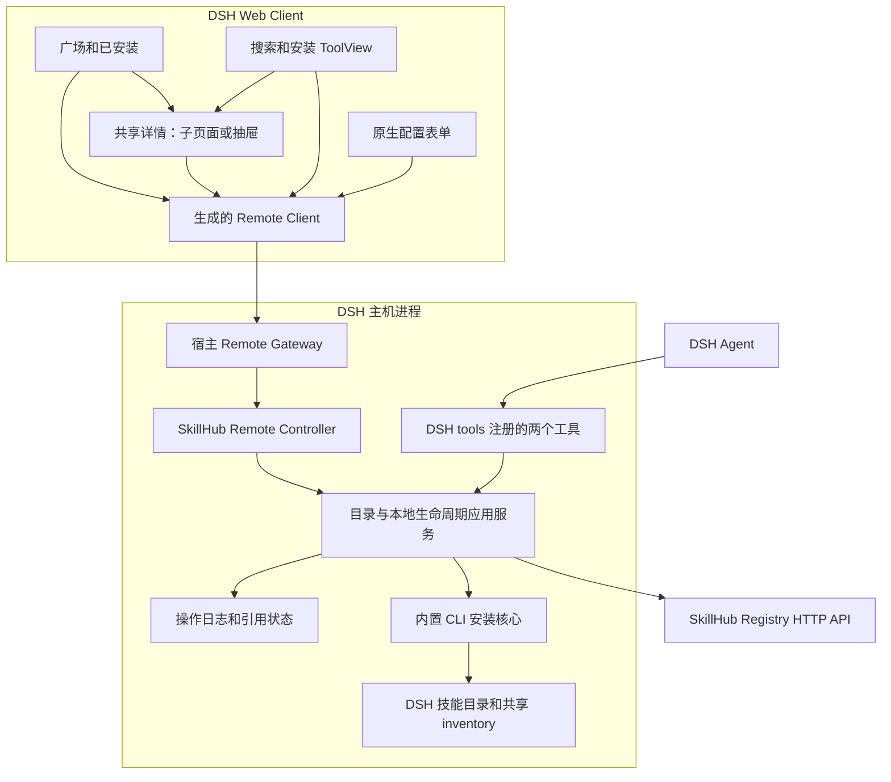
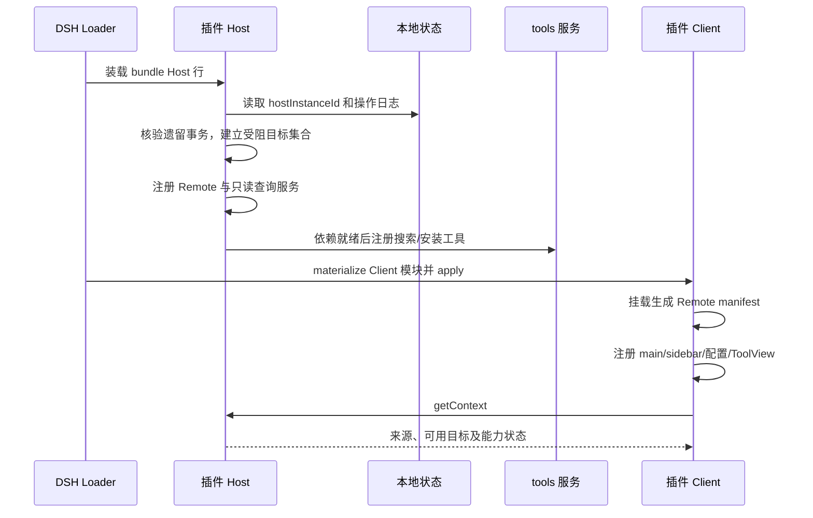
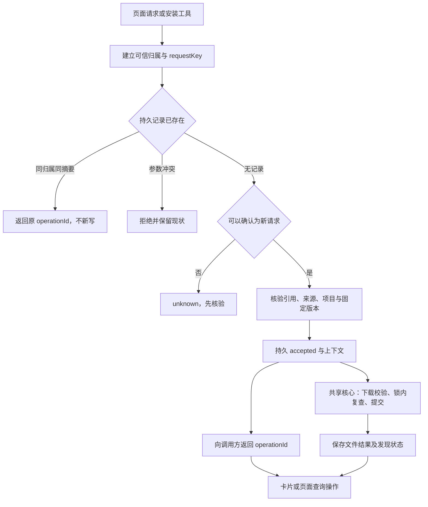

# SkillHub 原生 DSH 插件：详细设计与实现方案

本文定义 SkillHub 原生 DSH 插件的运行架构、模块职责、接口装配、安装核心复用、构建方式与实施阶段。

## 1. 产品范围与交付形态

交付形态是当前仓库 `plugins/dsh/` 中一个独立原生 Bundle，包含 Host、Web Client、生成的 Remote 产物和配置 patch。用户只安装该包，无需安装 SkillHub CLI。Registry HTTP API 提供内容，插件内置的 CLI 核心在 DSH 主机上安装文件。

两条产品路径：

1. SkillHub 广场：浏览/搜索 → 详情子页面 → 安装；已安装 → 检查更新/升级/卸载。
2. DSH 原对话：搜索工具 → 自定义搜索卡片 → 详情抽屉 → 按钮安装，或用户明确请求 → 安装工具 → 自定义结果卡片。

不做账号登录、Token、权限产品、DSH 插件市场、自动更新、强制覆盖、任意路径安装和技能自动执行。对话仅提供搜索/安装工具，升级卸载从广场进入。

## 2. 技术选型

| 设计项 | 选择 | 作用 |
| --- | --- | --- |
| 插件分发 | 原生 Bundle，Host 与 Web Client 分离 | 独立安装，复用 DSH 加载和配置机制 |
| Host 服务 | Cordis 生命周期与显式依赖 | 统一服务注册、依赖重载和资源释放 |
| 页面通信 | Typert Remote | 共享业务接口、类型和错误协议 |
| 对话接入 | 原生 Tool 与 ToolView | 在现有对话中搜索、安装并展示结果 |
| 页面入口 | main / sidebar.panellist | 广场和详情在宿主内容区展示 |
| 配置入口 | plugins.bundle.config | 管理 Registry 地址与详情 Tab |
| 技能获取 | Registry HTTP API | 匿名搜索、读取精确版本与下载完整包 |
| 本地安装 | 内置 CLI 业务核心 | 复用归档、指纹、目标锁和安装记录 |
| 操作持久化 | Host 本地原子日志 | 幂等查询与中断恢复 |

插件通过 DSH 扩展机制集成，不修改宿主源码、不替换官方插件管理器，不新增 MCP 服务或独立 HTTP 服务。

## 3. 部署与进程边界

浏览器不下载 ZIP、不计算目标 home、不启动 CLI、不直接读 Host 文件；远程访问时所有文件操作仍在远程 DSH 主机。Host 业务服务只接可信目标描述；向 UI 返回的是标签及不透明引用，升级/卸载确认可展示只读路径，但不能将显示路径作为执行参数。

## 4. 运行时装配和命名

| 对象 | 固定标识 | 约束 |
| --- | --- | --- |
| npm 包 | `@astron-team/skillhub-dsh` | 当前为私有开发包；公开发布仍须通过发布门禁 |
| Loader row / main panel | `astron-skillhub` / `skillhub` | 两者不互换；main 与 sidebar 关联一致 |
| Host service / Remote namespace | `skillhub` | Context 类型、生成 manifest 与调用一致 |
| 搜索工具 | astron_skillhub_search | 与 Client ToolView key 完全一致 |
| 安装工具 | astron_skillhub_install | 同上；不能注册同名覆盖其他插件 |
| 展示协议 | kind + schemaVersion | 与工具 output.schema 对齐，可校验历史载荷 |

本插件不得覆盖既有工具或 UI。固定参考包 `@cocofhu/skillhub@0.2.16` 的工具使用 `skillhub_` 前缀，本插件使用 `astron_skillhub_` 前缀；Loader ID 也分别独立。已通过该参考包的 Host 与浏览器共存验收，范围与限制见 verification.md；不据此承诺其他包或未来版本无冲突。

### 启动顺序

只读查询可在不相关目标恢复待处理时使用，但该目标写操作必须拒绝。禁用期间停止接收新写，已接受工作按日志完成或核验；清理注册、定时器、请求监听，不删除技能。不要在模块顶层注册无法释放的单例监听。

## 5. Host 模块实现职责

文件职责沿用 [实现分册目录](implementation-design.md#1-模块结构与职责)，不强制每个职责都拆一个类。

| 模块 | 输入 | 输出/副作用 | 明确不负责 |
| --- | --- | --- | --- |
| config | 宿主校验后的来源/Tab 配置 | 规范化来源和 sourceRevision，失效未提交引用 | 凭证管理 |
| registry-adapter | 坐标、精确版本、关键词 | 类型校验后的匿名数据和错误 | 用户导航或文件写入 |
| catalog-service | 来源修订、坐标、模块 | DetailSnapshot、模块状态与 detailToken | 自动安装 |
| installed-service | 可信管理范围 | inventory/metadata 的有界投影 | 全盘扫描和修复 |
| conversation-tools | args 与真实 exec | 选择引用、accepted/operationId、可重放展示值 | 再实现 ZIP 下载/解包 |
| remote-controller | 已解析宿主上下文与业务 DTO | RemoteResult 对应值/领域错误 | 信任任意 path 或自行认证 |
| install/mutation-service | 可信快照、目标、计划 | 幂等操作、核心调用、状态更新 | 显示 UI |
| operation-journal | accepted/阶段事实/原参数摘要 | 原子日志和恢复结果 | 保存技能正文或凭证 |
| dsh-adapter | 宿主会话/工作区 | 用户/项目根与发现证据 | 使用浏览器 cwd 作为可信路径 |

Registry 读取适配要保留 HTTP 状态和业务错误，不以字符串匹配英文 CLI 提示。使用现有 CLI client 时显式不给 token；不导入登录或 CredentialsStore。查询缓存绑定 sourceRevision，详情绑定精确版本，审核绑定 versionId，评论绑定 skillId；过期响应不能覆盖新上下文。

## 6. 对话工具：schema、执行与展示分离

`defineTool.parameters` 是逐参数定义、隐式开放的对象根；不能只依赖 schema 认为额外字段已被拒绝。安装入口须自行检查字段集合、互斥输入、非空坐标和 scope 枚举，不接收 force/path/url/registry 参数。

### 搜索工具

- 输入：q 字符串；trim 后为空时使用初始列表行为，结果上限沿用目录契约。
- 执行：从真实 exec 取得调用身份和会话归属，查询当前来源，为结果生成 selectionRef。
- output.schema：完整校验返回 envelope；数据量限制为当前查询结果，不把 SKILL.md 全文塞进模型上下文。
- output.render：输出供模型理解的索引、坐标、摘要、引用和“搜索不代表安装”的简短说明。
- output.presentationMeta：仅投影已验证结果中的展示字段，不访问网络、磁盘或当前 mutable store；回放同结果应一致。

### 安装工具

- 输入为 selectionRef，或用户新明确给出的 namespace/slug，二者互斥；scope 默认 user。
- 从 exec.callId 与真实会话上下文派生稳定幂等映射；没有可信归属时停止写操作。
- 先查已接受记录，再做新写上下文与版本验证；完整顺序引用 [接口 §10](interface-design.md#10-已接受操作的查重顺序与历史快照)。
- 成功接收只返回 accepted/operationId/context，不说已安装；卡片轮询实际结果。不在 accepted 后让模型自动执行该技能。
- 读取/校验期间遵守取消；accepted 已持久化之后，工具等待取消不能取消 Host 事务。
- 工具调度的 concurrency classifier 不替代文件锁；安装按保守不可并行分类，来自页面或不同调用的并发仍由共享锁处理。

工具引导只说明如何搜索、引用和显式安装，不给模型 shell/curl 安装指令。现有宿主工具策略仍然生效，不另加自定义权限审批产品。

### 执行上下文

工具调用标识使用 `exec.callId`；`exec.agent` 为可选，需要显式检查。最终 Session/项目提取方式在对应 Agent 类型与实机贯通中验证，不从字符串参数伪造 Agent。更多交互语义见 [对话分册](conversation-design.md)。

## 7. ToolView 与详情容器

官方 `tool.call.toolview` 为 keyed、session scope；按 wire toolName 选择视图，已占用 key 会替换既有视图。因此注册前必须完成命名冲突决策，不能以覆盖为安装成功。

| 宿主 phase | SearchToolView | InstallToolView |
| --- | --- | --- |
| preparing | 显示搜索参数准备中；不解析未完整 args 发请求 | 不推断版本/路径，不提前安装 |
| start | 搜索中，保留原工具调用标识 | 正在检查请求；尚无 operationId 时不虚构进度 |
| result | 校验 envelope 后显示卡片与查看详情 | accepted 则按 ID 查询；失败显示原因；历史数据标记历史 |

schemaVersion 不支持或结果元数据无效时展示保守文本和诊断，不从任意 JSON 中猜路径/按钮目标。宿主通用工具卡片作为兼容性展示回退，但首版交付仍要求自定义搜索与安装卡片通过验收。

Client 组件划分：

- SkillHubPanel：browse/installed/detail 导航和返回状态。
- DetailContent：版本固定、Tab、说明与安装区，广场和抽屉共享。
- ConversationDetail：唯一活跃抽屉、窄屏全宽、焦点约束和关闭。
- SearchToolView / InstallToolView：只消费当前调用展示数据，不能把最新一次调用结果覆盖全部历史卡片。
- 插件共享 OperationStore：缓存 operationId 引用与查询结果；每个操作同一时间最多一个查询请求，多个可见订阅共享；全部视图隐藏时停止轮询，再打开立即查询。Host 状态仍是权威。

有效引用的抽屉展示确认使用 openConversationDetail → 成功展示 → acknowledgeConversationDetail。Host 重启后的历史引用使用用户显式触发的 reopenConversationDetail(callId, selectionRef, signal)，从当前会话持久搜索日志重新核验并签发新引用，旧引用不恢复；具体契约见 conversation-design.md“历史搜索的显式重新查看”。工具后续使用旧搜索引用时，Host 提升到已确认详情快照；不要求把 Client UI 状态伪造为 Agent 消息。

## 8. Remote 装配与上下文

采用 TypertRemoteService + @Remote，生成 ./typert 和 ./remote，Client 显式挂载生成 manifest。不要手写 wire codec 或修改官方 api-remotes。Controller 方法有序委托应用服务，读取方法可接受末位 AbortSignal。

Remote 中的 Session/Agent lookup 如需使用，按官方要求放在顶层参数，不能塞进任意业务 DTO 再假设 Gateway 已校验。现有接口表省略了 carrier 层的 lookup 参数；实现时必须从已验证的宿主通道建立归属，不能把 Client 随意传来的 sessionId 当成授权证明。

业务 DTO、transport failure、已接受后的 operation failure 是三层：

1. Registry/核心返回结构化业务结果。
2. 参数无效、引用过期等未接受错误由 RemoteError 映射，Client 先分支 RemoteResult.ok。
3. accepted 后的下载/文件/恢复失败记录进操作；RPC 断开不能代表文件回滚。

只读匿名并不意味着 Host 文件 API 可以无上下文调用。沿用 DSH 现有可信通道，M0 必须证明页面和工具都能获得所需归属；如果无法实现，则阻塞相关写入口，不能退回无校验 HTTP 路由。

## 9. CLI 安装核心的实际复用

安装核心复用范围及改造要求如下：

| 现有入口 | 可复用 | 必须补齐 |
| --- | --- | --- |
| installSkill(InstallOptions) | registry/token/namespace/slug/version、targets、resolved；归档、指纹、文件与记录 | 早期幂等、DSH 格式验证、可等待事务钩子与恢复日志；不能只套一层 UI |
| planSkillUpgrades | 版本比较、基线、目标、阻断原因 | Host 精确允许目标集合；不暴露宽泛 agents/dir 选择 |
| executeSkillUpgradePlan | 受保护替换、expectedTargetFiles | 完整集合 CAS、事务钩子、提交后告警 |
| removeLocalSkill | 可参考身份/路径和 inventory 约定 | 不直接调用；当前按 Agent 过滤、stat catch 当缺失、rm 后删记录，不满足精确可恢复卸载 |

首次安装适配：token 明确 undefined；targets 由可信 DSH 适配器生成；force=false；resolved 使用固定详情快照。升级的内部 force 只在保护检查通过后用于替换，UI 和工具不能提供 force。卸载新增内部精确目标事务，不改变 CLI 用户默认操作语义。

拟新增 `cli/src/integrations/` 导出仅业务核心；打包闭包禁止导入 CLI main、命令解析、登录、交互 prompts 和 process.exit。构建时复用源码，发布时不依赖仓库相对路径。

共享核心改造的四个必需接缝：

1. 统一 canonical lock key、去重和排序，事务核心唯一负责取锁。
2. beforeMove 前确定 staging/backup/quarantine 并 await 日志落盘。
3. inventory CAS 作为逻辑提交点，提交后的日志/清理错误只报告告警。
4. 结构化结果携带真实恢复、残留与错误，禁止吞掉清理失败。

详尽算法和故障窗口只维护在 [生命周期分册](lifecycle-design.md)，不在此复制第二套事务实现。

## 10. 从请求到落盘的执行顺序

首次安装不覆盖；升级和卸载必须先产生计划并确认影响。requestDigest 使用规范化、稳定序列化的原始业务参数，不能把每次变化的读取时间包含其中。日志与摘要字段不可包含凭证或签名下载 URL。具体 hash 实现复用现有工具或 Node 标准库，首期不引入数据库。

## 11. 构建、包内容与配置交付

现有 CLI 使用 Bun 构建到 Node 目标；这是开发构建工具，不等于用户运行插件需要 Bun。插件沿用仓库现有包管理约定，最终 DSH Client 产物格式、Remote 生成工具及 Node/peer 范围由 M0 验证，不直接复制 DSH monorepo 的 workspace:* 依赖。

| 构建步骤 | 输出 | 验证 |
| --- | --- | --- |
| 类型与契约检查 | 校验 Host/Client/shared 与 schema | Client 无 Node fs/CLI 依赖；输出和展示一致 |
| Host bundle | Node 可加载入口，内含选定 CLI 核心 | 无 CLI main、进程退出、读取凭证副作用 |
| Remote 生成 | Host 元数据、Client manifest 与声明 | 签名/错误码变更后重新生成，宿主真实挂载 |
| Client build | ModuleLoader 可消费的浏览器产物和样式 | external 与宿主 React 一致，不打第二份运行时 |
| 包装 tarball | package.json、patch、Host/Client/Remote、许可证及 README | 所有 exports/file 引用存在，仓库外可加载 |
| 隔离 profile 验证 | 固定平台和发行版的记录 | 不依赖本地源码、开发 node_modules 或手动 CLI |

共享 CLI 核心作为插件私有 `lib/local-core.js` 分发，由 `scripts/build-core.ts` 从内部集成入口及其依赖闭包构建，不暴露为独立 npm 包。构建复用 CLI 的包元数据生成脚本，拒绝 CLI 命令、凭证存储和交互依赖；核心使用自己的依赖图，避免 CLI Zod 与插件 Zod 主版本混用。Host 生命周期接入前，先用实际 npm tarball 在仓库外 Node 环境验证安装及操作日志；此项不能替代 DSH Host 和 UI 验收。

构建脚本在 plugins/dsh/package.json 中定义，覆盖 build、typecheck、lint、test 与包内容校验；命令及环境要求同步到开发指南。

配置仅包含 registryUrl 与 detailTabs；保存完整配置对象，避免 DSH patch 整体替换 config 时丢字段。Client 表单显示已保存/保存失败，失败保留编辑值但不改变正在使用的来源。来源变更只使未提交引用失效，已接受操作仍绑定原 context；详细字段以接口分册为准。

## 12. 实施切片与具体完成条件

| 切片 | 依赖 | 文件/工作 | 完成条件 |
| --- | --- | --- | --- |
| E01 原生最小贯通 | 无 | Bundle/Host/Client/Remote，两个无破坏工具探针 | 页面与 ToolView 在同一真实 DSH 中工作，固定版本/命令/产物 |
| E02 Registry 只读 | E01 | registry-adapter、catalog、config | 匿名查询/详情及三态模块；HTTP 错误区分 |
| E03 双入口详情 | E02 | panel、DetailContent、抽屉、搜索工具 | 同版本详情、返回与焦点、selectionRef 提升 |
| E04 事务基础 | E01 | CLI 接缝、锁、journal、错误归一 | CAS/日志/清理/崩溃故障注入通过，再开放写入口 |
| E05 双入口安装 | E03/E04 | startInstall、工具 accepted、OperationStore/结果卡片 | 重复提交、旧上下文、断线重开不重复写 |
| E06 本地管理 | E04/E05 | installed projection、更新检查、计划 UI | 离线清单、完整共享目标升级、精确卸载通过 |
| E07 打包验收 | E01–E06 | 构建、干净包、指南及兼容矩阵 | 实机使用带资源技能，记录未覆盖平台 |

E04 可与只读 UI 开发并行，但 E05 不得在事务保护缺失时对真实目录开放。该切片细化既有 M0–M4，不另设正式任务体系；勾选与证据仍回写 tasks.md、acceptance.md、verification.md。

## 13. 测试要求

- 工具参数含额外 force/path/url、互斥输入同时存在、缺失 agent：拒绝，无文件改动。
- presentationMeta 纯函数回放、未知 schemaVersion、准备阶段部分 args：不异常执行业务动作。
- 同名工具/ToolView key：不替换其他插件；命名修正后测试注册与撤销。
- 依赖重载、Client 卸载再挂载、连接重置：无重复 slot/timer，原 operation 可恢复查询。
- Remote lookup 归属错误、跨来源旧引用、项目切换：执行前拒绝，不依赖浏览器传入路径。
- 详情更新后工具仍传搜索引用：固定到用户看到的版本，不漂移；歧义重新选择。
- 首次安装、双入口并发、CLI 并发、CAS/日志/清理失败：按统一生命周期矩阵验证。
- 无 CLI/Bun 的干净运行环境：能够使用构建包；构建环境依赖不泄漏为运行要求。

单测、静态检查、真实宿主和实际 Registry 是不同层次；不能用 mock ToolView 或生成图代替后两者。

## 14. 技术参考

DSH 扩展接口参考：

- [ToolExecutionInput / ToolRunContext](https://github.com/deepseek-ai/deepseek-harness/blob/d743267388641bc76f17c45ce8b4c231aed1d32c/packages/core/tools/src/index.ts)：callId、可选 agent、展示投影与工具执行。
- [defineTool 定义](https://github.com/deepseek-ai/deepseek-harness/blob/d743267388641bc76f17c45ce8b4c231aed1d32c/packages/core/tools/src/schema.ts)：逐参数 schema、output、execute。
- [ToolView slot 类型](https://github.com/deepseek-ai/deepseek-harness/blob/d743267388641bc76f17c45ce8b4c231aed1d32c/packages/client/ui-tool/src/client/contract/slots.ts)：keyed/session、callId 和阶段 props。
- [工具视图派发](https://github.com/deepseek-ai/deepseek-harness/blob/d743267388641bc76f17c45ce8b4c231aed1d32c/packages/client/ui-tool/src/client/tool/ToolCallTree.tsx)：按工具名选择与通用卡片 fallback。
- [Remote 开发流程](https://github.com/deepseek-ai/deepseek-harness/blob/d743267388641bc76f17c45ce8b4c231aed1d32c/docs/cookbook/adding-a-remote-api.md)：声明、错误、生成、消费和测试。

本仓库锚点：[安装核心](../../../cli/src/services/install-service.ts)、[升级核心](../../../cli/src/services/upgrade-service.ts)、[现有卸载](../../../cli/src/services/remove-service.ts)、[CLI 工具链](../../../cli/package.json)。

发行组合与 peers、外部 Remote 生成/挂载、会话/项目传递、日志归属、工具重放/展示、配置保存和 DSH 发现观察已有分项验证，具体通过范围见 tasks.md 与 verification.md。真实模型使用、完整平台和交付验收仍按 acceptance.md 执行，不由局部分项通过推导整体完成。

首版单一版本基线、依赖锁定、能力检测及平台验收遵循 [DSH 兼容性设计](compatibility-design.md)。
