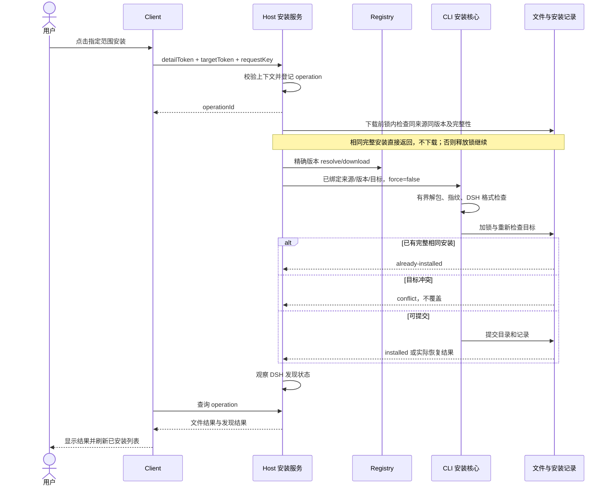

# 实现设计与交付拆分

完整装配与实施顺序见 [详细设计实现方案](engineering-blueprint.md)。

本文定义模块职责、核心改造和实施阶段。内部接口遵循 [接口设计](interface-design.md)。

## 1. 模块结构与职责

```text
plugins/dsh/                     # 拟新增，同仓库独立发布
  package.json                  # 包名/兼容 peer 经 M0 核验，不先编版本
  cordis.patch.yml               # 原生 bundle 入口，格式依目标发行版
  src/host/
    index.ts                    # 生命周期注册和清理
    config.ts                   # 来源与详情 Tab 配置
    registry-adapter.ts          # 匿名查询、DTO 校验、错误归一
    catalog-service.ts          # 列表、详情、可选模块读取
    installed-service.ts        # 当前来源/目标的本地只读投影
    install-service.ts          # 首次安装协调
    mutation-service.ts         # 升级/卸载计划、去重和执行
    operation-journal.ts        # 原子日志和恢复核验
    remote-controller.ts        # TypertRemoteService 对外接口
    conversation-tools.ts       # 搜索/安装工具薄适配、selectionRef 与请求身份
    dsh-adapter.ts              # 可信目标、宿主策略和发现观察
  src/client/
    index.ts                    # SkillHub sidebar/main 与配置入口
    skillhub-panel.tsx          # 目录/详情内部导航
    catalog-page.tsx            # 浏览技能 Tab
    installed-page.tsx          # 已安装 Tab
    detail-page.tsx             # 广场详情子页面容器
    detail-content.tsx          # 两入口共用身份、可选 Tab 和安装区
    conversation-detail.tsx     # 对话详情抽屉、关闭及焦点恢复
    conversation-toolviews.tsx  # 搜索与安装结果卡片
    settings.tsx               # Registry 地址及三态 Tab 开关
    state.ts                    # 查询、返回位置、operation 引用
  src/shared/contracts.ts       # 不包含路径和凭证的跨端类型
  test/                        # 按服务/交互/集成组织
  README.md
cli/src/integrations/            # 拟新增最小内部消费入口，不新发 SDK
```

文件划分可依实际规模合并，不能为了目录图创建空抽象。Client 使用目标 DSH 的原生 React/样式与通信依赖；不将 SkillHub 网站整包嵌入 iframe。构建工具与包管理器先复用仓库入口，DSH Client 构建格式在 M0 确认，不引入多个锁文件体系。

## 2. Host 服务生命周期

启动读取合法配置并注册服务；首次打开页面请求上下文，列表和本地安装数据按需加载；可选 Tab 未激活不加载完整正文；auto 未知能力允许一次有界只读探测，结果复用，hide 完全不请求。禁用时注销入口、结束轮询并清理临时资源，遵循宿主生命周期，不删除已安装技能。

来源地址限定 HTTP(S)，禁止包含用户名/密码。保留部署子路径的标准化语义需经现有 client 验证；不静默截断到 origin。来源只来自 Host 配置，不允许评论、技能说明或模型输入改变。

上下文 sourceRevision 在地址变更时递增，Client 响应提交前比较 revision。已开始的安装保持原快照；未开始的 detailToken 和 targetToken 作废。用户打开设置更改 Tab 时不影响已有安装操作。

## 3. Registry 读取适配

复用 SkillHubClient 的匿名 resolve/search/download；新增只读 detail/versions/reviews/audit/file 适配时遵循统一 JSON 包装与流读取，避免从网站 React hooks 引入 Cookie 或 CSRF 行为。

现有搜索固定 newest 第 0 页，不通过不断提高 limit 假装分页。评论和版本按其已有 PageResponse 真分页；Tab 缓存键至少含来源、坐标、版本/skillId 与页码。SKU、Suite 和技能不能混淆：首版只处理单技能，不触发 Suite install-plan。

SKILL.md 限长、文本解码和 Markdown 安全渲染单独测试。下载包继续使用 CLI 的 bounded reader，当前 MAX_PACKAGE_BYTES 为 100 MiB；解压限制取实际 archive 常量，不在插件另建更宽松上限。

每次 Registry JSON/SKILL.md 请求具有 30 秒总读取期限，覆盖等待响应头和读取正文，与调用方取消信号合并；请求结束释放计时器。超时映射为可重试的 `NETWORK_ERROR`，调用方主动取消为不可自动重试的 `CANCELLED`。超时不等于接口不支持，不缓存为可选模块缺失。此期限不用于包下载或已接受的文件事务。

## 4. 本地已安装投影

1. 从 Host 获取用户目标和当前可信项目目标。
2. 读取共享 inventory，筛选当前 Registry 和 DSH 目标；规范化后比较来源，不跨用户/其他项目遍历。
3. 核对目标目录及 metadata；可对限定目标内一层目录读取可识别 metadata，以发现清单遗漏，不递归扫描全盘。
4. 以“规范化目标＋坐标＋来源”去重，保留两个 scope 的不同安装。
5. 返回条目与 `complete/partial` 读取状态。错误不能变成空列表；本地未做全量 hash 时只标文件存在。
6. 安装成功后失效当前目标投影；来源/项目切换后清除旧投影。无后台同步或自动修复；卸载走单独精确目标计划。

## 5. 复用安装核心及必要改造

现有 `installSkill` 已处理下载、暂存、fingerprint、target lock、metadata/inventory 与恢复。首次安装固定 `force:false`；独立升级计划内部受保护替换可用 force:true，但必须 allowTargetDrift:false，不得用 force 实现“幂等”。

| 能力 | 现有情况 | 拟议最小改造 |
| --- | --- | --- |
| 已存在目标 | preflight 在 !force 时直接报错 | 锁内检查身份/版本/文件完整性，相同完整安装返回 already-installed；不改变 CLI 默认报错语义 |
| DSH 格式检查 | 核心通用安装，不保证 DSH invocation 兼容 | 增加内部 staging 验证接缝，在最终提交前执行，不下载第二份不受控包 |
| 固定版本 | options.resolved 可传已解析快照 | 提交前确认精确版本仍可获取；检查坐标、fingerprint 与快照一致 |
| 阶段进度 | InstallResult 只有最终列表与 warnings | 首版可只用 installing；如加入回调，回调异常不得破坏事务 |
| 错误处理 | CliError 含 CLI next 提示 | 插件映射结构化原因，去掉 login/force 命令提示 |
| 用户与项目路径 | dshProfile 固定 .dsh/skills | 由 DSH Host 实际 root/context 构造一个 AgentCandidate，核验自定义 DSH_HOME |
| 多目标 inventory | 共享版本记录 | 保留版本冲突保护，不扩大目标、不偷偷升级其他安装 |

内部入口不能导入 CLI main、prompts、process.exit 或当前用户登录配置；发布产物包含所需 Node 运行代码，无 PATH CLI 调用。

内部安装选项 `authorizeTargetMutation(paths, phase)` 为原生 Host 提供可等待的策略校验接缝。暂存目录创建、解包、元数据写入前调用；目标锁内每次替换前、备份清理和失败回滚前重复调用。Host 必须重新读取会话策略并规范化实际路径，不能只复用目标查询的通过结果。拒绝替换时停止提交；拒绝回滚时保留对应目录及备份，报告恢复未完成。此接缝不改变未传回调的 CLI 行为，也不替代持久操作日志；日志和 inventory 属于 Host 管理状态，其写入边界与技能内容目录分别核验。

暂存路径采用同根目录下 `.<slug>.install-<UUID>`，在创建目录前通过 `beforeStaging` 持久化 rootDir、canonicalSkillDir 和 stagingDir。目录创建必须拒绝已存在目标，不能收养或清理碰撞目录。完整准备日志必须与暂存意图逐一匹配；恢复同时识别旧日志的 6 位暂存后缀与新日志中已绑定的 UUID 后缀。仅有意图而无完整准备快照时，不把路径存在等同于内容可安全删除，仍需独立核验。

早期中断恢复：仅有暂存意图、没有准备快照、目标移动、inventory 提交、恢复动作或清理记录时，在目标锁内核验所有已记录暂存目录。全部明确返回 ENOENT 后，可将操作记为 failed/restored，退出待恢复列表；不创建技能根、不修改技能文件或 inventory。技能根尚未创建时逐级核验已存在祖先，拒绝路径重定向及非 ENOENT 错误。暂存目录仍存在时返回待核验，不删除其中内容；旧日志缺少暂存意图时不适用此规则。

## 6. 安装时序与失败边界



锁内二次校验不可省略。多文件写入不宣称数据库式跨文件事务；崩溃恢复依实际 metadata/inventory 与残留信息判断。不得自动清除未知目录、保留备份或用户修改。

## 7. 前端状态设计

页面及对话详情中的安装控件区分原安装操作结果与当前安装记录。原操作完成后，读取当前来源、会话和范围的本地清单；只有清单完整、目标范围可读且没有该技能记录时，才允许用户明确点击重新安装。缺失目录但仍有记录、读取失败或读取不完整均不能自动开始新安装。重新安装使用新 requestKey 和当前详情/目标引用，客户端按原 operationId 核对被替换的回执；原操作日志保持不变。新请求响应丢失时仍重试该新请求的原 key，不能回到旧操作或再次生成 key。Host 的首次安装不覆盖规则继续保护未被清单记录的已有目录。

目录顶层 `browse/installed` 与详情 `details/versions/securityAudit/reviews` 是独立状态。详情保存 returnView（顶层 Tab、搜索词、滚动与焦点项）。详情 Tab 变化不重置安装版本和目标；可选 Tab 隐藏则退回详情。

广场主面板通过官方 `session-maybe` 子槽位接收当前会话，使用该会话作用域的 Remote 获取可信安装目标。没有当前会话时保持匿名浏览可用，安装区提示打开会话；不得使用会话列表第一项或私有字段推断当前项目。切换会话重置安装控件局部选择，共享操作记录仍按原会话隔离。

安装 operation 引用放在插件 Client 共享状态（广场/对话均可访问），而非某个面板或 Tab 局部状态，切换页面不会触发第二次安装。Host 状态是权威；Client 没收到 operationId 时以同 requestKey/参数重试 startInstall 找回原 ID；已有 ID 则查询。Host 重启从日志恢复同 key 的操作引用并核验本地结果；日志缺失/结果不确定时显示未知，不用新 key 自动再装。

浏览器同一标签页刷新恢复使用 sessionStorage 中带 schemaVersion 的请求记录。发送前先保存原请求及 requestKey，收到响应后补 operationId；不保存成功/失败终态、文件路径或凭证。重载后有 operationId 直接查询 Host，没有 ID 则仅允许用原参数和同 key 的 retry 查询。记录损坏、存储不可读或首次写入失败时禁止发送安装；响应后的补写失败仍保留发送前记录供重试。标签页关闭、浏览器清理存储及 Host 重启后的历史入口需依 Host 日志恢复，不能把 sessionStorage 当作持久操作的权威。

版本 Tab 首版只读历史；展示历史发布说明不改变当前详情固定版本；本期不新增历史详情导航。首版不增加切换历史版本安装按钮，避免无意承诺降级。

## 8. 检查与证据

| 层次 | 必须覆盖的行为 |
| --- | --- |
| 适配单测 | 实际 JSON/流结构、401/403/404/429/5xx、无凭证、旧来源响应 |
| Tab 规则 | auto/show/hide、空内容/拒绝/未知/临时错误的区别、SaaS 隐藏评论不请求 |
| 本地投影 | 两 scope 去重、目录缺失、metadata 失配、部分读取失败、来源筛选 |
| 安装集成 | 完整包、路径逃逸、指纹、DSH 格式、重复请求、CLI 并发、记录失败恢复 |
| UI | 子页面返回、Tab 键盘操作、长文、窄屏、安装后列表刷新、离线本地数据 |
| 实机 | 干净插件包、真实 DSH Host/Client、匿名测试 Registry、至少一条带资源技能使用 |

构建、测试与运行证据分别记录，不能用设计图代替 UI 验收。对应命令和平台缺口回写 [verification.md](verification.md)。

## 9. 分阶段交付

M0：固定 DSH 发行版并验证页面、Remote、工具/ToolView、调用上下文、匿名接口、可信目标和发现观察。
M1：包结构、来源、广场浏览/详情、对话搜索卡片/详情抽屉、可选 Tab 与配置；只读贯通。
M2：先完成共享事务接缝、锁、操作日志与恢复，再开放页面/工具安装和结果卡片、已安装投影；保留 CLI 兼容。
M3：在 M2 事务基础上完成检查更新、不可变计划、多目标升级与精确卸载；覆盖故障恢复。
M4：双入口实机、干净包与三平台验证、中英文文档与审查。各阶段证据见 [验收矩阵](acceptance.md)。


## 10. 新增升级/卸载适配工作

1. 从 upgrade-service 提取或复用版本比较、同源基线检查和计划执行；插件 tokenForRegistry 恒返回 undefined，不读取 CLI CredentialsStore。将目标筛选改为 Host 传入的精确集合，不用宽泛 dir/agent 参数选择。
2. 计划阶段检查 inventory 全目标集合；多目标升级只接受所有目标都在当前管理范围、单一 direct 所有权且用户确认的集合。提交时再 CAS 对比来源、版本、targets 和 installedBy。
3. 现有升级 `executeSkillUpgradePlan` 内部 force:true 不代表忽略漂移：固定 allowTargetDrift:false、requireExistingTargets:true，并复用 DSH staging 验证。
4. 现有 removeLocalSkill 不能直接成为 UI 卸载入口：它按 agent 过滤，stat 捕获所有错误视为不存在，并且直接 rm。新增内部 `prepare/remove exact target` 接缝，使用 lstat/realpath 等实际文件语义确认路径，只有 ENOENT 是缺失。
5. 卸载先同盘隔离，再原子清单 CAS，失败恢复；升级与卸载阶段记录必须在不可逆/可恢复转换前持久化。日志位置和恢复表以生命周期分册为准。
6. 已安装列表增加 checkUpdate 状态、canUpgrade/canUninstall 及阻断原因，不能仅凭远端版本新就启用执行按钮。
7. 保持原 CLI 命令输出与默认行为兼容；若发现公共核心漏洞，最小修复必须有行为回归，不将插件特有交互塞进 CLI。

## 11. 契约测试补充

| 用例 | 初始状态/注入点 | 预期可观察结果 |
| --- | --- | --- |
| 升级共享目标 | 同技能用户级和当前项目两 target | 计划列两处，确认后同版本；无隐藏目标 |
| 跨边界共享目标 | 同 item 还有其他 Agent/project | blocked，所有路径与记录不变 |
| 确认后漂移 | plan 后新增 target 或修改一文件 | 锁内失败，未覆盖 |
| 同版本替换 | 远端同版本不同 fingerprint | blocked，不隐式修复 |
| 卸载单目标 | 两个 DSH target 同坐标 | 只删确认目标，另一目标及版本保留 |
| 共享来源 | installedBy 含 Suite | blocked，Suite 和 direct 记录不变 |
| 离线卸载 | Registry 不可达，本地可信 | 正常完成，无远端请求 |
| stat 拒绝访问 | EACCES 注入 | 失败，不标目录缺失、不删记录 |
| 清单失败 | rename 隔离后写 inventory 失败 | 恢复或 recoveryRequired，不能假成功 |
| 清理失败 | 清单提交后隔离 rm 失败 | 逻辑卸载完成、残留 warning 和日志保留 |
| 崩溃 | accepted/rename/CAS/cleanup 各边界 | 重启核验、不自动重放，未知状态阻止新写 |
| 并发 | 同 key 重发与 CLI 并发 | 幂等 ID 或明确冲突，互斥锁同源 |

构建适配细则见 [dsh-integration-design.md](dsh-integration-design.md)。最终文件事务规范见 [lifecycle-design.md](lifecycle-design.md)。


## 12. 事务核心必须增加的内部接缝

安装事务在共享核心内部暴露阶段事件，供 Host 持久记录路径、移动事实、清单提交与备份清理结果。仅在 executeSkillUpgradePlan 外围记录开始和结束不足以支持故障恢复。

采用**可等待的事务阶段观察器**（`InstallOptions.transactionObserver`，内部参数，不对模型/UI 暴露）：

- `beforeMove`：接收预先确定的原路径、staging/backup 路径、目标身份和顺序；await 持久化成功后才 rename。写日志失败阻止这次移动。
- `afterMove`：记录各目标实际移动事实。发生失败先按当前真实文件状态处理，不能假设回调运行前文件没变。
- `beforeInventoryCommit`：在 inventory 锁内完成旧身份、版本、指纹、完整目标集合和所有权 CAS 后，记录待提交的 before/after；日志写入成功才提交清单。观察器收到副本，不能修改待提交值。
- `afterInventoryCommit`：此时逻辑提交已完成；观察器失败只能报告 journalWarning，禁止触发旧目录回滚。
- `cleanupResult`：携带保留备份路径与错误，形成 warnings；不再无条件吞掉清理异常。

普通进度回调与事务观察器分离：UI 进度监听异常不得影响事务，持久化 beforeMove 的失败必须阻止后续文件变更。接口类型维护在 `cli/src/services/install-transaction.ts`，通过内部集成入口导出，不新增公开 SDK。`InstallResult.transactionWarnings` 提供提交后日志和备份清理的结构化告警，原 CLI 的字符串 warnings 保持兼容。

锁 helper 统一生成 canonical key、去重和排序，CLI 多目标 install/upgrade 与插件共用。不能在 Host 先 acquire locks 再调用自带 acquire 的旧核心；那会自锁。uninstall 内部目标级事务使用同一 helper，inventory CAS 在 target locks 后取得。

清单变更调用 mutateAtomic：写入异常时仍持有 inventory 锁，重读实际清单。等于 after 则按已提交返回；等于 before 则按未提交抛出原错误；无法读取或两者都不匹配则抛出 InventoryCommitUnknownError。安装核心将其映射为 INSTALL_COMMIT_UNKNOWN，保留当前目录、备份与暂存路径，禁止按普通失败立即回滚。

故障测试覆盖 CAS 成功后 journal 失败保留新版、CAS 写入异常后的三种核验分支、cleanup 错误报告残留，以及路径别名下统一取锁。共享 CLI 核心变化须运行对应完整 CLI 回归。

## 对话组件与工具适配

首期补充 Host 搜索/安装工具注册、Client SearchToolView 与 InstallToolView，并把详情内容从页面容器中抽出供抽屉复用。M0 先验证工具注册、展示元数据、工具调用身份、异步操作结果及原生 UI 槽位；无法验证时记录阻塞，不虚构宿主 API。组件职责、生命周期和场景见 [对话设计](conversation-design.md)。


### 持久操作存储内部接口

`cli/src/integrations/operation-store.ts` 通过内部集成入口提供 OperationStore，Host 适配层负责传入可信绝对状态目录、当前归属及是否为首次请求。存储层不执行文件安装，不重放历史操作，不读取 CLI 登录配置。

- open：在受保护目录原子创建或读取持久 hostInstanceId。
- accept：先查 ownerId/requestKey 和原始参数摘要；已存在则返回保存记录。无记录的 retry 返回未知；只有 new 才执行当前上下文校验，再加锁复查并写 accepted。校验函数只能预检，不执行文件变更。
- get：按 operationId 和调用归属读取；调用者不匹配时不返回记录。
- listForRecovery：启动核验读取未完成/恢复未结束的记录及清理待核验记录。清单已确认提交后，每个备份路径必须有成功清理记录；清理失败或结果未持久化时，即使操作已完成也进入核验队列。结果缺失不等于备份仍存在，扫描本身不删除文件或重放操作。仅供 Host 内部使用。
- assertTargetsAvailable：比较本次绑定的规范化目标集合，拒绝与未核验移动意图或未知结果重叠的写操作。beforeTargetMutation 在下载前和持有目标锁后分别调用；无文件移动意图的并发准备请求不因彼此存在而阻塞。
- update：按 revision 比较更新状态，保留原来源和创建时间；终态不得重新进入执行阶段。完成后可更新发现确认，不改变文件结果。
- recordTransaction：按同一 revision 写入移动意图/结果、清单前后快照、提交与清理事实；共享安装核心通过 createInstallTransactionObserver 接入，不把内部路径记录发送给 Client。

共享核心在第一处 rename 前调用可等待的 beforePreparation：持全部目标锁，并在 inventory 锁内重验清单后，保存旧清单、固定 release 坐标/版本/指纹和全部目标的安装路径、暂存路径、Agent、安装时间。记录失败时不开始移动。每个后续 beforeMove 必须匹配对应准备目标；所有准备目标的安装移动完成后才允许记录 inventory 提交意图。原有缺少 preparation 的开发日志仍可读取，但不能凭空补成可恢复基线；原生观察器禁止跳过准备阶段。

`inspectInstallRecovery` 是内部只读核验入口。调用方提供重新解析的可信目标集合和 inventory 存储，核验器验证集合绑定并按共享顺序取得全部目标锁。真实 inventory 与 after 快照一致时，还须逐目标核对来源、版本、安装时间、Agent、metadata 文件列表与实际内容指纹；符号链接、特殊文件、所有者异常、缺失或不可读状态均不能确认为提交成功。committed 日志缺失不妨碍从真实状态确认已提交。

返回 committed 表示该次锁内检查确认清单及所有目标一致；inventory-before 只表示当前清单匹配 before，不证明从未提交或文件已恢复；其他冲突返回 unknown。结果不修改操作日志或文件，释放锁后不能直接据此执行清理或回滚，执行恢复仍须重新加锁核验。未保存提交快照的中断须由后续移动阶段恢复处理。

`reconcileCommittedInstallation` 复用上述检查，在 target locks → inventory lock → journal lock 的顺序下持久确认提交结果。InventoryStore.withLockedSnapshot 在核验及写日志期间保留清单锁，不回写查询快照。确认仅适用于具有完整提交快照和目标移动记录的安装/升级；按 revision 一次性写入 committed 与 completed，保持原请求映射、来源、创建时间和发现状态。重复确认不增加 revision，也不重新下载或执行安装。

提交确认不代表备份清理完成：缺少清理确认时保留独立告警和待核验记录。目录冲突、before 清单、日志写入失败或并发修订时不写完成状态、不回滚已安装文件。此入口不处理提交前恢复，也不删除残留目录。

`cleanupCommittedInstallation` 在同一组目标锁及 inventory 锁内先完成提交核验，再清理日志绑定的备份。备份必须是原目标同级目录，名称符合安装核心生成的 `<slug>.skillhub-backup-<UUID>`，父目录规范化后与可信目标根一致。存在的备份必须符合 before 快照的来源、旧版本、Agent、安装时间、单一 direct 所有权、metadata 文件列表和内容指纹；拒绝符号链接、特殊文件或所有者不符。路径或内容不能确认时保留备份，不影响已经提交的新版。

每个清理结果独立持久化；只把 ENOENT 解释为备份不存在。结果写入失败即停止后续删除，下一次重新加锁核验，不直接重放删除。已确认清理成功的路径不再处理，避免误删后来重新创建的目录。全部备份确认后撤销专属清理告警并退出待核验队列；其他告警保持不变。返回的精确路径及清理事实只供 Host 内部使用，Client 须通过公开操作投影展示。

`recoverInstallation` 根据锁内真实清单选择恢复方向。清单匹配已提交 after 时沿用提交确认与备份清理，不回滚；匹配 preparation.before 且不存在已提交事实时，先核验全部目标、备份与暂存内容，再执行提交前恢复。旧内容必须符合 before 的身份/指纹/安装时间和 direct 所有权，新内容必须符合 preparation 的固定 release 和安装时间；目标身份不明、两个位置内容重复、缺少旧备份或目录被占用时，整组预检失败，保留现场。

恢复动作顺序为：将本次已安装的新目录移回原暂存路径 → 将旧备份移回原目标 → 清理已确认的暂存内容。首次安装没有旧备份，只移回并清理本次内容。每次动作先写 recoveryActions 意图，再重验路径占用/内容并执行，最后写结果；中断重启时按实际位置重新计算剩余动作，不盲目重放旧意图。全部目标恢复且当前清单仍符合 before 后记录 failed/restored；无需回写旧清单，因此不会覆盖无关条目的并发更新。未解决或日志写入失败的恢复维持阻断状态。

原生恢复入口必须传入 Host 的异步策略回调，缺失时拒绝调用。回滚每次变更前检查源和目标路径，清理备份前检查待删除路径；回调返回后重新核验路径、内容与操作修订号，不能沿用异步检查前的文件快照。回滚被拒绝时保留恢复意图并记录 recovery-required/incomplete；已提交安装的备份清理被拒绝时保留安装成功结果，同时记录清理失败和待核验告警。策略允许后可以重新核验并继续，不自动放宽 Host 策略。无文件变更的状态确认不需要技能目录写入授权。

原生运行时对同一 operationId 的完整执行与恢复持有跨进程操作锁，包括尚未获取技能目标锁的下载和暂存阶段。先验证操作 ID 与归属，再用操作存储根和独立执行锁名称取锁；竞争调用返回忙，不等待或重放。操作锁位于目标锁、inventory 锁与日志更新之前，读取和请求查重不持有操作锁。复用现有带心跳的文件锁；进程退出后需等待陈旧锁期限，再重新核验持久日志与实际文件，锁失效不代表操作成功或可以重装。失败路径释放锁，并保留操作失败和释放失败的组合信息。

Host 内部恢复协调器先根据当前 Agent 的 sessionId 筛选持久待恢复记录，再解析当前用户/项目的默认技能根；历史安装目标必须与解析结果精确一致。首个实现入口只接受单目标 install，升级和卸载在各自生命周期实现后接入，不能借安装恢复处理其他操作。恢复不要求当前 Registry 与历史来源一致，也不访问网络；文件身份仍由原操作日志核验。会话、文件系统服务或项目发生变化、目标已不属于当前上下文、策略拒绝时保留历史记录。运行时跟踪整个核验/恢复任务，关闭时等待其收尾，拒绝新任务；恢复后重扫待恢复数量，扫描失败使本地服务进入不可用状态。该协调器不接收客户端文件路径，启动扫描本身不自动触发历史写入。

单条 JSON 同时保存操作和请求映射，避免索引与正文分开写造成不一致；临时文件写入和同步后原子替换，POSIX 另同步父目录。操作存储锁复用共享目标锁机制；accept 的上下文校验在日志锁外执行，避免与事务的目标锁顺序相反。内部记录含 ownerId、requestKey 和摘要，Client 只能读取经过 Host 投影的公开 operation，不直接获得完整存储记录。阶段移动路径、清单前后快照及启动恢复的接入，以生命周期验收记录为准。

### 操作查询中的发现观察

getOperation 对已完成的安装、升级增加当前会话的只读发现观察。共享核心 observeInstallation 从所属操作日志取得目标，限制在 Host 解析的用户/项目根内；观察前后复用提交核验，核对原操作的 inventory、metadata、完整资源指纹及日志 revision。Host 以官方文件系统 provider 解析目标 SKILL.md，不注册新 provider；将官方技能服务当前会话返回的目录、路径、名称、正文、描述、调用选项及 metadata 与目标解析结果比较。任一检查不确定仍返回 unconfirmed，不修改文件结果、不重启宿主、不重新安装。

发现状态是查询时的观察投影，不永久写入安装日志，也不改变操作 revision。后续文件变化或卸载会使确认失效；历史操作完成仍保留。观察使用宿主生命周期和两秒取消信号，完成后核对会话、文件系统及技能服务身份。Cordis 服务身份按原服务对象比较，不比较每次查找产生的代理对象。多目标操作必须全部通过核验；受同名优先级遮蔽而无法逐目标确认时保留 unconfirmed。该状态仅表示原生读取已核验，不表示模型已经使用技能。

### 操作读取的短暂不可用

插件重新启用时，本地操作服务可能尚在初始化。客户端只对 getOperation 返回 skillhub/installation-unavailable 且 details.retryable=true 的错误最多重试两次，间隔 500ms、1000ms；其他错误不自动重试。该策略不适用于 startInstall、executePlan 或恢复写入。超过重试次数后仍显示原有错误和手动查询入口；终态不持续轮询，视图卸载或插件关闭继续释放订阅与查询缓存。
