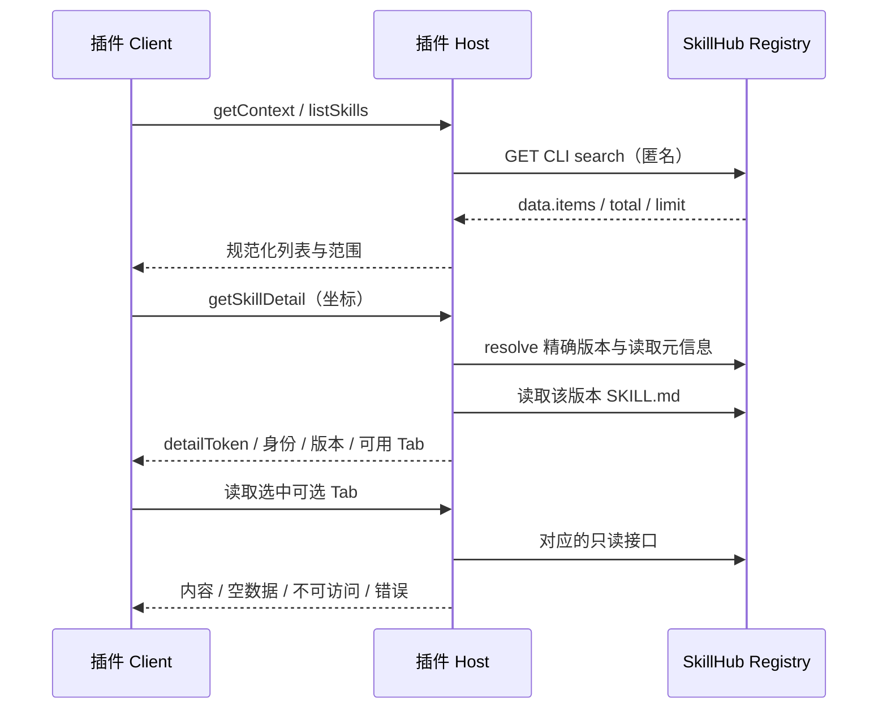

# 接口设计：匿名浏览、可选信息与本地生命周期

本文定义 Registry HTTP 接口及插件内部通信契约。Registry 表列出已有服务端接口；Client/Host 方法、DTO 和配置字段为本插件的设计接口。

## 1. 边界和调用方向



Client 不直接请求 Registry、不接触文件路径、不持有 Token。Host 通过 DSH 已有 Client/Host 通道暴露插件服务；选用官方 TypertRemoteService + @Remote + 生成产物 + Client 显式挂载；调用包装为 RemoteResult。具体外部包挂载在 M0 验证，见 [DSH 接入设计](dsh-integration-design.md)，不新开监听端口。

## 2. 已有 Registry REST 接口

`{registry}` 指配置实例的基础地址；所有路径分段需 URL 编码，不把展示坐标字符串直接拼接。JSON 响应沿用服务端 ApiResponse，业务体在 `data`；下载和文件读取是原始响应流。

| 用途 | 已有方法与路径 | 参数/业务体 | 当前限制 |
| --- | --- | --- | --- |
| 初始列表/搜索 | GET `/api/cli/v1/skills/search` | `q` 可选，`limit` 默认 20；返回 items,total,limit | 服务实际固定 newest、第 0 页；无分页参数 |
| 固定安装版本 | GET `/api/cli/v1/skills/{namespace}/{slug}/resolve` | `version` 可选；返回 namespace,slug,version,versionId,fingerprint,downloadUrl | 不携带完整说明 |
| 元信息/skillId | GET `/api/v1/skills/{namespace}/{slug}` | skillId 对应响应 `id`；含 displayName,summary,版本投影等 | 只取消费字段，不直接传管理权限字段到 UI |
| 版本列表 | GET `/api/v1/skills/{namespace}/{slug}/versions` | page=0,size=20；版本、changelog、publishedAt、downloadAvailable 等 | 可见不一定可安装；显示为只读历史 |
| 指定版本元信息 | GET `/api/v1/skills/{namespace}/{slug}/versions/{version}` | id,version,status,changelog 等 | 用于保持版本上下文一致 |
| 技能说明 | GET `/api/v1/skills/{namespace}/{slug}/versions/{version}/file?path=SKILL.md` | 原始字节流；不是 JSON data | 只请求固定说明路径，限制大小并安全渲染 |
| 固定版本下载 | GET `/api/cli/v1/skills/{namespace}/{slug}/versions/{version}/download` | ZIP 流或对象存储 302 | 也可使用 resolve 的 downloadUrl；仅 Host 消费 |
| 评论列表 | GET `/api/v1/skills/{skillId}/reviews` | page=0,size=20；data 为 PageResponse | Controller 接受空 principal，业务匿名可见性待实测；没有写评论 |
| 安全审核 | GET `/api/v1/skills/{skillId}/versions/{versionId}/security-audit` | scannerType 可选；data 为报告列表 | **当前 Controller 的 canViewAudit 在 principal=null 时返回 false** |

源码依据：`cli/src/clients/skillhub-client.ts`；`server/skillhub-app/.../controller/cli/CliSkillController.java`；`.../service/cli/CliSkillAppService.java`；`.../controller/portal/SkillController.java`、`SkillReviewController.java`、`SecurityAuditController.java`。

不调用评论 PUT/DELETE、安全扫描 retry、发布或删除接口。不改安全审核现有访问规则。若后续要求匿名展示审核摘要，应单独设计经过脱敏的公开投影，本期只保留读取适配与可选 UI。

## 3. 可选 Tab 配置（拟议）

```ts
interface SkillHubPluginConfig {
  registryUrl: string
  detailTabs: {
    versions: 'auto' | 'show' | 'hide'
    securityAudit: 'auto' | 'show' | 'hide'
    reviews: 'auto' | 'show' | 'hide'
  }
}
```

- `details` 常驻，不在开关中；广场“浏览技能/已安装”也常驻。
- 默认 `auto`，已有适配且匿名能力已确认才显示可选 Tab；未知期间不闪现成功内容。
- `hide`：无条件隐藏且不发起该模块的数据请求。适合 SaaS 未上线评论的情况。
- `show`：强制显示入口，但不能绕过服务规则；不支持或拒绝时显示对应说明，不发送认证请求。
- 当前代码的安全审核匿名能力为 unavailable，`auto` 隐藏；`show` 显示“当前来源的审核信息不支持匿名读取”。
- `auto` 能力判断优先使用已验证的实例能力声明/适配版本；没有可靠声明时，auto 模式在详情打开后允许一次有界只读首屏探测（版本/评论 size=1），探测结果缓存复用；已知匿名拒绝的审核不探测。探测与正文懒加载分开，hide 不探测，失败保持 unknown。详情模块能力不依赖未定义的 `.well-known/clawhub.json` 扩展字段。
- 200 空集合表示支持但暂无内容；401/403 表示匿名不可访问；单个资源 404 无法区分功能缺失与资源不存在，必须保留 unknown，不推断整个实例不支持。
- 网络错误/5xx 不能改变实例能力为 unsupported；已展示 Tab 保留错误和重试。切换来源重置判定与请求缓存。
- Tab 开关来自原生插件配置，在同一实例连接中生效。修改配置不是账号权限管理。

### 配置示例（仅插件拟议字段）

```json
{
  "detailTabs": {
    "versions": "auto",
    "securityAudit": "auto",
    "reviews": "hide"
  }
}
```

该示例适合未上线评论的实例；版本和安全审核仍按匿名能力判断。开源实例想展示评论可把 reviews 改为 auto，不需要更换插件包。若必须让用户看到某模块不可访问的原因，可选 show，但不获得额外权限。registryUrl 需配置为实际实例地址，

## 4. 插件 Client ↔ Host 服务（拟议）

| 方法 | 输入 | 输出 | 约束 |
| --- | --- | --- | --- |
| `getCompatibility` | 无 | dependencyBaseline、candidateDshVersion、localWritesAllowed | 只读检查 Host 实际解析的依赖包与固定 peers 是否一致；matched 不代表完整平台/宿主验收通过，localWritesAllowed 仅表示通过该依赖门禁 |
| `getContext` | 无 | sourceRevision、来源标签、可用目标、Tab 展示规则 | 路径由 Host 持有，Client 只得 label/token |
| `listSkills` | sourceRevision,q | items,total,returned,limit | limit 首版固定 20，不接任意 Registry URL |
| `getSkillDetail` | sourceRevision,namespace,slug,version | detailToken,skillId,精确版本,说明状态,各模块状态 | 使用列表选定的精确版本重新读取，不静默切换 latest |
| `openConversationDetail` | selectionRef | detailToken、固定版本 selectionRef、DetailSnapshot | 校验原搜索上下文；不写技能文件 |
| `acknowledgeConversationDetail` | 固定版本 selectionRef、detailToken | 展示关联确认 | 仅同会话 Client 可确认；关联原搜索引用，不代表安装授权 |
| `getInstalledDetail` | sourceRevision,itemKey | 本地身份/版本/目标，远端可用时补精确版本详情 | Host 解析记录；离线返回 local-only，不切到最新版 |
| `listVersions` | detailToken,page | 规范化版本页 | 正文延迟到 Tab 激活请求，能力探测例外；首版只读历史 |
| `listReviews` | detailToken,page | 公开评论页 | 使用 skillId，不误传 versionId；不绑定成版本评价 |
| `getSecurityAudit` | detailToken | 所选版本的报告或不可访问状态 | 不把其他版本审核移用到当前版本 |
| `listInstalled` | sourceRevision | 当前来源在用户/当前项目目标中的安装条目与完整性 | 只读，本地可用即使 Registry 离线 |
| `startInstall` | input：detailToken,targetToken,requestKey,hostInstanceId,mode,initiatedFrom；可信 agent scope | NativeOperation 或 null | 持久接受后返回操作快照，同 key 同参数返回原操作；retry 未找到记录返回 null，不创建操作 |
| `listInstallTargets` | detailToken，可信 agent scope | hostInstanceId、targets（targetToken、scope）、unavailable（范围列表） | 只读；从 Agent 文件系统解析，来源/项目/详情变化时拒绝；不返回路径，不代表已授权写入 |
| `checkUpdate` | sourceRevision,itemKey | 更新状态、当前/候选版本、checkedAt | 只读，不下载完整包 |
| `prepareUpgrade` | sourceRevision,itemKey | MutationPlan | 解析全部共享目标，仅允许当前用户/项目范围 |
| `prepareUninstall` | sourceRevision,itemKey | MutationPlan | 只解析一个目标；离线可用 |
| `executePlan` | planId,requestKey | operationId | 校验计划和精确 before，提交后不能复用 |
| `getOperation` | operationId,hostInstanceId；可信 agent scope | NativeOperation 或 null | 只返回当前会话在指定 Host 上可见的操作；不存在或不属于该会话返回 null，Client 显示未知，不能视为成功 |
| `recoverOperation` | input：operationId,hostInstanceId；可信 agent scope | 核验后的 NativeOperation 或 null | 只核验原操作，不生成新请求或重新下载安装包；不存在或不属于当前会话返回 null；重新验证当前可信根与写入策略；原始输入不接受额外字段 |

卸载结果处于 recovery-required/unknown，或已完成但存在清理告警时，显示“核验并恢复”。提交前中断可恢复原文件，已提交操作只清理残留；目标占用、内容变化或权限不足时保留现场。恢复请求响应丢失后查询原 operationId，不重新卸载。恢复覆盖单目标安装、卸载和失效记录清理，以及升级操作的完整目标集合。升级结果同样提供“核验并恢复”：用户级/当前项目级历史目标必须全部匹配，禁止只恢复其中一个目标；每一步变更前重新验证全部目标的上下文、可信根及当前写入策略。重复目标、当前上下文外的目标或根变化均拒绝恢复。已安装列表提供“升级操作”和“卸载操作”区域，从当前会话及来源的持久请求索引展示未关闭结果，不依赖当前安装列表行。历史区域只能查询、恢复或关闭原结果，不能生成新计划。收到恢复请求错误后仍查询原操作；查询已确认恢复或完成时，隐藏过期请求错误提示。

按 operationId 查询状态，不新建事件总线或任务队列；加入本地轻量操作日志以支撑升级卸载恢复。轮询只在有正在执行的任务且页面可见时进行；间隔由实现与宿主实践确定，不将未测数值设成硬 SLA。

安装请求 mode 为 new/retry，initiatedFrom 为 plaza/conversation。requestKey、hostInstanceId、operationId 使用 UUID；详情和目标引用非空且最长 2048 字符，不允许额外字段。Host 校验原始请求，避免生成器的对象解码丢弃多余字段后绕过检查。参数冲突返回 skillhub/request-conflict，Host 身份变化返回 skillhub/context-stale，非法输入返回 skillhub/invalid-installation-request；底层文件路径和原始异常不透传。NativeOperation 只包含公开状态及原始上下文，不包含 ownerId、目标路径、请求摘要或事务快照。

## 5. 核心数据模型（拟议）

```ts
type SkillIdentity = {
  sourceRevision: string
  namespace: string
  slug: string
}

type ModuleResult<T> =
  | { state: 'ready'; data: T }
  | { state: 'empty' }
  | { state: 'hidden' }
  | { state: 'unavailable'; reason: 'unsupported' | 'anonymous-denied' | 'unknown' }
  | { state: 'error'; error: PluginError }

type DetailSnapshot = SkillIdentity & {
  detailToken: string
  version: string
  versionId?: number // local-only 时无远端 ID
  origin: 'remote' | 'local-only'
  installable: boolean // local-only 为 false，远端重新核验后才可安装
  skillId?: number
  title: string
  summary: string
  documentation: ModuleResult<string>
}

type InstalledItem = {
  itemKey: string
  namespace: string
  slug: string
  version: string
  scope: 'user' | 'project'
  targetLabel: string
  localState: 'present' | 'missing' | 'inconsistent' | 'unverified'
  discovery: 'confirmed' | 'unconfirmed' | 'failed'
}

type InstalledList = {
  items: InstalledItem[]
  completeness: 'complete' | 'partial'
  issues: PluginError[]
}

type PluginError = {
  code: string
  message: string
  retryable: boolean
  requestId?: string
}

type OperationContext = {
  hostInstanceId: string // 插件状态目录持久身份，不是每次进程启动随机值
  hostLabel: string
  sourceIdentity: string // 规范化 Registry 身份；无凭证或下载链接
  sourceLabel: string
  sourceRevision: string
  initiatedFrom: 'plaza' | 'conversation'
  createdAt: string // Host 产生的 ISO 8601 UTC 时间
  updatedAt: string
}

type MutationOperation = {
  context: OperationContext
  kind: 'install' | 'upgrade' | 'uninstall' | 'remove-stale-record'
  operationId: string
  phase: 'accepted' | 'staging' | 'revalidating' | 'committing' | 'recovering' | 'completed' | 'failed' | 'recovery-required' | 'unknown'
  namespace: string
  slug: string
  version: string
  targetLabel: string
  files: 'pending' | 'installed' | 'already-installed' | 'upgraded' | 'removed' | 'stale-record-removed' | 'failed' | 'unknown'
  discovery: 'unconfirmed' | 'confirmed' | 'failed'
  beforeVersion?: string
  afterVersion?: string
  targets: Array<{ label: string; outcome: string }>
  warnings: string[]
  recovery?: 'not-needed' | 'restored' | 'incomplete' | 'unknown'
  error?: PluginError
}
```

local-only 详情的 detailToken 只供只读关联；startInstall 必须拒绝其提交，待远端 resolve 核验后签发可安装快照。

detailToken 是 Host 保存的快照引用，绑定来源、身份、精确版本、fingerprint；targetToken 绑定规范化安装目标及必要项目上下文。本地只读快照无 fingerprint 时不得创建安装计划。均不是身份凭证。Host 必须校验 token 归属与生命周期，拒绝前端修改的版本、路径和 URL；不把服务器下载链接暴露给 Client。

安装开始后快照冻结。改变来源只使未提交计划失效；已接受操作仍按原来源、版本和目标完成并标明上下文，不迁移到新配置。接收 startInstall 响应丢失时，Client 以相同 requestKey 与相同参数重试，找回原 operationId，不生成新 key。重复 requestKey 参数不同时报错；Host 重启后从操作日志恢复请求映射并核验结果；无日志或无法证明状态则返回 unknown，不自动重放。日志保留期和恢复规则见生命周期分册。

## 6. 已安装数据契约

数据源为 CLI inventory、目标内 `.skillhub/metadata.json` 与目录存在性。默认只展示当前 Registry 可识别的 SkillHub 安装，目标限定用户级和当前可信项目。它不是“DSH 所有已发现技能”列表，不全盘扫描其他项目或 Agent。

同技能安装到两个范围时按目标分两条。inventory 记录与实际目标不符标为异常，不能静默丢掉；未识别归属的目录不当作当前来源的 SkillHub 安装。基础展示不对所有文件做 hash，故 `present` 文案仅为“文件存在”，完整性在安装冲突判断时检查。

点击条目详情绑定**已安装版本**，不能以最新版说明冒充本地说明。来源离线时保留本地身份、版本与目标，并提示远端详情不可用。异常记录不自动修复；精确卸载与失效记录清理需按生命周期分册预检和确认。

## 7. 错误映射

| 情况 | 插件拟议 code | UI 行为 |
| --- | --- | --- |
| 401/403 | ANONYMOUS_ACCESS_DENIED | 无登录跳转；可选 Tab 按策略呈现 |
| 技能/版本 404 | RESOURCE_NOT_FOUND | 主详情阻止安装；模块请求保留资源语义 |
| 429 | RATE_LIMITED | 等待后手动重试，尊重 Retry-After |
| 网络或 5xx | SOURCE_UNAVAILABLE | 保留查询/详情，支持重试 |
| 来源/目标已变 | CONTEXT_STALE | 重新打开详情或选择当前目标 |
| 目标内容冲突 | TARGET_CONFLICT | 明确未覆盖，无 force 按钮 |
| 包校验失败 | PACKAGE_INVALID | 不提交包；显示原因 |
| DSH 格式不兼容 | DSH_INCOMPATIBLE | 不改写原包 |
| 记录写入/恢复失败 | INSTALL_COMMIT_FAILED | 实际恢复状态；保留 operationId |

Registry 读取收到 429 且 Retry-After 有效时，Host 按秒数或 HTTP-date 计算等待截止时间；同一 RegistryAdapter 的后续读取在截止前直接返回 RATE_LIMITED，不再发送请求。Remote 错误附带可选 retryAfterSeconds（剩余秒数），广场展示等待提示；到期仍由用户手动重试，不自动提交。无效或缺失字段不推测等待时长。该等待状态属于当前来源适配器，Host 重启或来源重建后不保留；它不是跨进程的配额管理。格式依据 [RFC 9110 §10.2.3](https://www.rfc-editor.org/rfc/rfc9110.html#name-retry-after)。

不能原样展示 CLI 的“run skillhub login”或“pass --force”建议。复用层需保留可判别的 HTTP 状态/结构化原因；现有 client 的错误对象没有统一 status 字段，适配时补测试，不靠英文 message 字符串匹配业务。

## 8. 待验收契约

逐一验证匿名列表、详情、版本、SKILL.md、评论、下载及拒绝响应。安全审核须覆盖匿名访问拒绝场景。实例开关和能力组合应覆盖 hide、auto 支持/未知、show 被拒、网络错误、空数据和来源切换。


## 9. 升级与卸载接口补充（拟议）

```ts
type MutationPlan = {
  planId: string
  kind: 'upgrade' | 'uninstall' | 'remove-stale-record'
  status: 'ready' | 'unchanged' | 'blocked'
  sourceRevision: string
  namespace: string
  slug: string
  currentVersion: string
  targetVersion?: string
  targets: Array<{
    targetToken: string
    scope: 'user' | 'project'
    label: string
    displayPath: string // 只读告知影响，不能在提交参数中覆盖
  }>
  expiresAt: string
  blockers: Array<{ code: string; message: string }>
}
```

prepare 返回 plan，即使 blocked 也正常返回原因，非 500。execute 只接受 ready 且未过期计划；计划到期返回 PLAN_EXPIRED；来源、项目或本地快照变化返回 CONTEXT_STALE。服务端保存的 before 包含完整文件基线、所有权和 inventory 全目标集合，不发完整文件 hash 映射到浏览器。

新增错误语义：LOCAL_MODIFIED、BASELINE_MISSING、SHARED_OWNERSHIP、MULTI_TARGET_SCOPE_CONFLICT、VERSION_ORDER_UNKNOWN、REMOTE_CONTENT_CHANGED、PLAN_EXPIRED、REQUEST_KEY_CONFLICT、RECOVERY_REQUIRED。Remote 层映射为 `skillhub/<lower-kebab-reason>`；blocked 的逐项原因仍作为业务数据返回。

操作日志保存 requestKey、参数摘要、调用上下文绑定、operationId 与执行阶段（不存凭证）；同 key 同参数可以找回，同 key 不同参数返回冲突。prepare 不修改文件，execute 返回接受状态不等于完成。

卸载不新增 Registry REST 接口，不调用 skill DELETE。升级复用匿名 resolve 和精确版本 download。升级使用多目标时 MutationOperation.targets 分别列结果，version 字段表示当前操作关联版本，不单凭该字段判断所有目标提交成功；以 files/targets/recovery 为准。

local-only 详情不能发起远端安装或升级，但可通过独立 prepareUninstall 在本地身份、基线与目标检查通过后离线卸载。其他规则、示例和恢复决策统一见 [lifecycle-design.md](lifecycle-design.md)。

## 对话工具接口

首期增加拟议 astron_skillhub_search 与 astron_skillhub_install。模型仅提供关键词或技能坐标/范围；来源、可信目标、幂等键由 Host 适配层派生。具体输入、结果 envelope、历史操作绑定与错误语义见 [对话设计第 6 节](conversation-design.md#6-工具与服务契约拟议)。页面与工具均复用本文 startInstall/getOperation，工具不接受任意文件路径或下载地址。


## 10. 已接受操作的查重顺序与历史快照

本节定义插件内部协议。Host 启动在插件状态目录读取或首次生成 hostInstanceId，重启保持不变；状态目录丢失或迁移到新 Host 时视为新身份，不能用显示名称猜测同一主机。会话/调用身份来自宿主可信上下文；具体传递能力须 M0 验证。

1. 建立当前调用归属：hostInstanceId、会话/Client 归属。无法确认归属不返回另一会话/主机的操作。
2. 对 startInstall/executePlan/工具安装，先以该归属与 requestKey 查持久 accepted 记录，对原始参数摘要 requestDigest 做一致性比较。摘要包括原 token/ref 或计划引用及显式参数，不只比较当前 resolve 结果。
3. 同 key 同摘要已存在时返回原 operationId 与保存的 context；即使旧 token 已过期或配置已变化，也仅恢复查询，不开始新写。同 key 不同摘要返回 REQUEST_KEY_CONFLICT。
4. 无记录且这是已知的重试/恢复请求时返回 unknown，不自动转换成新操作。Client 为首次请求创建键后记录其提交状态；工具映射随 accepted 记录持久化。身份/日志丢失无法证明首次请求时亦按 unknown 处理。
5. 只有可确认为新操作才进入当前 token、sourceRevision、项目、版本及计划 expiry 校验；持久化 accepted、requestDigest 与稳定调用映射成功后才能开始写文件。

accepted 不表示安装完成。工具立即返回 accepted 及 operationId，卡片查询终态；具体交互见对话分册第 9 节。getOperation 返回保存的 OperationContext，不从当前配置补填历史来源/Host 标签。历史 envelope 保存工具返回时的 accepted、同一 context 与 operationId；后续终态从 Host 操作记录读取，不回写原始工具结果；时间来自 Host，不能以卡片重新打开的时间冒充操作时间。

状态与结果用词沿用 MutationOperation；context 字段是附加归属信息，不建立第二套状态枚举。宿主确认后才可能报告发现成功，记录缺失不报告“已卸载”或“从未安装”。
