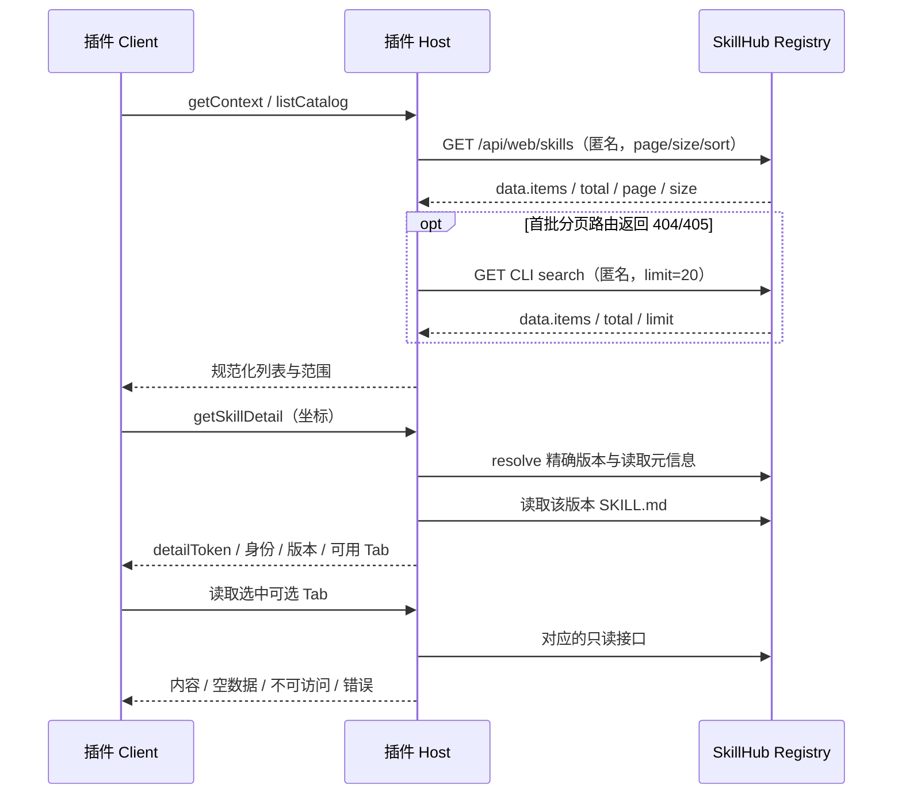

# 接口设计：匿名浏览、可选信息与本地生命周期

本文定义 Registry HTTP 接口及插件内部通信契约。Registry 表列出已有服务端接口；Client/Host 方法、DTO 和配置字段为本插件的设计接口。

## 1. 边界和调用方向



Client 不直接请求 Registry、不持有认证 Token，也不提交任意文件路径；升级与卸载计划中的路径仅用于只读展示影响范围。Host 通过 DSH 已有 Client/Host 通道暴露插件服务；选用官方 TypertRemoteService + @Remote + 生成产物 + Client 显式挂载；调用包装为 RemoteResult。具体外部包挂载在 M0 验证，见 [DSH 接入设计](dsh-integration-design.md)，不新开监听端口。

## 2. 已有 Registry REST 接口

`{registry}` 指配置实例的基础地址；所有路径分段需 URL 编码，不把展示坐标字符串直接拼接。JSON 响应沿用服务端 ApiResponse，业务体在 `data`；下载和文件读取是原始响应流。

| 用途 | 已有方法与路径 | 参数/业务体 | 当前限制 |
| --- | --- | --- | --- |
| 广场列表/搜索 | GET `/api/web/skills` | q,page,size=12,sort；返回 items,total,page,size | sort 为 newest/downloads/rating，匿名访问；发布版本、显示名和真实统计字段映射到卡片 |
| 对话搜索/旧来源回退 | GET `/api/cli/v1/skills/search` | q,limit=20；返回 items,total,limit | 保留原有有界工具结果；广场仅在分页首批返回 404/405 时回退 |
| 固定安装版本 | GET `/api/cli/v1/skills/{namespace}/{slug}/resolve` | `version` 可选；返回 namespace,slug,version,versionId,fingerprint,downloadUrl | 不携带完整说明 |
| 元信息/skillId | GET `/api/v1/skills/{namespace}/{slug}` | skillId 对应响应 `id`；含 displayName,summary,版本投影等 | 只取消费字段，不直接传管理权限字段到 UI |
| 版本列表 | GET `/api/v1/skills/{namespace}/{slug}/versions` | page=0,size=20；版本、changelog、publishedAt、downloadAvailable 等 | 可见不一定可安装；选择可下载版本后重新读取精确详情 |
| 指定版本元信息 | GET `/api/v1/skills/{namespace}/{slug}/versions/{version}` | id,version,status,changelog 等 | 用于保持版本上下文一致 |
| 技能说明 | GET `/api/v1/skills/{namespace}/{slug}/versions/{version}/file?path=SKILL.md` | 原始字节流；不是 JSON data | 只请求固定说明路径，限制大小并安全渲染 |
| 固定版本下载 | GET `/api/cli/v1/skills/{namespace}/{slug}/versions/{version}/download` | ZIP 流或对象存储 302 | 也可使用 resolve 的 downloadUrl；仅 Host 消费 |
| 评论列表 | GET `/api/v1/skills/{skillId}/reviews` | page=0,size=20；data 为 PageResponse | Controller 接受空 principal，业务匿名可见性待实测；没有写评论 |
| 安全审核 | GET `/api/v1/skills/{skillId}/versions/{versionId}/security-audit` | scannerType 可选；data 为报告列表 | **当前 Controller 的 canViewAudit 在 principal=null 时返回 false** |

源码依据：`cli/src/clients/skillhub-client.ts`；`server/skillhub-app/.../controller/cli/CliSkillController.java`；`.../service/cli/CliSkillAppService.java`；`.../controller/portal/SkillController.java`、`SkillReviewController.java`、`SecurityAuditController.java`。

不调用评论 PUT/DELETE、安全扫描 retry、发布或删除接口。不改安全审核现有访问规则。若后续要求匿名展示审核摘要，应单独设计经过脱敏的公开投影，本期只保留读取适配与可选 UI。

## 3. 可选 Tab 配置

```ts
interface SkillHubPluginConfig {
  registryUrl: string
  detailTabs: {
    versions: 'auto' | 'show' | 'hide'
    securityAudit: 'auto' | 'show' | 'hide'
    reviews: 'auto' | 'show' | 'hide'
  }
}
```

- `registryUrl` 从 `0.2.1` 起缺省为 `https://skill.xfyun.cn`；显式空串或仅空白断开，自定义来源保留。不继承 CLI 地址或凭证。
- `details` 常驻，不在开关中；广场“浏览技能/已安装”也常驻。
- 默认 `auto`，已有适配且匿名能力已确认才显示可选 Tab；未知期间不闪现成功内容。
- `hide`：无条件隐藏且不发起该模块的数据请求。适合 SaaS 未上线评论的情况。
- `show`：强制显示入口，但不能绕过服务规则；不支持或拒绝时显示对应说明，不发送认证请求。
- 当前代码的安全审核匿名能力为 unavailable，`auto` 隐藏；`show` 显示“当前来源的审核信息不支持匿名读取”。
- `auto` 能力判断优先使用已验证的实例能力声明/适配版本；没有可靠声明时，auto 模式在详情打开后允许一次有界只读首屏探测（版本/评论 size=1），探测结果缓存复用；已知匿名拒绝的审核不探测。探测与正文懒加载分开，hide 不探测，失败保持 unknown。详情模块能力不依赖未定义的 `.well-known/clawhub.json` 扩展字段。
- 200 空集合表示支持但暂无内容；401/403 表示匿名不可访问；单个资源 404 无法区分功能缺失与资源不存在，必须保留 unknown，不推断整个实例不支持。
- 网络错误/5xx 不能改变实例能力为 unsupported；已展示 Tab 保留错误和重试。切换来源重置判定与请求缓存。
- Tab 开关来自原生插件配置，在同一实例连接中生效。修改配置不是账号权限管理。

### 插件配置示例

```json
{
  "detailTabs": {
    "versions": "auto",
    "securityAudit": "auto",
    "reviews": "hide"
  }
}
```

该示例适合未上线评论的实例；版本和安全审核仍按匿名能力判断。开源实例想展示评论可把 reviews 改为 auto，不需要更换插件包。若必须让用户看到某模块不可访问的原因，可选 show，但不获得额外权限。省略 registryUrl 使用正式默认实例；自建实例显式配置实际地址，空地址断开。

## 4. 插件 Client ↔ Host 服务

| 方法 | 输入 | 输出 | 约束 |
| --- | --- | --- | --- |
| `getCompatibility` | 无 | dependencyBaseline、candidateDshVersion、localWritesAllowed | 只读检查 Host 实际解析的依赖包与固定 peers 是否一致；matched 不代表完整平台/宿主验收通过，localWritesAllowed 仅表示通过该依赖门禁 |
| `getContext` | 无 | sourceRevision、registryUrl、configured、detailTabs | 返回已规范化的来源与配置；安装目标另由 listInstallTargets 查询 |
| `testRegistryConnection` | inputUrl、signal | reachable=true、mode、elapsedMs | 测试草稿地址的公开目录或基础搜索能力，不保存配置；失败沿用安全Registry错误 |
| `listCatalog` | sourceRevision,q,page,sort | items,total,page,size,hasMore,mode | page 从 0 开始、size 固定 12；mode=paged/limited；不接任意 Registry URL |
| `listSkills` | sourceRevision,q | items,total,returned,limit | 对话搜索及既有调用保持 limit=20 |
| `getSkillDetail` | sourceRevision,namespace,slug,version | SkillDetail（含 detailToken、versionId、精确版本、说明及模块状态） | 使用列表选定的精确版本重新读取，不静默切换 latest |
| `openConversationDetail` | selectionRef | detailToken、固定版本 selectionRef、DetailSnapshot | 校验原搜索上下文；不写技能文件 |
| `acknowledgeConversationDetail` | 固定版本 selectionRef、detailToken | 展示关联确认 | 仅同会话 Client 可确认；关联原搜索引用，不代表安装授权 |
| `getInstalledDetail` | sourceRevision,itemKey | 本地身份/版本/目标，远端可用时补精确版本详情 | Host 解析记录；离线返回 local-only，不切到最新版 |
| `listVersions` | detailToken,page | 规范化版本页 | 正文延迟到 Tab 激活请求，能力探测例外；选择版本使用现有 getSkillDetail 重新绑定 |
| `listReviews` | detailToken,page | 公开评论页 | 使用 skillId，不误传 versionId；不绑定成版本评价 |
| `listInstalled` | sourceRevision | 当前来源在用户/当前项目目标中的安装条目与完整性 | 只读，本地可用即使 Registry 离线 |
| `startInstall` | input：detailToken,targetToken,requestKey,hostInstanceId,mode,initiatedFrom；可信 agent scope | NativeOperation 或 null | 持久接受后返回操作快照，同 key 同参数返回原操作；retry 未找到记录返回 null，不创建操作 |
| `listInstallTargets` | detailToken，可信 agent scope | hostInstanceId、targets（targetToken、scope）、unavailable（范围列表） | 只读；从 Agent 文件系统解析，来源/项目/详情变化时拒绝；不返回路径，不代表已授权写入 |
| `checkUpdate` | sourceRevision,itemKey | 更新状态、当前/候选版本、checkedAt | 只读，不下载完整包 |
| `checkVersionUpdate` | sourceRevision,itemKey,version | InstalledUpdateCheck | 按所选精确版本检查，不回退 latest |
| `prepareVersionUpgrade` | sourceRevision,itemKey,version | UpgradePlanView | 固定精确候选，准备所选安装位置的升级计划 |
| `prepareUpgrade` | sourceRevision,itemKey | UpgradePlanView | 只准备选中安装位置，核验当前用户/项目可信根 |
| `prepareUninstall` | sourceRevision,itemKey | UninstallPlanView | 只解析一个目标；离线可用 |
| `executePlan` | input：planId,requestKey；可信 agent scope | NativeOperation 或 null | 校验计划和精确 before，提交后不能复用 |
| `getOperation` | operationId,hostInstanceId；可信 agent scope | NativeOperation 或 null | 只返回当前会话在指定 Host 上可见的操作；不存在或不属于该会话返回 null，Client 显示未知，不能视为成功 |
| `recoverOperation` | input：operationId,hostInstanceId；可信 agent scope | 核验后的 NativeOperation 或 null | 只核验原操作，不生成新请求或重新下载安装包；不存在或不属于当前会话返回 null；重新验证当前可信根与写入策略；原始输入不接受额外字段 |

卸载结果处于 recovery-required/unknown，或已完成但存在清理告警时，显示“核验并恢复”。提交前中断可恢复原文件，已提交操作只清理残留；目标占用、内容变化或权限不足时保留现场。恢复请求响应丢失后查询原 operationId，不重新卸载。恢复覆盖单目标安装、卸载和失效记录清理，以及升级操作的完整目标集合。升级结果同样提供“核验并恢复”：用户级/当前项目级历史目标必须全部匹配，禁止只恢复其中一个目标；每一步变更前重新验证全部目标的上下文、可信根及当前写入策略。重复目标、当前上下文外的目标或根变化均拒绝恢复。已安装列表提供“升级操作”和“卸载操作”区域，从当前会话及来源的持久请求索引展示未关闭结果，不依赖当前安装列表行。历史区域只能查询、恢复或关闭原结果，不能生成新计划。收到恢复请求错误后仍查询原操作；查询已确认恢复或完成时，隐藏过期请求错误提示。

按 operationId 查询状态，不新建事件总线或任务队列；加入本地轻量操作日志以支撑升级卸载恢复。轮询只在有正在执行的任务且页面可见时进行；间隔由实现与宿主实践确定，不将未测数值设成硬 SLA。

安装请求 mode 为 new/retry，initiatedFrom 为 plaza/conversation。requestKey、hostInstanceId、operationId 使用 UUID；详情和目标引用非空且最长 2048 字符，不允许额外字段。Host 校验原始请求，避免生成器的对象解码丢弃多余字段后绕过检查。参数冲突返回 skillhub/request-conflict，Host 身份变化返回 skillhub/context-stale，非法输入返回 skillhub/invalid-installation-request；底层文件路径和原始异常不透传。NativeOperation 只包含公开状态及原始上下文，不包含 ownerId、目标路径、请求摘要或事务快照。

## 5. 核心数据模型

### 5.1 详情与已安装列表

以下字段对应 `plugins/dsh/src/host/types.ts`；展示状态由 Client 根据这些响应推导，不增加未实际返回的 origin、installable 或 completeness 字段。

```ts
type ModuleAvailability = 'hidden' | 'available' | 'anonymous-denied' | 'unknown'

interface SkillDetail {
  detailToken: string
  title: string
  summary: string
  namespace: string
  slug: string
  version: string
  versionId: number
  tabs: {
    versions: ModuleAvailability
    securityAudit: ModuleAvailability
    reviews: ModuleAvailability
  }
  documentation:
    | { state: 'ready'; content: string }
    | { state: 'error'; reason: string; retryable: boolean }
}

interface InstalledSkillList {
  items: Array<{
    itemKey: string
    namespace: string
    slug: string
    version: string
    scope: 'user' | 'project'
    state: 'present' | 'missing' | 'metadata-invalid' | 'mismatch' | 'unreadable'
  }>
  complete: boolean
  issues: string[]
  unavailable: Array<'user' | 'project'>
}

interface InstalledSkillDetail {
  item: InstalledSkillList['items'][number]
  content:
    | { state: 'ready'; detail: SkillDetail }
    | { state: 'local-only'; reason: string }
}
```

`complete` 表示已解析范围的安装投影是否完整，包含共享清单读取与条目核验，`unavailable` 单独列出无法核验的目标范围。共享清单不完整时所有范围均不能推断未安装；清单完整且所选范围不在 `unavailable` 中时，可以在该范围独立判断是否存在安装记录。另一个范围不可用不阻止当前健康范围安装或核验。metadata-invalid、mismatch、unreadable 分别表示元数据无效、记录不一致、读取失败，UI 不将它们折叠为未安装。已安装列表不携带发现结论；发现结果从原操作的只读核验取得。

`itemKey` 是 Host 生命周期内签发的 HMAC 不透明摘要，绑定会话、cwd、来源修订及条目范围、坐标、版本、指纹、状态和目标。Host 不按条目缓存引用；读取时在当前可信根重新投影并匹配摘要，再验证原目标。列表大小和其他会话刷新不会淘汰已返回引用；来源、会话、Host 或记录变化后旧引用失效。摘要不包含可解码的路径，也不替代执行前完整性与归属核验。

local-only 返回本地条目与原因，不签发安装 detailToken；取得可安装详情必须重新完成远端精确版本解析。

本期安全审核状态随 `getSkillDetail.tabs.securityAudit` 返回；匿名不可访问时展示说明，不提供独立的 `getSecurityAudit` Remote 方法，也不移用其他版本的审核结果。

### 5.2 操作状态与原操作结果

Remote 返回 `NativeOperation`，契约位于 `cli/src/integrations/native-contract.d.ts`，由构建脚本同步到插件；不复制完整内部事务模型。

| 字段 | 含义 |
| --- | --- |
| operationId、revision、kind | 原操作标识、日志修订号及安装/升级/卸载/失效记录清理类型 |
| namespace、slug、version、targetLabel | 原操作绑定的技能、版本及目标汇总标签 |
| context | 持久 Host 身份、来源身份/标签/修订、入口及创建/更新时间 |
| phase、files、discovery、recovery | 分别表示执行阶段、文件结果、宿主发现和恢复结果，不能相互替代 |
| warningCount | 原日志告警数量；不返回原始异常文本 |
| resultDetails | 原日志派生的可选结果详情；旧开发版本响应缺失此字段时不猜测内容 |

```ts
type OperationResultDetails = {
  beforeVersion: string | null
  afterVersion: string | null
  targets: Array<{
    label: string
    outcome: 'installed' | 'upgraded' | 'removed' | 'stale-record-removed' | 'restored' | 'unknown'
  }>
  warnings: Array<'backup-cleanup' | 'removal-cleanup' | 'verification-required'>
}
```

结果详情只读取原操作日志，不读取当前 inventory 来补写历史。beforeVersion 的快照须覆盖该操作的全部目标；其他范围已安装的同坐标版本不能作为本次操作旧版本。已经核验的 already-installed 返回相同旧新版本。afterVersion 仅在安装或升级完成时返回实际完成版本，其他情况为 null；UI 明示未确认或不适用。

单目标沿用原范围标签，多目标按原确认计划顺序编号，不暴露事务目录。完整目标集合核验完成后才能显示各目标成功；失败且完整恢复已经确认才显示 restored；执行中、崩溃待恢复或结果不确定均显示 unknown。旧日志没有目标明细时返回空数组并说明未记录，不推断目标。

告警以固定类别展示：backup-cleanup 表示备份清理需核验，removal-cleanup 表示卸载隔离文件清理需核验，其他原日志告警统一为 verification-required。原始路径、异常、ownerId、请求摘要及事务快照不得透传。结果卡片展示原操作结果，并明确引导用户通过已安装列表核验当前状态。

local-only 详情不能提交 startInstall；只有远端 resolve 核验后签发的 detailToken 才可进入安装预检。

detailToken 是 Host 保存的快照引用，绑定来源、身份、精确版本、fingerprint；targetToken 绑定规范化安装目标及必要项目上下文。本地只读快照无 fingerprint 时不得创建安装计划。均不是身份凭证。Host 必须校验 token 归属与生命周期，拒绝前端修改的版本、路径和 URL；不把服务器下载链接暴露给 Client。

安装开始后快照冻结。改变来源只使未提交计划失效；已接受操作仍按原来源、版本和目标完成并标明上下文，不迁移到新配置。接收 startInstall 响应丢失时，Client 以相同 requestKey 与相同参数重试，找回原 operationId，不生成新 key。重复 requestKey 参数不同时报错；Host 重启后从操作日志恢复请求映射并核验结果；无日志或无法证明状态则返回 unknown，不自动重放。日志保留期和恢复规则见生命周期分册。

## 6. 已安装数据契约

数据源为 CLI inventory、目标内 `.skillhub/metadata.json` 与目录存在性。默认只展示当前 Registry 可识别的 SkillHub 安装，目标限定用户级和当前可信项目。它不是“DSH 所有已发现技能”列表，不全盘扫描其他项目或 Agent。

同技能安装到两个范围时按目标分两条。inventory 记录与实际目标不符标为异常，不能静默丢掉；未识别归属的目录不当作当前来源的 SkillHub 安装。基础展示不对所有文件做 hash，故 `present` 文案仅为“文件存在”，完整性在安装冲突判断时检查。

点击条目详情绑定**已安装版本**，不能以最新版说明冒充本地说明。来源离线时保留本地身份、版本与目标，并提示远端详情不可用。异常记录不自动修复；精确卸载与失效记录清理需按生命周期分册预检和确认。

## 7. 错误映射

| 情况 | 插件拟议 code | UI 行为 |
| --- | --- | --- |
| 401/403 | ANONYMOUS_ACCESS_DENIED | 无登录跳转；可选 Tab 按策略呈现 |
| 技能/版本 404 | RESOURCE_NOT_FOUND | 主详情阻止安装；模块请求保留资源语义 |
| 429 | RATE_LIMITED | 等待后手动重试，尊重 Retry-After |
| 网络或 5xx | SOURCE_UNAVAILABLE | 保留查询/详情，支持重试 |
| 来源/目标已变 | CONTEXT_STALE | 重新打开详情或选择当前目标 |
| 目标内容冲突 | TARGET_CONFLICT | 明确未覆盖，无 force 按钮 |
| 包校验失败 | PACKAGE_INVALID | 不提交包；显示原因 |
| DSH 格式不兼容 | DSH_INCOMPATIBLE | 不改写原包 |
| 记录写入/恢复失败 | INSTALL_COMMIT_FAILED | 实际恢复状态；保留 operationId |

Registry 读取收到 429 且 Retry-After 有效时，Host 按秒数或 HTTP-date 计算等待截止时间；同一 RegistryAdapter 的后续读取在截止前直接返回 RATE_LIMITED，不再发送请求。Remote 错误附带可选 retryAfterSeconds（剩余秒数），广场展示等待提示；到期仍由用户手动重试，不自动提交。无效或缺失字段不推测等待时长。该等待状态属于当前来源适配器，Host 重启或来源重建后不保留；它不是跨进程的配额管理。格式依据 [RFC 9110 §10.2.3](https://www.rfc-editor.org/rfc/rfc9110.html#name-retry-after)。

不能原样展示 CLI 的“run skillhub login”或“pass --force”建议。复用层需保留可判别的 HTTP 状态/结构化原因；现有 client 的错误对象没有统一 status 字段，适配时补测试，不靠英文 message 字符串匹配业务。

## 8. 待验收契约

逐一验证匿名列表、详情、版本、SKILL.md、评论、下载及拒绝响应。安全审核须覆盖匿名访问拒绝场景。实例开关和能力组合应覆盖 hide、auto 支持/未知、show 被拒、网络错误、空数据和来源切换。


## 9. 升级与卸载接口

升级与卸载使用不同的只读计划视图；字段对应 `plugins/dsh/src/host/types.ts`。完整文件基线与清单快照仅保存在 Host，不传到 Client。

```ts
interface UpgradePlanView {
  hostInstanceId: string
  status: 'ready' | 'unchanged' | 'blocked'
  reason: string
  planId: string | null
  expiresAt: string | null
  currentVersion: string
  candidateVersion: string | null
  targets: Array<{ scope: 'user' | 'project'; path: string }>
}

interface UninstallPlanView {
  hostInstanceId: string
  status: 'ready' | 'blocked'
  reason: string
  kind: 'uninstall' | 'remove-stale-record' | null
  planId: string | null
  expiresAt: string | null
  currentVersion: string
  target: { scope: 'user' | 'project'; path: string } | null
}

interface HostExecutePlanRequest {
  planId: string
  requestKey: string
}
```

`path` 只读展示实际影响位置，提交参数不能携带或覆盖路径。`ready` 才提供可执行的计划；`blocked` 用 reason 说明阻断原因，升级无新版时可返回 unchanged。上述状态属于正常业务返回，不作为 HTTP 500 处理。

`executePlan` 先按当前会话、requestKey 和 planId 查找已接受操作；存在时返回原操作快照，不因计划已过期而重新执行。首次提交须核验未过期计划、来源、会话、项目和本地基线。计划缺失、过期或上下文变化返回 `skillhub/context-stale`，提示重新准备；不同请求键争用同一计划、同键参数冲突返回 `skillhub/request-conflict`；请求格式非法返回 `skillhub/invalid-installation-request`。其他无法受理的执行异常映射为 `skillhub/installation-unavailable`，不将底层路径或原始异常透传。Remote 错误不采用统一的“大写业务原因转小写”规则。

`executePlan` 返回 `NativeOperation | null`，不是单独的 operationId。Client 从快照取得 operationId，再查询原操作；null 不能解释为成功。完整操作字段以共享核心生成的 `plugins/dsh/src/host/generated/native-contract.d.ts` 为准。

操作日志保存 requestKey、参数摘要、调用上下文绑定、operationId 与执行阶段（不存凭证）；同 key 同参数可以找回，同 key 不同参数返回冲突。prepare 不修改文件，execute 返回接受状态不等于完成。

卸载不新增 Registry REST 接口，不调用 skill DELETE。升级复用匿名 resolve 和精确版本 download。升级使用多目标时 resultDetails.targets 分别列结果，version 字段表示当前操作关联版本，不单凭该字段判断所有目标提交成功；以 files/resultDetails.targets/recovery 为准。

local-only 详情不能发起远端安装或升级，但可通过独立 prepareUninstall 在本地身份、基线与目标检查通过后离线卸载。其他规则、示例和恢复决策统一见 [lifecycle-design.md](lifecycle-design.md)。

## 对话工具接口

首期提供 astron_skillhub_search 与 astron_skillhub_install。模型仅提供关键词或技能坐标/范围；来源、可信目标、幂等键由 Host 适配层派生。具体输入、结果 envelope、历史操作绑定与错误语义见 [对话设计第 6 节](conversation-design.md#6-工具与服务契约)。页面与工具均复用本文 startInstall/getOperation，工具不接受任意文件路径或下载地址。用户明确安装但未指定范围时省略 scope，由 Host 默认当前用户；明确项目级时使用可信项目根，不自动回退。历史 awaiting-confirmation 仍允许通过现有 UI 选择，但不能自动恢复写入。


## 10. 已接受操作的查重顺序与历史快照

本节定义插件内部协议。Host 启动在插件状态目录读取或首次生成 hostInstanceId，重启保持不变；状态目录丢失或迁移到新 Host 时视为新身份，不能用显示名称猜测同一主机。会话/调用身份来自宿主可信上下文；具体传递能力须 M0 验证。

1. 建立当前调用归属：hostInstanceId、会话/Client 归属。无法确认归属不返回另一会话/主机的操作。
2. 对 startInstall/executePlan/已明确范围的工具安装，先以该归属与 requestKey 查持久 accepted 记录，对原始参数摘要 requestDigest 做一致性比较。摘要包括原 token/ref 或计划引用及显式参数，不只比较当前 resolve 结果。
3. 同 key 同摘要已存在时返回原 operationId 与保存的 context；即使旧 token 已过期或配置已变化，也仅恢复查询，不开始新写。同 key 不同摘要返回 REQUEST_KEY_CONFLICT。
4. 无记录且这是已知的重试/恢复请求时返回 unknown，不自动转换成新操作。Client 为首次请求创建键后记录其提交状态；工具映射随 accepted 记录持久化。身份/日志丢失无法证明首次请求时亦按 unknown 处理。
5. 只有可确认为新操作才进入当前 token、sourceRevision、项目、版本及计划 expiry 校验；持久化 accepted、requestDigest 与稳定调用映射成功后才能开始写文件。

accepted 不表示安装完成。工具立即返回 accepted 及 operationId，卡片查询终态；具体交互见对话分册第 9 节。getOperation 返回保存的 OperationContext，不从当前配置补填历史来源/Host 标签。历史 envelope 保存工具返回时的 accepted、同一 context 与 operationId；后续终态从 Host 操作记录读取，不回写原始工具结果；时间来自 Host，不能以卡片重新打开的时间冒充操作时间。

状态与结果用词沿用 MutationOperation；context 字段是附加归属信息，不建立第二套状态枚举。宿主确认后才可能报告发现成功，记录缺失不报告“已卸载”或“从未安装”。

### 广场目录投影

`listCatalog` 只返回坐标、发布版本、摘要、可选 displayName/downloadCount/starCount/ratingAvg/ratingCount；不透传 ownerId、草稿、下载地址等字段。指标缺失不影响旧条目展示，非有限数值、负数计数、范围外评分隐藏；ratingCount=0 时隐藏评分。详情沿用同名可选统计字段。当前接口没有技能头像，展示首字母回退。

分页响应须匹配请求 page/size。hasMore 使用服务端页位置与 total 计算；空的服务端页停止加载。过滤无 publishedVersion 的条目不把 headlineVersion 当作可安装版本，也不重写来源 total。404/405 仅允许第 0 页回退旧 CLI 搜索，回退 mode=limited、hasMore=false。来源校验、取消、体积上限、超时和匿名请求策略复用 RegistryAdapter。


### 公开标签筛选

- `GET /api/web/labels`：匿名返回 `data: [{slug,type,displayName}]`，仅含可筛选标签；`type` 为 RECOMMENDED/PRIVILEGED，不表示分类层级。
- `GET /api/web/skills?label=<slug>&q=...&page=...&size=12&sort=...`：标签与原查询共同过滤，仍由服务器分页。本版单选；现有后端多标签语义为 OR。
- Remote `listLabels(sourceRevision,signal)` 返回 `{available,items}`；404/405 返回不可用，其余错误独立报告。
- Remote `listCatalogByLabel(sourceRevision,q,page,sort,label,signal)` 保留原 `listCatalog` 入口；空标签等价于普通目录，非空标签禁止 CLI 无过滤降级。
- 标签 slug 按后端规范验证（1–64 个字符、小写字母/数字、内部单连字符），请求使用标准 URL 参数编码；来源修订和取消保护沿用现有只读传输。


### 对话安装内部快照解析

模型工具参数及公开 Remote 保持不变。Host 内部安装解析允许有效但未展示的搜索引用按搜索时精确版本核验，形成独立安装快照；已展示引用继续使用原固定快照。后台核验不调用 `acknowledgeConversationDetail`，不改变 Client 展示状态。核验前后检查来源、会话、项目和引用有效性，已展示内容的优先级及歧义拒绝规则见 [对话设计 §16](conversation-design.md#16-无需打开详情的对话安装)。

### 来源连接测试约束

`testRegistryConnection(inputUrl, signal)`仅供配置页显式测试，不注册Agent工具。Host创建独立RegistryAdapter并验证HTTP(S)地址，不接受凭证、查询参数或片段；匿名GET、不跟随重定向、响应体仍使用既有大小限制。探测目录第一页，接口缺失时沿用基础搜索回退，整个测试最多10秒。请求失败返回既有`skillhub/registry-error`安全原因，不暴露响应正文或凭证。

测试不使用当前来源写路径，不改变配置、sourceRevision、目录缓存或本地文件；不尝试下载或安装。Client取消旧请求并以请求代次隔离结果，防止地址变更后显示旧地址成功信息。mode为paged仅说明分页目录可读，limited仅说明基础搜索可读，二者均不证明写入或可选Tab能力。


### 安装默认范围与管理确认

新的对话安装调用省略 scope 时默认当前用户；项目级必须由用户明确选择，页面放在高级选项中。安装仍核验固定版本、来源和可信目标。历史待选择回执保持只读或显式确认，不自动重放。

更新和卸载使用可选的 `ctx.userQuestions.ask` 发起真实确认，展示技能、版本变化与范围。只有对应问题的单个准确确认选项能执行；取消、跳过、自定义及多个答案均不授权。原生回答器不可用时返回对话确认卡；真实 Client 点击通过 Agent-scoped Remote 确认，模型无法提交 confirmed 标志。

### 安装进度与列表刷新边界

复用原 startInstall、requestKey、getOperation 和共享请求存储，不增加写入接口。提交后固定范围；响应丢失核验使用原 requestKey 的 retry，不能创建新写入意图。弹窗展开不导航、不重读技能详情。只在操作首次进入结束阶段或结束阶段变化时使当前会话的库存投影失效；重复读取同一结束阶段不重复刷新。后台库存读取保留已有卡片和状态，写入资格继续由完整核验及 Host 事务边界保护。


### 原地卸载组件与接口复用

`RemovalControl` 支持面板与弹窗两种呈现，使用同一 `prepareUninstall → executePlan → getOperation` 流程及 `RemovalRequests` 幂等请求。市场与已安装列表只保存选中的库存项并打开弹窗，不调用技能详情读取接口，也不改变当前 Tab 或详情选择。清理失效记录仍使用原清理计划，不能转成删除不存在目录的普通卸载。

确认框默认隐藏 URL、路径和绝对到期时间，但保留来源、会话、目标、文件基线和过期核验；用户取消只关闭本次 UI。关闭已提交但未确认的结果保留原请求；只有读取到可关闭的结束状态时才清除前端请求记录。原始事务日志和恢复数据不被 UI 简化删除。


### 选定版本升级

保留 `checkUpdate` 与 `prepareUpgrade` 的原签名及“检查最新版”行为，新增 Agent-scoped `checkVersionUpdate(sourceRevision,itemKey,version,signal)` 和 `prepareVersionUpgrade(sourceRevision,itemKey,version,signal)`。两组接口共享当前库存重读、所选目标基线、版本比较、文件修改保护与确认计划；定向接口必须按指定 version 解析，响应版本不一致即拒绝，不使用 latest 替换不可用版本。执行仍只提交原 executePlan，无新文件写入接口或 SaaS 安装接口。

详情按 source/session/itemKey/所选 version 隔离只读检查缓存，切换仅触发读取。较新且可核验的版本显示升级到该版本，相同版本不重复显示升级，旧版本或不可排序版本明确阻断。确认使用捕获的库存项与精确目标，不因后台库存刷新重建另一升级意图；升级完成使库存失效，旧 itemKey 的检查结果不会绑定到新记录。


### 使用此技能：只读当前会话核验

`@RemoteScope('agent') prepareSkillUse(sourceRevision, itemKey, signal)` 接受当前来源 revision 和 opaque 安装记录键。返回 `SkillUsePreparation`：

```ts
type SkillUsePreparation =
  | { status: 'ready'; name: string; version: string; scope: 'user' | 'project'; examples: SkillExamples }
  | { status: 'blocked'; reason: SkillUseBlockReason };
type SkillUseBlockReason =
  | 'installation-unverified' | 'operation-pending' | 'shared-installation'
  | 'files-changed' | 'skill-unavailable' | 'skill-shadowed'
  | 'user-invocation-disabled' | 'unsupported-name' | 'host-unavailable';
```

`name` 来自已核验本地 SKILL.md 与当前 DSH 胜出技能，禁止使用市场 slug 或远程说明猜测。来源/会话/范围或记录变化沿用 context-stale；中止、服务失效不降级为未经核验的调用。只读检查不创建安装/升级/卸载计划或操作，不写文件，不下载，不注册模型工具。没有实际调用权时 Client 显示明确原因并保留草稿。技能中心新对话的 itemKey 必须由该新会话的 listInstalled 重新取得并匹配原来源、坐标、版本和范围；对话入口沿用原会话核验。案例选择不增加新 Host Remote，使用官方 conversation.input.dock 贡献，详见使用设计。

Client 使用原生 `InputActions.captureInsertion()` 和 `insertText(text, span)` 的 revision 比较；保留选中文本时在捕获位置末端插入，不用 clipboard 字符长度计算编辑坐标。普通任务文字在前，实际 `/name` 以空白分隔嵌入，避免自动创建 slash command claim。既有 claimed/submitting 等草稿不改写。完整交互与时序见 [使用设计](use-skill-design.md)。


## 固定技能案例协议

案例直接随技能包分发，已安装使用读取 `.skillhub/examples.json`；不新增案例查询端点或数据库权威内容。现有精确版本 file 接口可返回原始文件流，不能按 ApiResponse.data 解析。prepareSkillUse 的 ready 返回值扩展有界案例投影，发布预检扩展可选识别摘要；精确定义和状态规则统一见 [案例实现设计](skill-examples-design.md#3-本地读取与原生草稿衔接)。既有 Remote 参数及不自动发送边界保持。扩展已在开源代码实现，旧 API 响应允许缺少预检字段并按未知处理；SaaS 需后续同步。

## 对话管理扩展

查询/检查更新/更新/卸载/操作结果工具使用显式可信会话上下文的 Host 内部服务，不伪造 Remote invocation。模型只提供有效选择引用与候选版本，不提供文件路径、下载 URL 或 confirmed 标志。每次更新/卸载由 Host 生成不可变计划并获取真人确认；缺少原生问题服务时返回待确认卡，不降级为自动执行。

唯一安装直接定位，多份时选择；新安装省略范围由 Host 默认用户级。列表与操作响应包含真实目标范围和该位置版本，内部引用不展示给用户。工具由 management-tool.ts 注册并严格校验参数，契约如下。来源、会话、根目录、版本或基线变化均使旧确认失效。

每次模型调用关联一个 Host 保存的 UUIDv4 请求键，不能把现有安装 UUIDv5 直接传给仅接受 v4 的确认计划；重复回执查询不创建新操作。工具和页面最终使用同一执行与恢复服务。完整产品范围见 conversation-management-design.md。


| 模型工具 | 输入 | 结果种类 |
| --- | --- | --- |
| `astron_skillhub_list_installed` | 空对象 | `skillhub-installed`：items、complete、issues、unavailable 与 sourceRevision |
| `astron_skillhub_check_update` | sourceRevision、itemKey、可选精确 version | `skillhub-update-check`：所选 item 与 check |
| `astron_skillhub_upgrade` | sourceRevision、itemKey、可选精确 version | `skillhub-management`：blocked / awaiting-confirmation / cancelled / accepted |
| `astron_skillhub_uninstall` | sourceRevision、itemKey | 同上，操作限于所选位置 |
| `astron_skillhub_operation` | operationId、hostInstanceId | `skillhub-operation`：本会话原操作或 null |

管理结果带 schemaVersion=1 和真实 toolCallId。工具拒绝未知参数；业务未确认返回 not-confirmed 与安全原因，不伪造成功。模型投影移除来源 URL、确认引用、原始诊断和路径；Client 通过 presentationMeta 获取经校验的展示状态。

Client 的 `beginConversationManagement(sourceRevision,itemKey,action,version,requestKey,signal)` 只准备计划并返回确认卡，requestKey 必须是 UUIDv4；`confirmConversationManagement(confirmationRef,confirmed,signal)` 绑定当前 Agent、来源及原计划。二者均不是模型工具。接受后沿用 getOperation 查询，不重复提交。

多个位置时通过原生问题（可用时）要求用户选定一个位置，随后再由 Host 确认操作。模型引导禁止推荐同时处理所有位置；本期不提供批量工具。Host 的确定性保证是精确引用、单位置计划和真实人工确认，不宣称能直接证明模型理解了用户自然语言。


## 可用性诊断扩展

正式行为见 [技能可用性诊断](skill-availability-design.md)。仅新增插件内部 RPC 与模型只读工具，不新增 Registry HTTP API。

| 入口 | 输入 | 输出 |
| --- | --- | --- |
| Agent RPC `checkAvailability` | `sourceRevision`、`itemKey`、`AbortSignal` | `SkillAvailability` |
| 模型工具 `astron_skillhub_check_availability` | 严格二选一：`{sourceRevision,itemKey}` 或 `{name}`；拒绝混用、未知字段和路径 | `schemaVersion:1`、`kind:skillhub-availability`、`diagnosis` |

`SkillAvailability` 用独立字段表达 `integrity`（verified/changed/missing/unknown）、`discovery`（winner/shadowed/not-discovered/unknown）、`association`（managed-reference/not-associated）与可选 `invocation`（userInvocable/modelInvocable）。`checkedAt` 为检查时刻，`reason` 为受控原因。`name` 仅在实际技能名可核对时返回，不能用市场 slug 冒充调用名。托管目标的 `installation` 仅包含精确记录中的 namespace、slug、version、scope；顶层可选 scope 与该目标一致。即使缺少文件、无法解析调用名，也可据此显示被检查目标。按 name 查询不返回 installation 或 scope，不能从名称猜测来源。

`managed-reference` 仅证明选中了当前来源管理记录，不代表文件完整或当前可调用；`not-associated` 表示此次按名观察没有建立管理归属，不能解释为已确认属于其他市场。未知状态不得转成未安装。结果不携带路径、原始宿主对象、文档正文或异常文本。所有只读结果均不授予修改权限。
