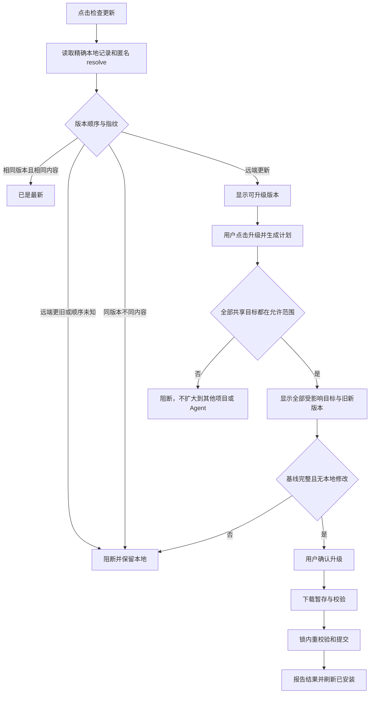
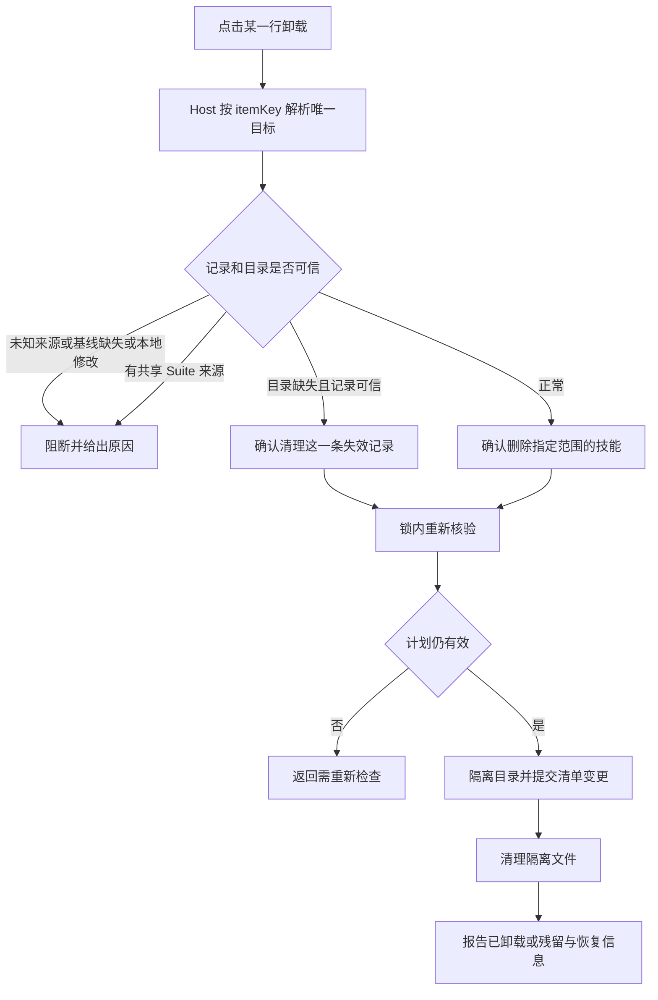
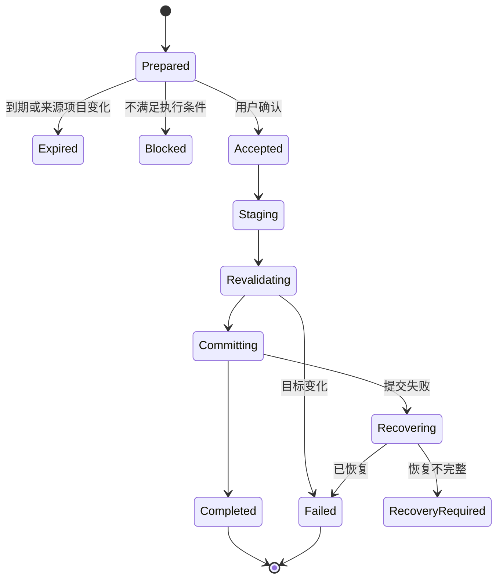
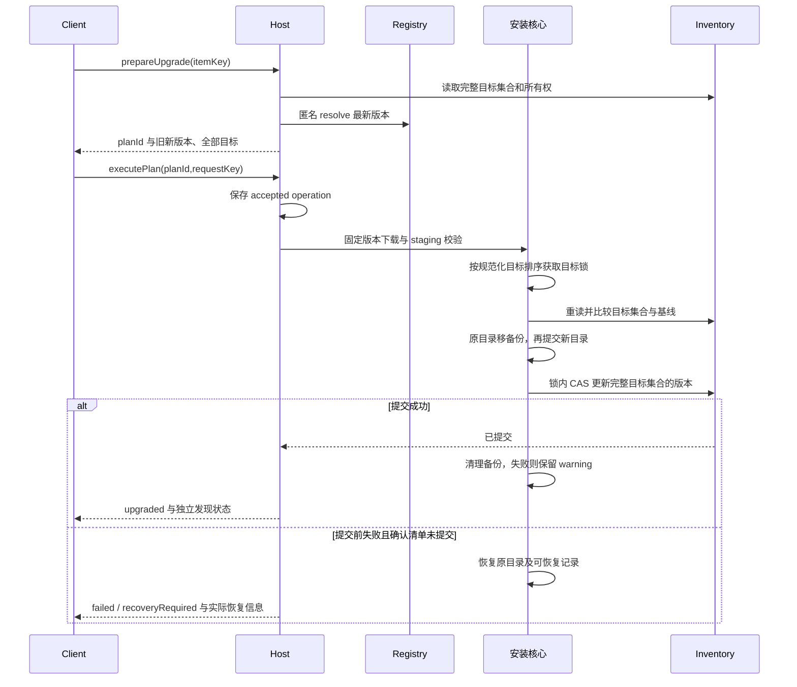
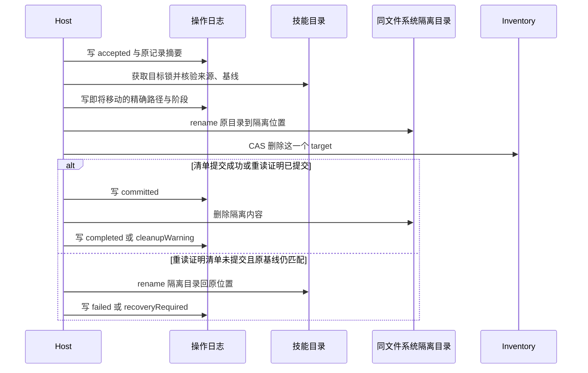
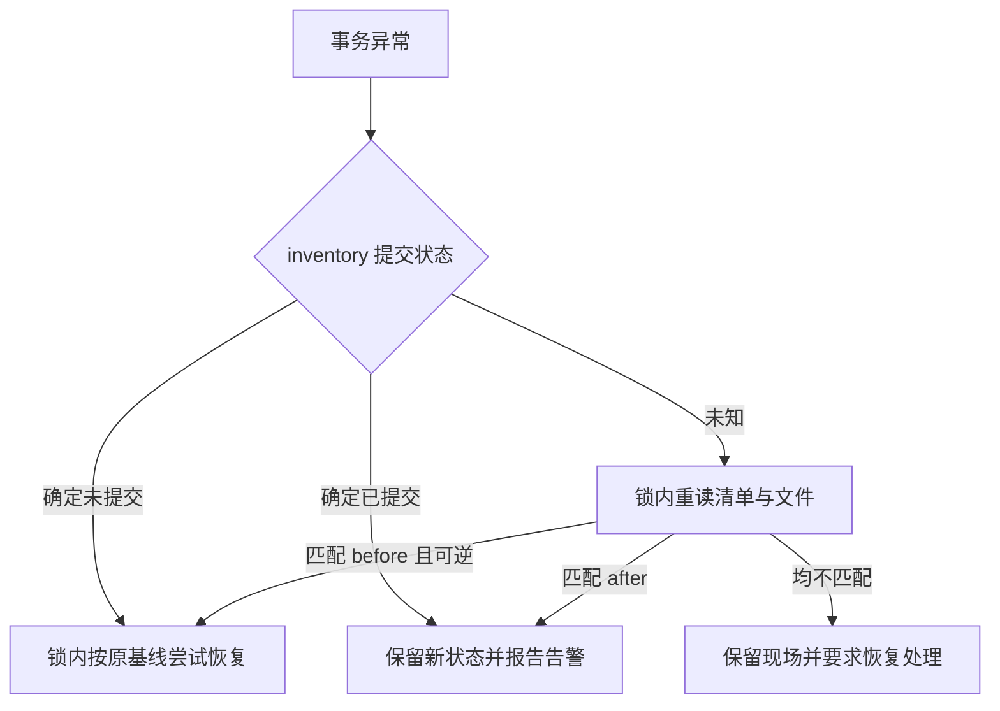

# 安装、升级、卸载：产品规则与执行契约

本文统一定义安装、升级、卸载的产品规则、执行协议、并发控制和恢复机制。

## 1. 精确定义与范围

| 操作 | 改变什么 | 不改变什么 |
| --- | --- | --- |
| 安装 | 一个明确目标新增技能包与记录 | 不覆盖已有目录，不执行包内脚本 |
| 检查更新 | 读取源最新可用版本并比较本地版本 | 不写目录、不自动下载完整包 |
| 升级 | 将确认计划中的已有安装替换为解析时的精确新版本 | 不随执行时 latest 漂移；不降级，不绕过本地修改 |
| 卸载 | 移除一个确认目标的技能目录及对应 inventory target | 不删远端技能，不删除其他目标，不卸载连接插件 |

本期均是用户主动操作，没有自动更新、批量跨技能管理、版本回退、清理未知目录或 Suite 管理。无登录、Token 或权限管理；升级使用匿名 Registry，卸载可以离线完成。保留宿主已有调用边界与策略。

## 2. 已安装页交互

已安装行显示坐标、已装版本、范围、本地状态、更新状态和操作。基础列表只读本地数据，打开页面不对全部条目发起远端更新检查。

| 行状态 | 详情 | 检查更新 | 升级 | 卸载 |
| --- | --- | --- | --- | --- |
| 身份/版本/基线可信，尚未检查 | 可用 | 可用 | 先检查，不能直接提交 | 可进入卸载预检 |
| 已确认新版本可升级 | 可用 | 可重新检查 | 可进入计划 | 可进入卸载预检 |
| 最新且指纹一致 | 可用 | 可重新检查 | 禁用，显示已是最新 | 可进入卸载预检 |
| 远端离线或匿名拒绝 | 本地可用 | 显示失败/重试 | 禁用 | 本地预检通过仍可卸载 |
| 本地文件修改、缺基线或记录失配 | 可用 | 可只读获知版本 | 阻断并给原因 | 阻断，避免删除无法确认的文件 |
| Suite/shared ownership | 可用 | 可只读获知版本 | 本期阻断 | 本期阻断，不能破坏共享来源 |
| 目录已经缺失且记录精确可信 | 本地可用 | 不作为完整安装检查 | 阻断，不能冒充升级 | 变为“清理失效记录”，需明确确认 |
| 操作中/恢复待处理 | 可用 | 不开始同目标检查计划 | 禁用 | 禁用 |

检查更新产生 `unchecked/checking/upgradable/current/blocked/unavailable` 状态及 checkedAt。状态绑定当前来源、安装版本和目标指纹，安装记录变化就失效。用户点击升级时重新生成计划，不能直接执行旧徽标。

已安装详情展示当前本地版本，升级目标版本在计划区单独展示。版本 Tab 仍可只读查看历史，不增加“安装旧版/降级”入口。

## 3. 升级流程与多目标规则

### 3.1 候选版本与比较

使用 Registry `resolve` 返回的最新可用版本，不自行从所有历史版本挑最大值。沿用 CLI `compareSkillVersions`：相同字符串为 same；合法 SemVer 才比较；无法比较返回 unknown，不按字符串排序。远端更旧、不可比较、同版本不同 fingerprint 都阻断。

已发现预发布版本是否可用由现有 Registry resolve 决定；插件不另造“稳定/测试通道”。计划绑定精确版本和 fingerprint；确认后该版本不可下载就失败，不换成另一个版本。

### 3.2 多目标共享版本

现有 inventory 的一个来源+坐标只有一个 version/fingerprint，所有 targets 共用。必须保持这一约束，不在本期悄悄迁移 inventory schema。

- 只有一个目标：升级该行对应目标。
- 同一 inventory item 的所有目标恰好都在本插件可管理范围（当前 DSH 用户级和当前项目），且无共享来源：计划列出全部目标。用户确认的是**这些明确列出的目标一起升级**，不是默认静默扩散。
- 任何 target 属于其他 Agent、其他项目、非可信路径、共享 Suite 或同目录别名风险：返回 blocked；不得自动加入不可见目标，不允许仅升级选中一行导致记录失真。
- 计划检查完整 target set；执行时 inventory 新增/删除目标也会使计划失效，即便选中目录本身没有变化。
- 用户取消计划不下载、不写文件。此处的确认是版本和文件影响确认，不是新的账号授权产品。

### 3.3 升级确认内容

详情页内展开升级计划，显示完整坐标、来源、`旧版本 → 新版本`、每个目标的范围和只读规范化位置、是否存在本地修改、计划有效截止时间，以及“确认升级 / 取消”。超过一个目标时文案必须明确“将升级以下 N 个安装位置”。

正文长时，先完整显示目标清单再确认，不仅显示“升级成功”toast。实现前校验同路径别名去重，不能同目录写两次。

## 4. 卸载流程与影响确认

卸载入口在已安装行和对应详情的次级操作区，点击先预检，再展示确认弹窗。焦点默认落在取消，确认按钮使用破坏性操作样式，弹窗展示来源、坐标、版本、主机、范围和只读目标路径。

文案：“仅删除此安装位置的技能文件及对应记录。不删除 SkillHub 远端技能，不影响其他安装位置。当前正在运行的任务不会被强制终止。”

不调用远端 DELETE。不同于升级，卸载可以只移除一个 target，其余 target 仍沿用原版本，不违反共享版本模型。无 baseline 或检测到本地修改时本期不提供“强制删除”，用户需在外部妥善处理后重新检查。

目录缺失只认明确 ENOENT；权限错误、I/O 错误、符号链接异常不能算“已经不存在”。 判断前须核验安装根仍是原真实目录；Windows 对普通文件下的子路径也可能返回 ENOENT，不能据此清理安装记录。执行提交及恢复时再次检查安装根和隔离根的目录类型。清理失效记录也是独立确认计划，不伪装成删除文件成功。

安装执行已失败且共享核心已退出清理流程时，若日志尚无事务记录，或仅有暂存 intent、无 preparation/移动/清单提交或恢复动作，Host 可在目标锁内验证暂存路径绑定及目录确实不存在，然后记录 failed/not-needed。此核验只更新操作状态，不删除文件、不回滚其他请求；暂存仍在、路径不可信、锁竞争或核验失败仍保留恢复要求。

## 5. 计划协议和并发约束

升级/卸载使用“prepare → 展示影响 → execute”，安装仍保持详情按钮直接开始。三个操作共用一个 MutationOperation 生命周期。

共享安装清单在获取文件锁前，复用目标锁的 acquisition gate 串行化过期锁回收；取得清单锁后释放 gate，清单读改写继续由文件锁保护。两个进程不能同时根据同一份过期状态删除锁，从而覆盖新持有者。清单锁获取使用 10 秒重试预算，既有轮询可能增加一次最多约 1 秒的等待，并叠加文件系统及事件循环耗时；该预算不是严格的时间截止，最后一次尝试若成功仍可返回。超时返回锁忙，仅清理自身排队记录，不删除仍存活的其他竞争者。此保证要求参与进程均采用该 gate；与未包含修复的旧 CLI 并发恢复过期锁时，不声明相同保证。清单格式、原锁路径及事务提交边界保持不变。

| 字段 | 定义 |
| --- | --- |
| planId | Host 生成的不可猜测引用；Client 不提交原始路径 |
| kind | upgrade / uninstall / remove-stale-record |
| sourceRevision | 生成计划时的实例修订，地址切换导致未执行计划失效 |
| identity | Registry 规范化身份、namespace、slug |
| targets | 精确规范化目标集合与范围，来自 Host，不接受客户端自由扩展 |
| before | 本地版本、fingerprint、metadata 快照、当前文件快照、target 所有权与完整 target set |
| after | 升级精确版本/fingerprint；卸载为目标不再存在 |
| expiresAt | 拟定生成后 5 分钟到期；重新生成才可继续，不延长旧计划 |
| status | ready / unchanged / blocked，只有 ready 可执行 |
| blockers | 机器可判定的原因码及可展示说明 |

execute 只接 planId 和 requestKey。Host 对计划、调用上下文、expiry 和参数重放校验，锁内还要比较 before。确认弹窗显示路径用于告知影响；客户端仍不能把路径作为写操作参数。

requestKey 在页面入口由 Client 为一次明确提交生成并保留；在对话入口由可信工具适配层按 Host/会话/toolCallId 生成稳定映射（不由模型输入）；同 key、同操作参数重复请求返回原 operationId，同 key 不同参数拒绝。不能因请求超时换 key 自动再执行。计划提交后不能重复用于另一操作。

UI 离开页面不等于取消已接收操作；不提供提交阶段的取消按钮。插件正常禁用时停止接收新写操作，让已进入提交阶段的操作完成或按日志恢复；进程崩溃按第 7 节处理。

## 6. 升级的文件提交

CLI upgrade 内部会调用 installSkill(force:true)，这里 force 表示受保护的同来源替换，不代表用户可强制覆盖本地变化。本插件生成计划固定 `allowTargetDrift:false`、`requireExistingTargets:true`，并执行所有权和旧版本 CAS。不能仅把 force 改为 true 就认为实现了升级。

## 7. 卸载、日志与恢复

现有 removeLocalSkill 直接 rm 再 removeTarget，不能满足可恢复精确卸载。拟新增内部目标级卸载适配，或收敛现有核心后保留 CLI 旧入口；禁止调用其 Agent 级筛选后误删多个 DSH 目标。

隔离目录须位于目标同文件系统且在 DSH 扫描范围外。拟议例子为 DSH 根下 `.skillhub-trash/<operationId>`，实际位置由可信目标适配器推导；不能放到其他盘或可被技能发现的子目录，EXDEV 不退化为无恢复保证的直接 rm。

操作日志保存在官方解析后的 DSH home 下：`<DSH_HOME>/skillhub/operations/<operationId>.json`，同目录 `host.json` 保存稳定主机身份。该位置与技能发现目录分离；Host 使用官方 home 解析及路径规范化函数，不接收 Client 路径。只记录操作阶段、绑定身份/目标、原 target 记录、版本/指纹摘要、备份/隔离路径；不存凭证、签名下载 URL 或技能正文。原子写入，文件权限沿用宿主受保护状态目录。不新增服务端数据库。

恢复按真实文件与 inventory 状态判断，不只看最后一条日志：

| 恢复观察 | 处理 |
| --- | --- |
| 未开始移动 | 标记失败，可重新预检 |
| 隔离目录存在、原目录不存在、清单仍有原 target | 尝试恢复；若原路径已被别人占用则停止，标 recoveryRequired |
| 隔离目录存在、清单已删除 target | 逻辑卸载完成，报告清理残留，不把记录加回 |
| 原目录和隔离目录都存在，或版本/所有权不符 | 不覆盖、不猜测，报告人工恢复所需的精确位置 |
| 升级日志显示中间状态 | 按原版本、备份、新目录与 inventory 比对；只有确定可逆才恢复 |

Host 启动扫描到的未完成操作，在查询时将 accepted/staging/revalidating/committing/recovering 投影为 unknown，供用户核验并恢复；不据此修改持久日志或断言旧任务仍在运行。当前实例启动后创建的操作维持真实执行阶段，已完成或已恢复的原操作维持终态。其他进程仍持有执行锁时，恢复不得抢占；阶段投影不替代执行锁、目标归属与权限校验。进程强制退出后，尚未过期的锁租约也可能暂时拒绝恢复；此时保留原操作和未确认提示，不显示恢复成功、不自动重放写操作。租约过期后由用户再次明确发起核验恢复。

重启不自动重新下载/升级，也不重放删除。恢复检查在重新取得相同锁后进行；受影响目标处于 recoveryRequired 时拒绝新的写操作。成功且无残留的日志可按拟议 7 天保留期清理；恢复未完成/有残留的日志不自动过期。

### 7.1 不可混淆的提交边界

**inventory CAS 成功是逻辑提交点，后续 committed 日志或清理失败不得恢复旧目录。** journal 是恢复证据，不比真实 inventory 和目标内容更权威。

| 失败窗口 | 文件动作 | 对外状态 |
| --- | --- | --- |
| 移动前的计划/日志写失败 | 停止尚未开始的移动，清理安全暂存 | failed，目标未变 |
| 目录已切换，但确定 CAS 尚未提交 | 在锁内恢复原文件；确认未破坏他人更新 | failed/restored 或 recovery-required |
| CAS 抛异常但结果未知 | 保持现场，锁内重读 inventory 对比 before/after；不能立即恢复 | unknown/recovering |
| CAS 已提交，写 committed 日志失败 | 保留已提交文件和清单，尽力保存告警；不回滚旧目录 | completed＋journalWarning；无法确认则待核验 |
| CAS 已提交，清理备份/隔离失败 | 保留残留并告知精确位置 | completed＋cleanupWarning |
| 重读既不匹配 before 也不匹配 after | 停止自动恢复，不覆盖任何一方 | recovery-required |

对多目标升级，判断必须比较整个确认集合的版本、metadata、文件与清单，不能仅判断第一个目录。恢复日志在变更前已持久保存确定的 backup/staging 路径，因此 committed 日志失败仍可由 precommit 日志和真实状态核验；无可信日志时不猜测删除遗留目录。

## 8. 锁与共享来源

统一顺序为按 canonical lock key 排序的 target locks → inventory lock；CLI 和插件共用 orderSkillTargetLocks，不能各自实现不同排序。锁身份由规范化目标路径生成，路径别名及输入顺序不同也必须得到同一取锁顺序。禁止另一路先持 inventory lock 再等 target lock，避免死锁。取锁前 canonical 去重与冲突检查；由事务核心唯一负责取锁，插件外围不得再持同批锁调用旧 installSkill。网络下载在持目标锁之前进行，提交前重新验证；安装幂等的早期锁检查完成后释放，再下载。

Inventory 变更必须在 mutateAtomic 的最新快照里比较旧身份、版本、完整目标集合和 installedBy，不能用预检读到的旧 inventory 覆盖他人更新。沿用 schema，无 target 粒度版本字段。

`targetInstalledBy` 非单一 direct 的目标视为共享来源，本期升级与卸载均阻断。缺失 installedBy 按现有 CLI 的 legacy direct 语义读取，但 metadata/文件基线缺失仍阻断。任何 canonical path 不同来源记录共享、符号链接逃逸或目录重定向均需停止变更。

## 9. 结果反馈与验收

结果包含 operationId、kind、受影响目标、旧新版本、files 状态、recovery 状态、warnings 与 discovery。卸载后只能承诺该目标移除；同名技能可能由项目/用户/其他 provider 继续提供，不能显示“DSH 中已彻底删除”。运行中的任务不强制终止，不能承诺撤销已加载内容。

验收至少覆盖：单目标升级；两个允许目标一起升级且确认完整；外部目标阻断；无新版本；版本不可比较；同版本变内容；本地修改；Suite 共享；下载/指纹失败；确认后变化；双击；响应丢失；目录移走后清单失败；清理隔离失败；重启恢复；精确单目标卸载；离线卸载；ENOENT 与 EACCES 区别。

## 10. 两入口的持久操作归属

操作日志同时持久化 OperationContext、requestKey 的调用归属和原始参数摘要，字段以接口分册第 10 节为准。Host 重启后先查已接受记录再验证新写 token；恢复原操作引用不受旧 token 内存记录消失影响，也不得开始第二次文件变更。缺日志、不同 Host 或参数冲突按 unknown/拒绝处理，不把自动重试当成新授权。
