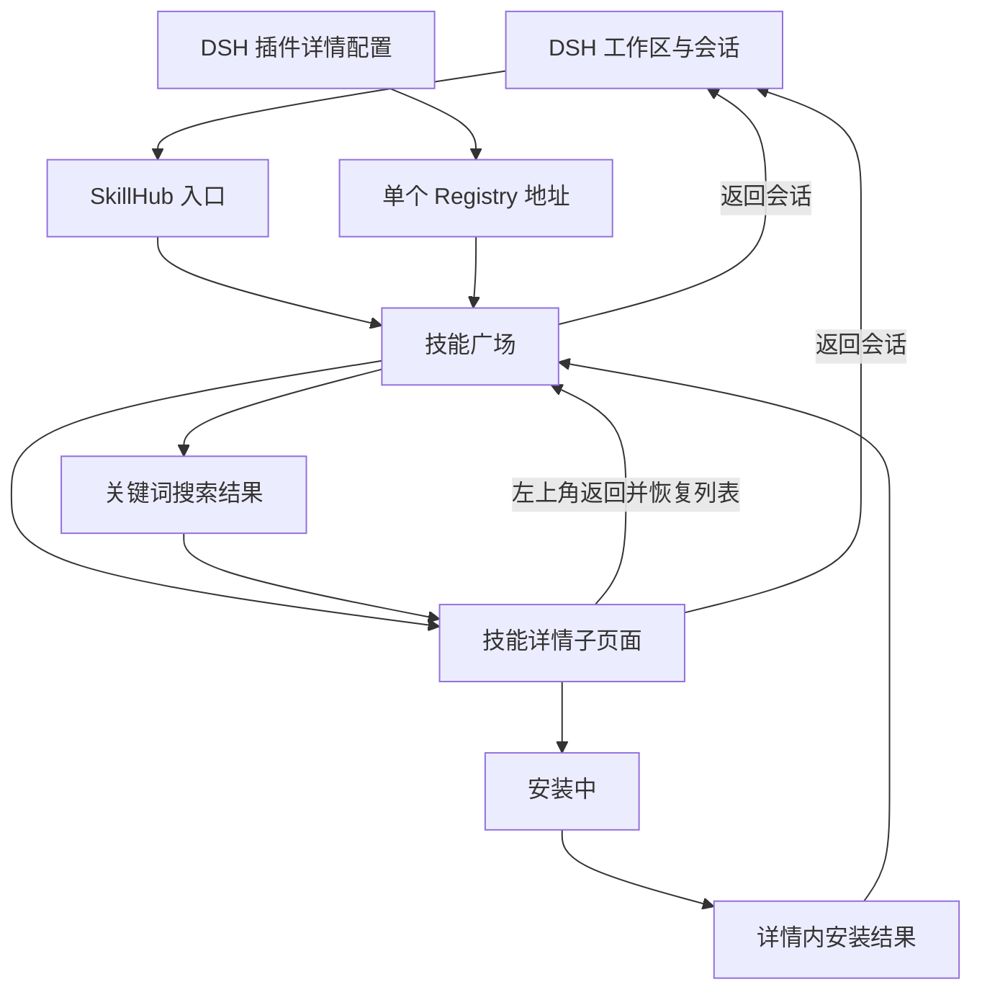
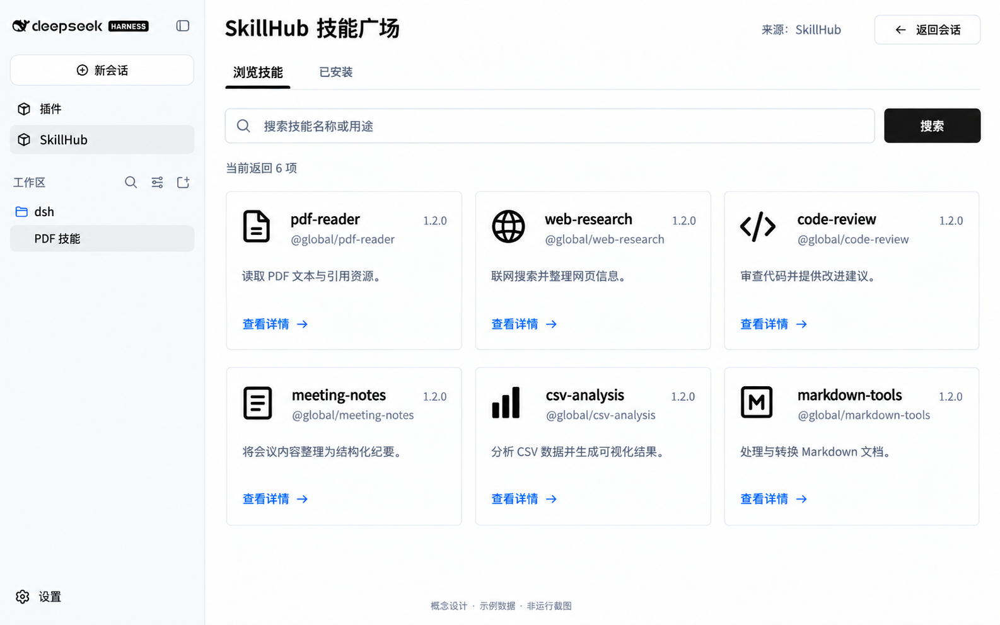
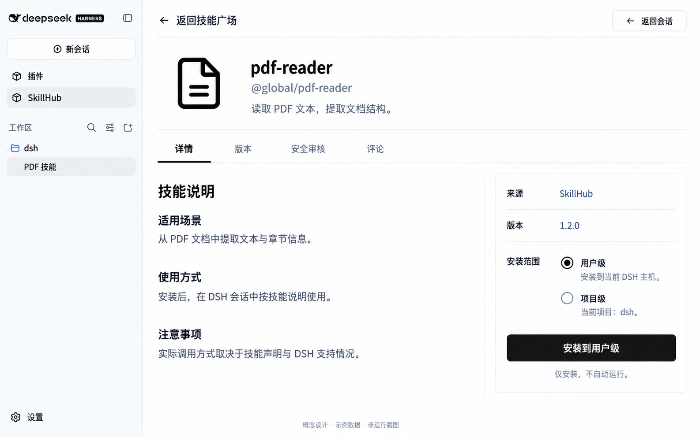
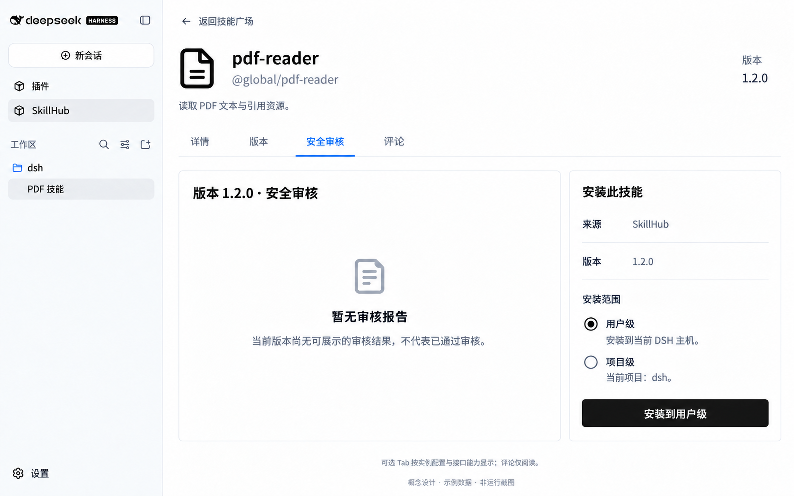
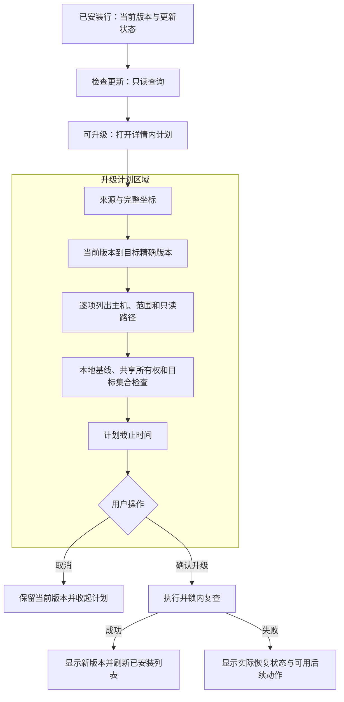
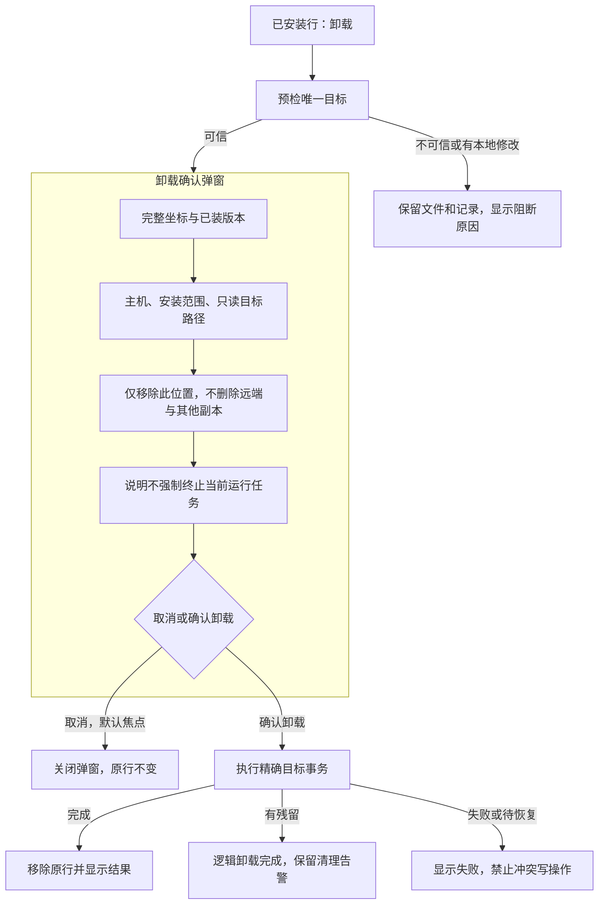
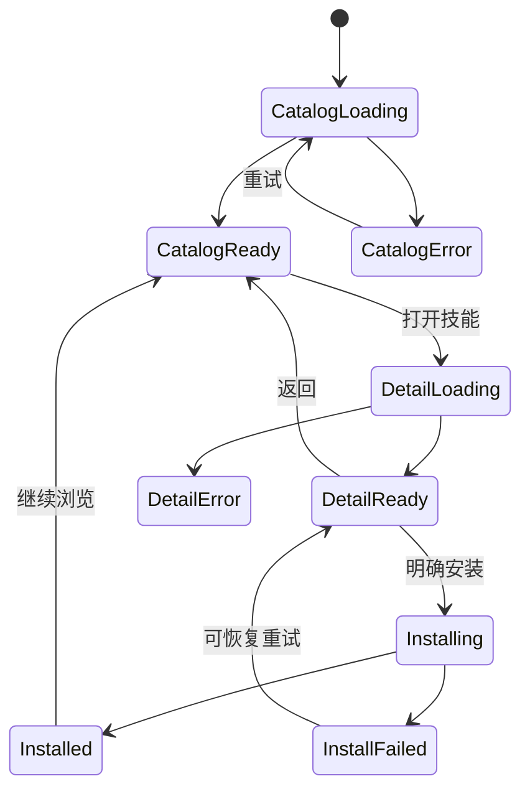

# SkillHub for DSH：产品与需求详细规格

版本：1.0；文档类型：产品需求与交互设计。

本文是产品与需求阅读入口；整套文档导航与维护规则见 [README](README.md)，功能到证据映射见 [验收追踪](acceptance.md)。

| 阅读目的 | 对应文档 |
| --- | --- |
| 产品定位、交互、页面图、功能与验收 | 本文第 1–12 节 |
| 对话搜索卡片、详情抽屉、安装工具与结果 | [conversation-design.md](conversation-design.md) |
| 原生包、工具/UI、构建及实施切片 | [engineering-blueprint.md](engineering-blueprint.md) |
| 整体方案、模块边界、数据流与风险 | [design.md](design.md) |
| 已有 REST、拟议跨端接口、DTO、Tab 配置与错误 | [interface-design.md](interface-design.md) |
| 文件职责、安装复用改造、状态与测试拆分 | [implementation-design.md](implementation-design.md) |
| 升级/卸载交互、目标规则、操作计划和恢复 | [lifecycle-design.md](lifecycle-design.md) |
| 参考资料采纳、DSH Bundle/Remote/Slot 接入 | [dsh-integration-design.md](dsh-integration-design.md) |
| 可执行任务和验证证据 | [tasks.md](tasks.md)、[verification.md](verification.md) |

完整技术设计由同一 OpenSpec change 内的 [架构方案](design.md)、[接口设计](interface-design.md)、[实现设计](implementation-design.md)、[任务清单](tasks.md)、[验收规格](specs/dsh-skill-consumption/spec.md)组成，不另建第二套需求来源。

## 1. 产品定义和范围

### 1.1 一句话定义

在 DSH 内安装 SkillHub 原生插件，获得一个可匿名浏览、搜索、查看详情、安装、升级和卸载技能的 **SkillHub 技能广场**。用户完成安装后回到原会话，由 DSH 使用技能。

SkillHub 网站负责发布、审核与维护内容；Registry 提供技能数据与包；插件负责发现与安装入口；DSH 负责工作区、会话、发现和执行。插件没有自己的聊天页，也不替换 DSH 的模型和会话；通过宿主工具和自定义结果卡片接入现有对话。

### 1.2 用户与场景

| 用户场景 | 用户目标 | 本版提供 |
| --- | --- | --- |
| 首次使用 | 看看有哪些技能可以使用 | 打开即展示真实技能列表，无登录步骤 |
| 已有明确任务 | 找到某类技能，例如 PDF 文本提取 | 关键词搜索、用途摘要和详细说明 |
| 安装前判断 | 确认技能内容、版本与安装位置 | 独立详情页及明确的范围选择 |
| 完成安装 | 知道是否装好，回到任务继续工作 | 文件安装与 DSH 发现分别反馈，返回会话 |
| 远程运行 DSH | 将技能装到远程 DSH 而非本机浏览器 | 明确显示当前 DSH 主机与可信目标 |

### 1.3 必做与不做

| 本期必须交付 | 明确不在本期 |
| --- | --- |
| DSH 原生包、一个 SkillHub 入口 | DSH 插件市场、网站重构 |
| 匿名列表、关键词搜索、详情 | 登录、Token、私有访问、账号与权限管理 |
| 默认用户级，可选可信当前项目 | 任意安装路径、多目标批量安装 |
| 完整安装、主动升级、精确卸载、冲突保护 | 自动更新、降级、强制覆盖本地修改 |
| 一个来源地址的必要配置 | 多来源聚合、认证中心、收藏和排行榜 |
| 对话搜索卡片、详情抽屉、显式安装工具、结果卡片 | 自动发现后安装、模型自主升级卸载 |
| 已安装管理、可选版本/审核/评论 Tab | 发表评论、扫描触发、自动运行技能、自动重启 |

“只做浏览和安装”仍包括完成安装所必需的错误反馈和文件保护。服务端和宿主现有策略继续生效；插件不建设权限产品，也不绕过拒绝。

### 1.4 产品成功条件

用户无需登录或手工安装 SkillHub CLI，能够在 DSH 内完成一条真实技能的浏览、详情、安装和返回会话路径。验收覆盖技能包完整性、安装记录一致性、宿主发现与后续使用。

## 2. 交互形态选择

广场入口选用 **主内容区内独立详情子页面，左上角返回技能广场**；对话入口新增 **详情抽屉**，窄屏改为内容区全宽浮层。以下比较仅适用于广场；对话交互以 [对话设计](conversation-design.md) 为准。

| 方案 | 好处 | 限制 | 本版决定 |
| --- | --- | --- | --- |
| 居中弹窗 | 打开快，保留背景 | 长说明与安装状态容易挤在小区域，窄屏需重做 | 不采用 |
| 右侧抽屉 | 可以快速比较列表项目 | 占用已有 DSH 面板空间；长说明阅读宽度不足 | 暂不采用 |
| 详情子页面 | 阅读完整，安装状态稳定，窄屏自然适配 | 返回多一步 | 采用；保留列表状态弥补切换成本 |

这里的子页面是 SkillHub 主面板内部的页面状态，不是跳到外站，不默认创建浏览器全局路由，不替换 DSH 会话。详情中的安装信息卡只是页面内容，不是宿主右侧抽屉。

## 3. 信息架构和导航

- 宿主侧栏持续显示品牌、工作区和会话；增加一个 SkillHub 入口。
- 广场上方显示 SkillHub 技能广场、来源、返回会话。
- 详情左上角显示“返回技能广场”，右上角保留“返回会话”。两者不同：前者回目录，后者离开插件主面板。
- 广场常驻“浏览技能 / 已安装”两个 Tab；不设插件市场和账号入口。详情常驻“详情”，版本、安全审核、评论按实例配置显示。
- 从目录返回详情、返回会话再打开 SkillHub，当前 Client 生命周期内保留查询与浏览位置；浏览器刷新后重新加载，不承诺持久化页面历史。
- 没有活动会话时不显示“返回会话”按钮；用户可用宿主“新会话”。

## 4. 页面 P1：技能广场

### 4.1 页面区域

| 区域 | 内容 | 规则 |
| --- | --- | --- |
| 标题栏 | 标题、来源、返回会话 | 来源是配置实例的显示地址/标签；无登录状态 |
| 搜索区 | 输入框、清空、搜索按钮 | Enter 与按钮行为一致；按提交查询，不逐字触发网络请求 |
| 结果说明 | 当前返回 N 项 | 如 total 可信且大于 N，可写“共匹配 T 项，当前显示 N 项” |
| 卡片网格 | 图标、slug/名称、完整坐标、摘要、版本、查看详情 | 卡片不提供安装按钮，避免跳过判断 |
| 空/错误区域 | 原因与恢复动作 | 不用空列表掩盖接口错误 |

### 4.2 卡片字段

- 标题默认使用 CLI 返回的 slug。未来有可靠 displayName 时可展示标题，但始终保留 `@namespace/slug`。
- 摘要最多显示三行，完整内容在详情页查看；空摘要显示“暂无简介”。
- 版本来自服务端可安装发布版本，不把更新时间或包名当版本。
- 图标是界面装饰，不表示已验证或技能分类；默认统一文件图标，不凭 slug 推断权威类别。
- 不展示无接口支撑的评分、认证、下载量、作者头像、推荐理由。
- 浏览列表不逐卡读取本地目录；切入“已安装”Tab 时查询限定范围的本地记录，安装冲突判断才检查完整内容。

### 4.3 浏览与搜索规则

初始查询使用空关键词，默认返回 20 项。该数值来自现有 CLI 默认 limit，是本版设计默认值，不是全库上限。当前服务实现固定 `newest`、第 0 页；不提供用户可选排序或“加载更多”按钮。

搜索前去掉首尾空白；新查询提交后中止旧查询或忽略其响应。结果键包含来源版本和关键词，旧来源的成功响应不能覆盖新来源界面。清空并提交恢复初始列表。

当匹配数超过返回范围，显示范围说明并建议更具体的关键词。后续如果产品要求遍历整个目录，再扩展分页契约；本版不把一次返回 20 条说成全目录浏览。

## 5. 页面 P2：技能详情子页面

### 5.1 布局

主内容区整体切换为详情页面，保留 DSH 外壳。上方是返回导航、技能身份与“详情 / 版本 / 安全审核 / 评论”Tab；默认正文是技能说明，右侧为页面内部安装信息卡。窄窗口按“身份 → 说明 → 安装”单列排列。安装信息卡不固定覆盖正文。

### 5.2 内容和数据规则

| 信息 | 来源与规则 |
| --- | --- |
| 名称、坐标、摘要 | 搜索快照先展示；详情返回后校正，不修改所选身份 |
| 安装版本 | 打开详情时 resolve 一次获得精确版本；后续文档与安装绑定该版本 |
| 技能说明 | 读取该版本 SKILL.md，安全渲染 Markdown；保留技能原文，不用 AI 自动补写功能 |
| 使用方式/注意事项 | 原文有才展示；图片中的章节仅为示例，不要求后端返回这些独立字段 |
| 来源 | 当前配置实例，不展示内部带查询参数的下载链接 |
| 安装范围 | 用户级默认；当前项目可确认时提供项目级 |
| 可安装性 | 目标检查、包兼容性及下载可能分别失败，详情可读不等于可安装 |

说明缺失或读取失败时显示“详细说明暂不可用”及重试。只要精确版本 resolve 可用，可继续尝试安装；安装仍需完整包校验。若技能本体变为不可访问或 resolve 失败，则禁用安装。

Markdown 不执行 HTML/脚本；外部链接明确打开新页面，阻止危险 URL scheme；首版不自动加载远程图片，避免查看说明产生额外网络跟踪。相对资源预览不在本期，不影响完整包安装。

### 5.3 详情 Tab 规则

| Tab | 展示内容 | 版本语义与限制 |
| --- | --- | --- |
| 详情 | 摘要与 SKILL.md | 当前详情固定版本的说明，常驻 |
| 版本 | 版本号、发布时间、发布说明、可下载状态，实际分页 | 首版只读历史，不提供任意降级或切换安装版本；升级通过已安装目标计划完成；查看发布说明不改变当前详情的版本 |
| 安全审核 | 扫描器、审核时间、结论与发现项，按实际字段 | 只属于当前版本；无结果不等于安全；不能触发扫描 |
| 评论 | 公开作者显示名、评分、正文、时间和分页 | 现有接口按技能聚合，不伪装成版本专属评论；不提供输入框、回复、点赞或删除 |

版本、安全审核、评论支持 `auto / show / hide` 实例级配置，放在宿主插件配置内。开源和 SaaS 使用同一插件，不按产品名称硬编码。比如 SaaS 未上线评论时设置 hide，开源实例可在匿名读取已验证后 auto 展示。

`auto` 只有确认支持匿名读取才展示；`show` 保留入口但错误仍如实展示；`hide` 不展示且不请求。空数据保留 Tab 并显示“暂无版本/评论/审核报告”，网络错误保留重试。未知能力不能被当作“没有数据”。 auto 探测未确认时，在详情内容上方说明对应模块尚未确认，并提供“重新检查可选内容”；点击重新读取当前固定版本详情并探测未确认模块。确认可用后显示对应 Tab，正文仍在激活时读取。详情永不隐藏；隐藏当前选中 Tab 后回到详情。详见 [接口配置规则](interface-design.md)。

**当前源码限制：安全审核 Controller 明确拒绝匿名访问。** 默认 auto 下隐藏；显式 show 时显示“当前来源的审核信息不支持匿名读取”。本期不改后端访问政策、不增加登录。下图展示可选模块已启用且可匿名读取、但当前版本暂无报告的假设实例，不代表当前仓库已经支持匿名审核。

### 5.4 安装范围

- 用户级：“安装到当前 DSH 主机”。实际目标由 Host 解析，不能在浏览器拼接 home。
- 项目级：“仅用于当前项目：项目名”。没有可信项目根时禁用，并解释“当前没有可用项目”。
- 项目切换后旧目标失效，安装按钮提示重新确认当前目标；不能悄悄把旧项目的操作迁到新项目。
- 首版一次只安装一个目标，不做“全部 Agent”或 Suite 整套安装。

### 5.5 安装提交

按钮显示“安装到用户级”或“安装到当前项目”。用户点击即表示对显示版本和目标的安装请求，不加自建二次确认弹窗。DSH 自身要求的策略步骤仍由宿主处理。

如果安装时最新发布版本发生变化，仍安装详情已显示的精确版本；若该版本已撤销，则报错并提供刷新详情，不静默安装另一个版本。

## 6. 页面 P3：安装过程与结果

安装过程与结果遵循以下状态规则。

结果在详情页内展示，不用短暂 toast 作为唯一凭据；安装成功同时刷新“已安装”Tab。

### 6.1 安装过程

| 阶段 | 用户文案 | 行为 |
| --- | --- | --- |
| 接收与检查 | 正在检查安装条件… | 禁用重复安装与范围切换 |
| 下载 | 正在下载技能… | 没有字节证据不显示虚假百分比 |
| 校验 | 正在检查技能包… | 包错误保持目标不变 |
| 提交 | 正在安装… | 锁内重校验并写文件与记录 |
| 完成 | 已安装 | 分别展示文件与发现状态 |
| 失败 | 安装失败：原因 | 恢复信息和可用动作 |

现有核心尚无完整阶段事件，若不增加观察钩子，实现只显示可信的“正在安装…”而非伪造阶段。首版不提供取消安装按钮，避免用户以为已撤销实际提交。

返回目录或会话不取消已接收安装；Host 在当前进程中完成工作，Client 再次进入详情可查询结果。插件禁用或 Host 重启导致未确认完成时，下次通过文件和记录重新核验，不将未知状态自动重试为第二次写入。

### 6.2 成功与异常矩阵

| 状态 | 文案与动作 |
| --- | --- |
| 文件与记录已提交，DSH 已发现 | “已安装”“DSH 已发现”；返回会话或继续浏览 |
| 安装已完成但发现不可确认 | “已安装”“尚未确认 DSH 发现”；不声称已加载或执行 |

发现状态展示最近核验时间，以“上次核验时”描述确认结果。广场安装、升级及对话安装结果均提供“刷新发现状态”，只查询原操作，不重新安装、升级或调用模型。刷新期间显示核验中；资源变化或已卸载后可能转为未确认，原文件操作完成结果仍保留。完成操作不持续轮询，历史结果不承诺当前仍安装。
| 相同版本完整存在 | “已安装”；不重复下载覆盖 |
| 目标被其他版本/来源/文件占用 | “安装位置已有内容，本次未覆盖”；返回浏览或进入该目标的受保护升级预检，不提供强制按钮 |
| 源要求身份 | “当前内容无法匿名访问，首版暂不支持登录”；无登录引导 |
| 429 | “请求过于频繁，请稍后重试”；尊重可用的 Retry-After，不自动循环请求 |
| 网络/下载中断 | 保留技能、版本与目标，提供手动重试 |
| 不兼容 DSH | 展示具体原因，不重命名或重写技能包 |
| 部分恢复失败 | 明确“未完全恢复”，显示可复制诊断信息；不显示“已回滚” |

## 7. 页面 P4：已安装 Tab

此页回答“装了哪些、装在哪里、是否可更新、如何移除”。页面使用表格，字段为技能坐标、已安装版本、范围、本地状态、更新状态和操作。每行提供详情、检查更新、升级和卸载；可用性取决于身份、基线和计划检查。顶部提供本地关键词过滤和刷新，不自动检查全库更新。

默认显示当前来源在用户级与当前项目的可识别 SkillHub 安装，明确范围说明，不声称列出 DSH 全部技能。数据来自 inventory、目标 metadata 和文件存在性；没有访问远端也能显示本地记录，并可在本地预检通过后精确卸载。其他来源和无法确认身份的技能不混入。相同技能的两个目标分行展示。

“文件存在”不等于完整性校验通过或 DSH 已发现。清单残留、目录缺失、记录不一致须显示异常，不直接删除记录。读取部分失败时展示已读结果并说明不完整，不当作空列表。只有完整读取且零条目时显示“还没有从当前来源安装技能”，提供“浏览技能”。

打开已安装条目的详情绑定本地安装版本；远端不可达时仍保留坐标、版本、目标，显示远端详情不可用。同版本完整存在时显示已安装；其他版本占用时仅在独立升级预检通过后提供升级操作。返回恢复“已安装”Tab 的筛选与滚动位置。同一 Client 生命周期内，从已安装详情返回会话再进入 SkillHub，保留所选详情；在浏览与已安装之间切换保留本地筛选。该导航状态绑定会话及来源修订，两者任一变化均重置筛选和所选记录，不跨上下文恢复旧操作页面，也不将页面恢复当作写操作确认。浏览器刷新不承诺保留这些导航状态。

### 7.1 升级与卸载交互

- “检查更新”仅比较版本与本地状态，不改文件。检查结果显示时间，点击升级前重新生成不可变计划。
- “升级”在详情内展示旧版→新版、全部受影响安装位置和检查结果；确认后执行。现有 inventory 多目标共用版本，不能静默只升级其中一个；完整规则见操作分册。
- “卸载”针对选中一行，预检后弹窗显示坐标、版本、主机、范围和只读路径；用户确认后移除精确目标，不调用 Registry 删除接口。
- 本地修改、未知来源、缺失基线、Suite 共享、目标变化都要阻断；不提供强制覆盖/强制删除。
- 升级/卸载结果留在页面；刷新已安装条目和详情版本，发现/加载状态单独报告。

完整决策表、5 分钟计划时效、共享目标约束、文件事务与失败恢复见 [生命周期详细设计](lifecycle-design.md)。

### 7.2 升级计划：界面与动作关系

用户从已安装行进入详情中的升级计划，先看清版本与所有目标，再提交。

生成计划后焦点进入取消按钮；计划阻断或无需升级时进入返回按钮。取消或返回后恢复到生成计划按钮，倒计时刷新不抢占焦点。计划阻断时不显示可点击的确认按钮；原因显示在目标清单旁。计划生成后如果用户切换来源或当前项目，页面保留失败原因并要求重新检查，不静默更新旧计划的目标。取消只取消未提交计划；已进入提交阶段没有“取消”操作。

### 7.3 卸载确认：字段和分支

目录已明确不存在时，弹窗标题与主按钮改为“清理失效记录”，不使用“确认卸载”暗示有文件被删除。确认按钮带明确动作名，不使用含糊的“确定”。关闭弹窗恢复焦点到触发行；成功后原行消失则移到列表标题，并播报实际结果。

## 8. 功能需求清单

| ID | 功能 | 输入/触发 | 输出/验收 |
| --- | --- | --- | --- |
| F01 | 原生入口 | 安装并启用插件 | 宿主内可打开 SkillHub |
| F02 | 匿名来源 | 一个 Registry 地址 | 匿名查询，不复用 CLI Token/Cookie |
| F03 | 初始列表 | 首次打开、清空查询 | 实际列表与真实结果范围 |
| F04 | 搜索 | 提交关键词 | 正确结果或明确空/错误状态 |
| F05 | 详情导航 | 点击卡片 | 子页面及左上角返回，原列表状态保留 |
| F06 | 详情读取 | 坐标与来源 | 精确版本、摘要、可用原文说明 |
| F07 | 目标选择 | 用户级/当前项目 | Host 验证目标，不接受任意路径 |
| F08 | 完整安装 | 明确点击 | 包、资源与记录一致提交 |
| F09 | 冲突保护 | 同名/本地修改/并发 | 不覆盖，反馈原因 |
| F10 | 结果反馈 | 安装终止 | 文件、发现、失败恢复分开表达 |
| F11 | 返回会话 | 用户点击 | 原会话不被替换，不自动执行 |
| F12 | 来源变更 | 原生插件配置保存 | 旧查询/详情/未提交计划失效 |
| F13 | 已安装列表 | 切换 Tab/刷新 | 来源与目标范围明确，异常和不完整可见 |
| F14 | 详情模块 | 选择详情 Tab | 版本/审核/评论按真实数据呈现，懒加载 |
| F15 | 模块配置 | auto/show/hide | 实例差异可配置；不绕过匿名限制 |
| F16 | 检查更新 | 已安装行主动点击 | 版本/指纹/可升级性与检查时间，不修改文件 |
| F17 | 主动升级 | 确认精确版本和目标计划 | 无本地修改，同来源受保护替换与恢复 |
| F18 | 精确卸载 | 确认单目标计划 | 删除该目录/记录，不删除远端或其他目标 |
| F19 | 恢复与状态查询 | 响应丢失或 Host 重启 | 同 key 去重、日志核验，不自动重放写操作 |
| F20 | 对话搜索 | 用户提出寻找技能需求 | 原生工具返回可点击卡片；不自动安装 |
| F21 | 对话详情 | 点击搜索卡片 | 抽屉保留会话，共用详情 Tab 和安装状态 |
| F22 | 对话安装 | 明确安装意图或点击安装 | 共享 Host 操作，持续结果卡片及 operationId |
| F23 | 历史卡片 | 重开对话、来源或项目变化 | 显示原上下文，写操作前重验，不自动重放 |

## 9. 视觉、响应式与可访问性

沿用宿主字体、颜色变量、焦点样式和组件，不引入一套独立 SaaS 主题。主按钮黑色、辅助按钮描边、错误用文字与图标双重表达。图片仅展示浅色参考，实际主题随宿主变化。

以主内容区可用宽度布局：宽屏三列卡片、中等宽度两列、窄屏一列；具体断点在实际宿主验证后确定。详情有足够空间时正文与安装信息两列，否则单列，不占用宿主右侧会话面板。

卡片使用一个明确的可访问打开动作，避免按钮嵌套；详情打开聚焦标题，返回后聚焦原卡片；搜索结果与安装结果通过温和的状态区域播报。长坐标允许换行或复制，不截断唯一身份。中文与英文均需验证长文本。

## 10. 状态和上下文设计

安装/升级/卸载状态由 Host 持有，与页面显示状态分离。安装中返回目录不表示任务取消；界面保留该 operation 的引用。错误重试前须再次验证来源与目标，不能重复使用过期计划。

## 11. 非功能要求和验收方法

| 维度 | 设计要求 | 验证方式 |
| --- | --- | --- |
| 完整性 | 归档、资源、指纹和记录一致 | 带资源测试包＋文件/记录比对 |
| 匿名性 | 不发送认证头、不读 CLI 凭证 | Host HTTP 捕获和测试断言 |
| 导航 | 子页面往返不丢查询和焦点 | 真实 DSH 浏览器操作 |
| 并发 | 双击和 CLI 并发不能覆盖目标 | 并发安装/修改测试 |
| 健壮性 | 错误与空结果分离，旧响应不串页 | 延迟、断网、来源切换测试 |
| 可观测性 | 关联请求与安装操作；不输出包内容和敏感链接 | 错误日志审查 |
| 性能 | 不下载全部技能、不逐卡本地扫描 | 查看打开目录的请求数量与包流量 |
| 平台 | Linux/macOS/Windows DSH Web | 分平台记录实际结果，未覆盖不声称通过 |

## 12. 相关设计

界面示例中的技能名称、版本和数据仅用于说明布局。功能行为以本规格为准，页面采用 DSH 宿主主题与组件。

- [对话交互](conversation-design.md)
- [整体架构](design.md)
- [接口设计](interface-design.md)
- [详细实现方案](engineering-blueprint.md)
- [安装、升级与卸载](lifecycle-design.md)
