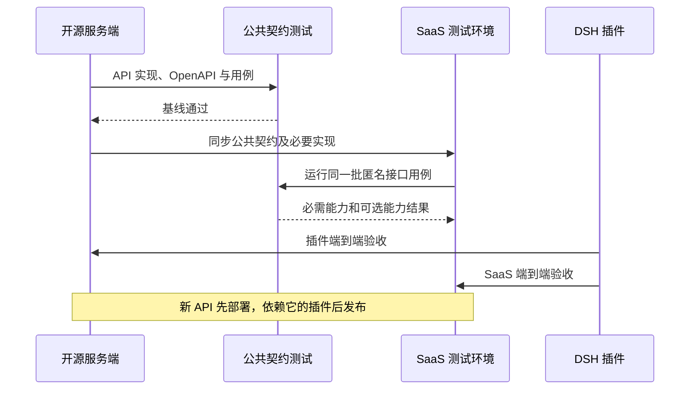

# Registry API 契约与开源 / SaaS 同步方案

## 1. 接口分层

| 接口层 | 调用方与服务方 | 发布位置 | SaaS 是否需要同步 |
| --- | --- | --- | --- |
| Registry HTTP API | 插件 Host → SkillHub 服务端 | 开源及 SaaS 后端 | 需要，共享对外契约 |
| 插件 Remote API | DSH Client → 插件 Host | 插件 npm 包 | 不需要部署到 SaaS |
| 对话工具 | DSH Agent → 插件 Host | 插件 npm 包 | 不需要部署到 SaaS |
| 本地安装核心 | 插件 Host → 文件系统 | 插件 npm 包 | 不需要服务端安装接口 |

服务端提供技能数据与包，安装、升级和卸载在 DSH 主机完成。无需新增让 SaaS 操作用户本机目录的接口，也无需服务端创建安装任务。

## 2. 开源先行原则

公共契约在开源仓库定义、实现并验证，再同步到 SaaS。插件始终依赖同一组路径、参数、响应和错误语义，不按“开源/SaaS”名称判断功能。

同步内容包括 Controller/DTO、业务规则、OpenAPI 描述、契约测试和必要的数据迁移，不只复制路由方法。SaaS 可采用不同存储和内部模块，但其公开响应必须满足同一契约。

已有端点优先复用。首期不为 DSH 再建一套同义 API；新增接口须有现有契约无法满足的明确需求。

## 3. 首期接口基线

详细字段见 [接口设计](interface-design.md#2-已有-registry-rest-接口)。

| 能力 | 接口基线 | 兼容要求 |
| --- | --- | --- |
| 浏览 / 搜索 | GET `/api/cli/v1/skills/search` | q 可选；返回真实 items/total/limit；不假设有翻页参数 |
| 解析安装版本 | GET `/api/cli/v1/skills/{namespace}/{slug}/resolve` | 版本和 fingerprint 固定；不能在下载时静默换版本 |
| 读取元信息 | GET `/api/v1/skills/{namespace}/{slug}` | 坐标与 skillId 语义一致，保留可匿名读取范围 |
| 读取说明 | GET `/api/v1/skills/{namespace}/{slug}/versions/{version}/file?path=SKILL.md` | 原始内容流，不包装成 JSON data |
| 下载包 | GET `resolve.downloadUrl`；当前开源返回 `/api/v1/skills/{namespace}/{slug}/versions/{version}/download`，另提供 CLI 同义下载路由 | 不硬编码重建下载地址；完整 ZIP 或受支持的对象存储跳转，与 resolve 指纹一致 |
| 版本历史 | GET `/api/v1/skills/{namespace}/{slug}/versions` | 可选详情模块，分页与版本字段一致 |
| 评论 | GET `/api/v1/skills/{skillId}/reviews` | 可选、只读、技能级评价；未上线可隐藏 |
| 安全审核 | GET `/api/v1/skills/{skillId}/versions/{versionId}/security-audit` | 可选、版本级报告；保留服务端访问策略 |

当前安全审核接口拒绝匿名访问；不因 API 同步而自动开放。若要公开审核摘要，须另行定义可公开字段与读取契约。

### 3.1 SaaS 同步核对表

首期插件复用以下现有实现；目前没有为 DSH 新增服务端路由或数据迁移。SaaS 同步时按消费契约逐项对照，不要求复制开源的内部服务结构。

| 能力 | 开源实现入口 | 插件消费约束 |
| --- | --- | --- |
| 搜索 | `CliSkillController.search`、`CliSkillAppService.search` | `data.items` 中的 namespace、slug、latestVersion、summary；limit 为实际上限，total 不能伪造；空结果仍返回数组 |
| 解析 | `CliSkillController.resolve`、`CliResolveResponse` | namespace、slug、version、versionId、fingerprint、downloadUrl；请求精确版本时响应必须一致 |
| 元信息 | `SkillController.getSkillDetail`、`SkillDetailResponse` | id、namespace、slug、displayName、summary；不向插件透传管理权限作为业务授权 |
| 版本 | `SkillController.listVersions`、`SkillVersionResponse` | `PageResponse` 的 items/total/page/size；消费 version、changelog、publishedAt、downloadAvailable；nullable 字段保留 null 语义 |
| 评论 | `SkillReviewController.list`、`SkillReviewResponse` | id、score、createdAt；displayName/reviewText 可省略或为 null，插件转为空字符串；不得依赖 userId/moderationReason 等非公开字段 |
| 说明 | `SkillController.getFileContent` | 固定版本的原始 UTF-8 内容；开源响应类型为 application/octet-stream，不能要求 JSON 包装或必须 text/plain |
| 下载 | `SkillQueryService.resolveVersion`、`SkillController.downloadVersion` | 使用返回地址；验证对象存储跳转、下载限制、完整 ZIP 和 fingerprint 一致性 |
| 审核 | `SecurityAuditController` | 保留匿名拒绝，不为满足可选 Tab 放开服务端策略 |

同步验收分两层：先运行服务端 Controller 测试与插件匿名契约脚本，再在目标 DSH 中安装并使用带资源的测试技能。MockMvc 使用模拟业务服务，不证明数据库、对象存储、网关或部署配置可用；只有目标实例测试通过后才能将该实例标为已支持。

### 3.2 本次交付的同步范围

| 交付项 | 开源侧状态 | SaaS 执行动作 |
| --- | --- | --- |
| 服务端路由、业务行为、数据库迁移 | 本次插件接入未新增或修改 | 对照 §3.1 核验现有实现；缺项才补齐，不新增本地安装任务接口 |
| OpenAPI 描述与生成类型 | CliResolveResponse 必需字段、SkillVersionResponse nullable、固定版本 file/download 的原始流与跳转注解；生成类型已同步 | 同步等价 schema 语义及测试，不修改原响应行为 |
| 文件与版本列表契约测试 | `SkillControllerTest` 补充固定版本原始正文及 nullable 分页字段断言 | 在 SaaS 对应测试层移植语义断言，不依赖开源内部类名 |
| 插件匿名适配器与探针 | `plugins/dsh/src/host/registry-adapter.ts`、`scripts/probe-registry.ts` | 使用同一探针连接 SaaS 测试实例，无需在 SaaS 服务端部署插件代码 |
| 评论与安全审核 | 可选读取，保留服务端访问限制 | 未上线评论可配置 hide；匿名审核拒绝属于受支持的可选状态，不开放权限来使测试变绿 |
| 配置与网关 | 实例差异独立核验 | 验证 Registry 基础路径、匿名 GET、下载跳转及限流；插件 Host 发起 HTTP 请求，不将浏览器 CORS 放开作为默认同步项 |

同步时应保存实际 SaaS 变更提交与部署版本；目前没有 SaaS 变更集或部署验收记录。完成同步清单不等于完成 SaaS 接入。OpenAPI 描述修正的完成范围见 §4.1，生成类型尚未同步时不能只复制旧生成文件。

### 3.3 能力验证状态

下表引用现有验收记录，不表示这些实例当前在线，也不表示当前工作树已经部署。

| 能力 | 开源本地预览实例 | SaaS 测试实例 |
| --- | --- | --- |
| 匿名搜索、精确版本解析、元数据 | 通过 | 未验证 |
| 固定版本 SKILL.md 原始内容 | 通过 | 未验证 |
| 完整归档与 fingerprint | 通过 | 未验证 |
| 版本历史 | 通过 | 未验证 |
| 评论 | 通过 | 未验证；未上线时可隐藏 |
| 安全审核 | HTTP 401，按匿名拒绝处理；未验证公开审核报告结构 | 未验证，不假设匿名可读 |
| DSH 安装带资源技能 | 已有项目级安装及资源核验记录 | 未验证 |
| 模型实际使用技能 | 未完成验收 | 未验证 |

开源接口证据：[匿名契约报告](../../../docs/research/dsh-native-plugin-2026-10-12/registry-local-preview-contract-result.json)。资源技能安装证据：[安装结果](../../../docs/research/dsh-native-plugin-2026-10-12/registry-resource-install-result.json)、[文件核验](../../../docs/research/dsh-native-plugin-2026-10-12/registry-resource-install-files-result.json)。服务端模拟测试证据：[Controller 契约报告](../../../docs/research/dsh-native-plugin-2026-10-12/registry-backend-contract-result.json)，不得代替目标实例验收。

### 3.4 SaaS 同步执行与交接

1. 选择公开测试技能及一个固定版本，包内至少包含 SKILL.md 和资源文件；记录 SaaS 部署版本、坐标和 Registry 地址，不记录凭证。
2. 按 §3.1 逐项比对路径、字段、分页、null、原始流和错误语义，列出服务端缺项与适配提交。若核心端点需要登录，当前匿名 MVP 不能直接接入，不在插件中补隐式登录。
3. 在源码目录运行 README 中的 `bun run probe:registry`，为该实例指定独立且不存在的输出路径。必需项全部通过才进入 DSH 验收；可选失败单独记录，不把超时或 5xx 标成“功能未上线”。
4. 将插件连接到同一实例，完成浏览、固定版本详情、用户/项目安装及资源核验。验证可选 Tab 的 auto/show/hide；用目标版本 DSH 实际使用测试技能，记录结果。
5. 交接记录包含 SaaS 提交/部署版本、探针 JSON、DSH 与插件版本、安装/使用结果、可选模块配置和未通过项。只有相应范围通过后才更新发布说明中的 SaaS 支持声明。

## 4. 契约定义要求

每个新增或调整接口同时定义：

- 方法、路径、路径参数编码、查询参数及默认值。
- JSON 响应包装、必填/可选字段、null 与空集合的含义。
- 坐标、skillId、versionId 的区别；固定版本与 latest 解析语义。
- 分页起点、上限、排序和 total 的含义。
- 匿名访问范围；401/403/404/429/5xx 的响应语义。
- 文件类型、完整性、下载跳转、错误返回及大小限制。
- 正常、空数据、拒绝、限流、网络失败和版本撤销的测试用例。

JSON 沿用服务端 ApiResponse，业务体在 data；文件与下载端点返回原始流。插件统一解析并转换为内部 DTO，不把后端管理字段直接透传到 UI。

OpenAPI 描述由开源服务端维护。接口变更按仓库 `make generate-api` 流程同步生成类型；同时保留插件所需的原始文件/下载行为测试，OpenAPI 类型不能覆盖流和重定向的全部运行语义。

### 4.1 OpenAPI 描述与验证

`web/src/api/generated/schema.d.ts` 包含插件消费的 CLI 与公共读取路由。以下描述由服务端注解维护，再从实际 `/v3/api-docs` 生成类型，不手工修改生成文件：

| 描述项 | 实现依据 | 契约 |
| --- | --- | --- |
| resolve 必需字段 | 插件 RegistryAdapter 的 resolve schema 与服务端 resolve 返回 | 精确坐标、版本、versionId、fingerprint、downloadUrl 的成功响应必需字段 |
| 固定版本 file 成功响应 | `SkillController.getFileContent` 返回 application/octet-stream 的 InputStreamResource | 原始二进制内容，不是 ApiResponse；读取 SKILL.md 时按 UTF-8 解码 |
| 固定版本 download 响应 | `SkillController.buildDownloadResponse` 可能返回 302 + Location，否则返回流 | 200 原始包流与 302 跳转分别描述，Location 不属于 JSON 响应字段 |
| nullable 字段 | `SkillVersionResponse.changelog/publishedAt` 及 Controller 契约测试 | 区分 null、字段缺省和空字符串；不把可选字段当成非 null 保证 |

上述注解、Swagger ModelConverters 转换和实际 `/v3/api-docs` 断言已通过；前端生成类型已同步且 typecheck 通过。接口行为保持不变，匿名文件流及下载 200/302 的 Controller 回归通过。测试导出的完整文档位于 `server/skillhub-app/target/registry-openapi.json`，由仓库锁定的 openapi-typescript 生成；此隔离测试路径不启停共享服务。测试配置与目标部署可能不同，完整实例访问策略、对象存储与 SaaS 兼容仍按 §3.3 分别验收。

## 5. 新旧实例兼容

| 场景 | 插件行为 |
| --- | --- |
| 必需搜索/resolve/下载可用 | 提供基本浏览与安装 |
| 评论尚未上线 | reviews 配置为 hide，或 auto 在确认支持前隐藏 |
| 审核匿名拒绝 | auto 隐藏；show 显示不可匿名读取 |
| 版本模块不可用 | auto 隐藏，show 保留入口并说明不可用，hide 不请求；临时网络失败保留错误与重试，不影响已解析固定版本安装 |
| 主技能匿名拒绝 | 停止相应读取或安装，提示限制，不增加登录流程 |
| 某个技能 404 | 按资源不存在处理，不判断整个实例不支持该功能 |
| 5xx / 网络失败 | 保留错误与重试，不永久降级为功能不存在 |
| 必需接口未同步 | 对应基本功能不可用；不得声明该 SaaS 版本受支持 |

首期能力判断沿用 detailTabs 的 auto/show/hide 和有界只读探测，不新增未经定义的 capability 字段。将来确需统一能力发现接口时，应先在开源定义版本化契约，并保留旧实例探测路径。

## 6. 同步与发布顺序

1. 在开源提出 API 变更，并同步接口设计与测试。
2. 开源实现通过后形成可同步的变更集，明确依赖和数据迁移。
3. SaaS 适配内部实现，并在测试环境运行同一契约用例。
4. 插件分别连接两个环境完成浏览、详情、下载和安装验证。
5. 服务端优先部署向后兼容接口；插件按已验证能力发布。
6. SaaS 延后同步时，发布说明列明已支持的实例版本和未支持能力；不阻塞独立的开源交付。

## 7. 版本与变更策略

匿名契约检查入口为 `plugins/dsh/scripts/probe-registry.ts`，执行命令及报告语义见 [插件 README](../../../plugins/dsh/README.md#registry-匿名契约检查)。开源与 SaaS 各使用公开测试技能的精确版本运行，分别保留报告。必需读取和归档指纹检查通过后，仍需执行 DSH 安装及使用验收；安全审核 HTTP 成功不替代响应结构验证。

新增可选字段应保持旧客户端可读；删除字段、改变类型、改变版本解析或访问语义属于兼容性变更，需新版本契约或明确迁移期。插件以能力和契约验证判定兼容，不要求开源与 SaaS 的产品版本号完全一致。

插件内部 Remote 版本与 Registry HTTP 版本独立演进。插件包内 Host/Client 应成套发布，防止只更新其中一端造成 DTO 不匹配。
