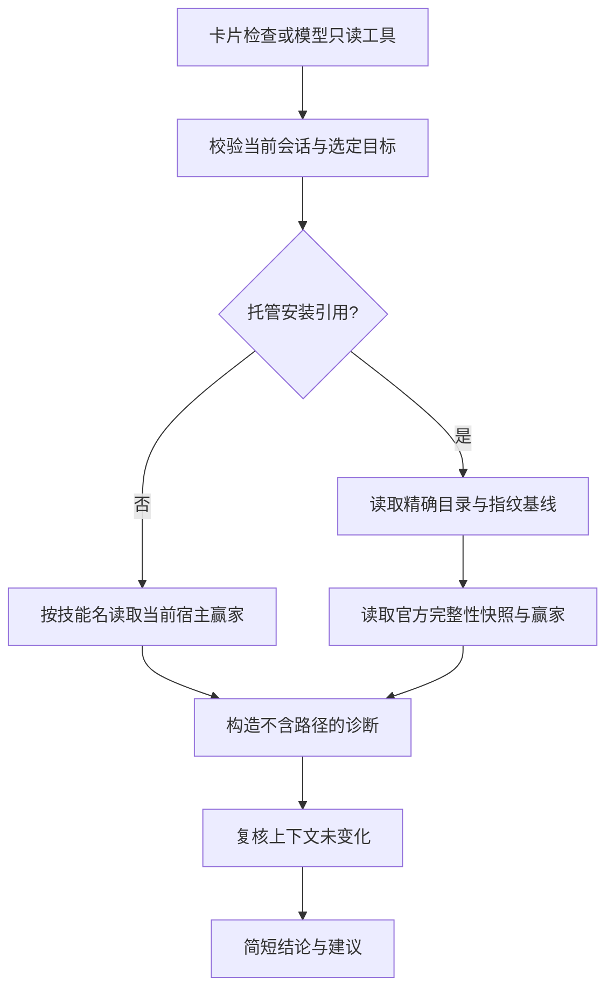

# 技能可用性诊断

## 范围与产品交互

首期提供当前会话的只读诊断，回答“已安装的技能为什么不能用”。不新增安装来源，不修改 SKILL.md、安装记录、技能启停状态或用户草稿；不自动修复、覆盖、卸载或发送消息。不涉及 SaaS、CLI 命令或 Registry API 变化。

已安装技能卡片的“更多”提供“检查可用性”，按当前选定安装位置检查。结果在卡片下方紧凑显示结论及一条建议，正常结果不追加操作按钮；不显示路径、内部引用、原始错误、来源 URL 或重复安装信息。切换位置清除旧诊断。旧卡片引用失效时提示重新查询，不能重新绑定另一版本。

对话可调用只读工具 `astron_skillhub_check_availability`。精确托管安装使用当前查询的 sourceRevision + itemKey；按实际技能名查询仅反映宿主当前生效技能，不能据此认领来源。模型简述工具结论，不重复完整列表，也不能把诊断当安装/卸载授权。

## 状态契约

文件完整性、宿主发现与调用策略是独立事实：

| 场景 | 必须表达 | 不能推断 |
|---|---|---|
| 托管文件与指纹匹配，宿主加载相同资源 | 当前检查可用；保留用户/模型调用策略 | 后续任意调用一定成功 |
| 不同资源赢得同名查找 | 所选安装被同名技能覆盖；可证实才说明赢家范围 | 默认项目一定优先，自动切换技能 |
| 同一资源内容或策略与磁盘不一致 | 内容变化或宿主状态待核验 | 同名覆盖 |
| 本地文件指纹变化 | 本地内容已修改 | 文件损坏或恶意 |
| 明确文件不存在 | 文件缺失 | 未安装过 |
| 权限错误、元数据异常、服务不可用、目录未完整读取 | 无法核验，并给出受控原因 | 未安装、确定不可用 |
| 完整宿主快照未发现目标 | 当前会话未发现该技能 | 全机器没有此技能 |
| 外部/无法关联的宿主赢家 | 来源未关联，仅展示已观察事实 | 任意 Registry 归属、版本、未修改 |
| 调用策略 | 分开说明用户调用与模型调用是否允许 | 一项禁用代表全部禁用 |

同名赢家通过官方宿主结果判定，不自行重建优先级。外部技能只读，不能出现更新、卸载或接管动作。首期不提供全机器扫描；宿主赢家视图不代表所有被覆盖的外部技能。

## 实现边界

复用宿主可信 agent/session/cwd、当前来源 revision、opaque itemKey 和精确安装路径校验。Host 内部读取 inventory、只读基线与官方 skills snapshot/get；不调用 CLI 进程。诊断放入独立模块，现有管理工具负责注册和传输。

官方 snapshot 的 complete 必须保留；缺少 snapshot 能力或不完整返回 unknown，不使用 list 空数组证明不存在。兼容仍以现有两个 RC 基线为准，逐一实测能力，不扩大 peer 范围。

所有异步边界检查来源、会话、cwd、fs/skills 原始服务身份和取消信号。诊断只报告时点观察；不改变已有使用前复核与变更确认。结果仅构造白名单字段，不透传宿主 content、metadata、resourceBase、provider 或异常。

## 验收

覆盖：可用、同名跨范围覆盖、外部同名赢家、同路径内容变化、本地修改、目录/入口缺失、权限错误、无效元数据、无 snapshot、不完整快照、用户与模型调用策略四种组合、过期引用、来源/会话/服务切换、取消与并发。断言诊断无文件写入，无原始路径和敏感内容输出。

浏览器验证两列卡片、长技能名、诊断展开、切换位置、重复点击、请求取消及历史卡片，不让诊断增加大面积布局或破坏已有按钮。双 RC 的官方 Host 验证与真实模型对话分开记录，未调用模型不能称为真实对话验收。
