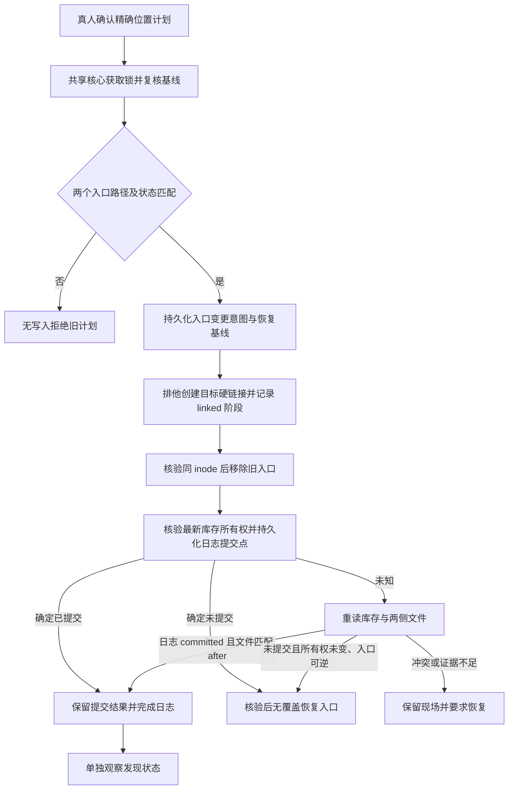

# 受管理安装位置的技能启停

状态：实现契约，验收范围见 verification.md。现有按位置安装/更新/卸载继续以 [生命周期设计](lifecycle-design.md) 和 [对话管理设计](conversation-management-design.md) 为基线；本增量对停用安装的读取、更新和卸载补充如下。

## 1. 范围与取舍

启停作用于当前 Registry 受管理的一个 DSH 安装位置，跨会话持久保存。停用时将精确入口 `SKILL.md` 重命名为 `SKILL.md.disabled`，启用时恢复原名；目录、资源位置、入口字节和调用策略保持不变，不执行包内内容。不是会话级过滤，也不承诺全机器或所有 provider 同名技能停用。

仅管理可信用户级及当前项目级安装，保留单一 direct 归属、内容基线与路径保护。外部来源、手工安装、Suite/shared ownership、路径别名及重叠认领不开放启停。新安装仍默认当前用户；项目安装保留高级入口并要求可信项目根。默认值不用于猜测已有安装的启停目标：唯一匹配可准备确认，多位置必须明确选择。

社区调查显示入口重命名、完整目录隔离、逐 agent Provider 覆盖均有实例。本轮选择入口重命名：整包移动会使空闲历史会话已加载正文中的资源路径失效，单纯检查活动任务不能解决。保留目录及资源路径减少该风险，但入口原路径仍变化，历史上下文不能视为已撤回。完整策略 Provider 需承担发现与胜出解析；单会话 scoped register 可以更轻，但语义是当前会话调用控制，不用于本轮安装级开关。此前整包移动实验不能证明新方案可行，入口重命名须重新验证；不复用或执行第三方插件代码。

## 2. 安装状态、存储与发现分离

安装逻辑模型如下，序列化协议见 §7：

| 维度 | 含义 |
| --- | --- |
| 安装身份 | Registry 规范化身份 + namespace + slug + agent + 规范化原安装根和原安装目录；保留稳定位置身份 |
| 安装状态 | enabled / disabled；独立于 Host 是否发现、是否允许用户/模型调用 |
| 文件位置 | 两态使用同一安装目录；disabled 使用记录绑定的精确入口别名，目录继续被认领 |
| 版本与基线 | 每位置版本、指纹、时间及归属；停用不丢失、不伪造原元数据 |
| 完整性 | 内容匹配、已修改、缺失或未知；disabled 本身不是文件缺失 |
| 操作状态 | 处理中、结果未知或需恢复属于事务状态，不能用 enabled/disabled 掩盖 |
| 发现观察 | 当前会话是否发现目标、同名赢家、缓存或未知；必须单独采集证据 |

停用入口不是垃圾，不得按清理期限删除。状态记录绑定精确安装及入口别名；不能以 `SKILL.md` 缺失推导 disabled，不能看到任意 `.disabled` 文件就认领。所有安装列表、详情、诊断、使用前校验及运行时上下文读取同一共享投影，模型和 UI 只收到白名单公开状态。

稳态读取指纹仅在精确受管安装由可信停用入口投影为 disabled 且安装身份匹配时，按该状态将该安装内精确 `SKILL.md.disabled` 逻辑映射为 `SKILL.md` 计算，保留原始内容字节；其余作者文件照常参与。不对任意扩展名归一化，不跳过别名内容。两入口同时存在、入口缺失、别名冲突、目录或链接类型异常均阻断；原包自带该同名作者文件时必须阻断启停；升级候选包自带该文件则阻断停用状态下的升级，不能覆盖合法作者资源，也不因此改变普通上传协议。发布/导出必须先恢复原稿，或由经过验证的规范导出流程在输出副本恢复入口名并校验原指纹，不能把停用目录原样作为标准包发布。标准打包仍要求 SKILL.md，停用目录不能直接发布。 首次停用改名后且库存提交前、启用恢复及升级暂存等转换阶段，只能由受信操作日志与不可变计划绑定的精确目标、阶段和基线授权入口映射；不得通过通用布尔参数对任意目录放开映射。

停用成功仅表示选定位置的入口变更与持久日志提交完成。项目副本停用后用户副本可能接替，外部 Provider 也可能仍提供同名技能；不自动启停赢家、不自动将旧“使用”动作改绑给赢家。停用安装不提供“使用”，可提供启用、检查更新、更新和卸载。启用后仍需发现和策略核验，不能直接标记可调用。

## 3. 精确计划与真人确认

页面和对话共享 Host 计划与核心事务，不派生 CLI 进程。Host prepareToggle 生成确认计划，共享核心提供 inspectToggle / acceptToggle / executeToggle；对话启用/停用工具复用该路径。

1. Host 根据当前查询引用解析精确身份，核验当前 source revision、可信 session/agent/cwd、根目录及服务身份；客户端与模型不得提交自由路径。
2. 读取状态、版本、指纹、归属、精确入口状态，核验完整包。已达目标状态返回无变化，不进行重复移动。
3. 生成五分钟有效的不可变计划，绑定 before/after、上下文和原目标；确认显示技能、范围、当前状态及拟执行动作，提示同名副本可能继续可用、入口重命名不会撤回已加载内容，旧入口引用可能失效。不能承诺撤回运行任务或历史上下文。
4. 原生确认可用时使用原生界面，否则使用既有确认卡。自然语言定位不等于真人批准；取消不写文件。确认期间不可切换原目标。
5. 提交时在锁内重校验。源、会话、项目根、安装状态、版本、内容或归属变化使未接收计划失效；用户须重新查询、选择和确认，不能自动重绑。
6. 沿用 requestKey 的精确重放规则：同 key 同参数返回原 operationId，不同参数拒绝。已接收请求的安全结果查询不变成新执行；响应丢失查询原操作，不能换 key 自动重试。会话变化不会撤销已经提交的写入，但禁止旧确认授权新写入。

### 旧会话和活动使用边界

资源目录保留不等于所有会话无影响：历史正文仍存在，代码可能直接引用原 `SKILL.md` 路径。停用不能撤回已加载正文或强制终止任务。入口加载与重命名竞争时明确返回加载失败并允许重新查询，不静默选择同名副本，不虚构活动资源检查 API 或要求全进程静止。跨进程使用不可证明时仅承诺受管理入口的发现控制，不保证外部程序停止使用。支持 RC 的读取、缓存与竞争行为须重新验证。

## 4. 共享核心文件事务

复用并扩展 `cli/src/stores/inventory-store.ts`、`cli/src/services/inventory-cas.ts`、目标锁及 `cli/src/integrations/operation-store.ts` 等现有边界；Host 只负责可信上下文、确认及展示。入口事务由 native-toggle.ts / toggle-journal.ts 实现，可信入口映射由 installed-skill-snapshot.ts 提供。

入口及别名必须由可信适配器在同一真实安装目录推导，不从模型或 Client 接收。设计门禁要求验证祖先可信、两端均非符号链接/重解析重定向、目标别名无占用，并证明受支持发现器不读取停用别名。本功能仅控制受支持官方 filesystem Provider 的标准入口发现，不承诺阻止任意第三方 Provider 读取别名或原正文。若观察到第三方仍提供该资源，明确报告当前仍被提供；不以快照缺席或 `.disabled` 名称作为全机排除证明。

统一按 canonical key 排序获取原目标及入口变更所需锁，再取 inventory lock；逻辑目标在停用前后使用稳定锁身份。CLI 与插件共用实现，不新增反向取锁路径。停用安装的原路径继续被认领，安装/同步/其他目标写入不能当作空位接管。入口别名也受冲突校验保护。

持有目标锁与库存锁核验最新所有权后，持久日志 committed 阶段是启停逻辑提交点；磁盘库存不保存入口状态，保留其他位置最新变更。入口变更前日志保存身份、before/after、精确路径与阶段。文件转换失败不得直接改状态；不支持同目录硬链接时拒绝，不退化为可能覆盖目标的 rename 或复制删除。日志与库存采用既有持久化流程；进程强杀恢复测试不等于硬件断电耐久性验证。

启用时标准入口必须不存在且停用入口可信；标准入口存在任何内容、链接或无法读取均阻断，不覆盖、不合并。停用时别名目标必须不存在。停用入口被修改、指纹未知或两入口均缺失同样阻断。两入口均存在、库存与文件矛盾或未知协议进入待核验状态。

## 5. 崩溃、恢复和并发

| 故障窗口 | 结果与恢复规则 |
| --- | --- |
| intent 写入失败或未移动 | 不移动、不更新状态；报告失败 |
| linked 中间态或已转换，日志确定未提交 | 同一锁域检查两侧与原基线，安全时逆向移动；否则保留现场并要求恢复 |
| 日志提交报错且结果未知 | 重读日志、inventory 所有权和两侧文件，禁止立即反向移动 |
| 日志 committed 已持久化，终态日志失败或响应丢失 | 保留新状态与文件，回执告警或待核验；不得反向恢复旧入口 |
| 重启发现未完成事务 | 获取执行租约和兼容锁后核验；不自动重放启停，不抢占活跃操作 |
| 恢复目标被占用 | 保留停用入口及日志，拒绝覆盖并提供受控诊断；不删除新占用内容 |

目标恢复完成前阻断冲突写入；其他独立目标仍可按共享库存 CAS 更新。恢复仅处理本次目标，不恢复整份旧库存快照。兼容未发布旧 v3 事务时，若持久库存的目标状态已经是 after 且文件完整匹配，则保留旧 CAS 的已提交结果；不能因旧日志仍为 moved 就回滚已提交事务。共享核心需支持新日志版本，旧未完成操作必须先按兼容路径收尾或阻止迁移，不能将旧日志强制转换。

## 6. 停用期间的生命周期

- 查询仍展示停用安装及其版本、范围；停用入口不可读为未知，不冒充已卸载。可用性诊断先报告已停用，再独立报告 Host 时点观察。
- 更新检查仍只读；更新执行使用同样的精确版本、内容指纹与真人确认，在原安装目录完成可恢复替换，新版本入口在暂存阶段转换为停用别名并按规范指纹校验，保持 disabled、安装位置认领和其他目标不变。不得先恢复标准入口再更新。
- 卸载确认明确删除所选停用安装；从其可信原安装目录进入可恢复删除流程，提交后释放该目标认领，其他安装不变。远端离线不妨碍本地基线可信的停用/启用/卸载。
- 旧卡片引用、更新计划和“使用”草稿请求在状态变化后失效；先前已加载进会话或正在执行的内容不承诺撤回。不得通过启停扩大作者的用户/模型调用权限。
- 新装、升级、删除、sync、Suite 和 doctor 等库存消费者必须理解停用位置和保留路径。Suite 共享目标仍受现有归属限制，不因停用绕过。
- 插件自身禁用/卸载不自动启用全部技能；持久状态和包应保留，可由兼容管理核心核验恢复。不能宣称卸载插件等同撤销文件变更。

## 7. 库存协议与实施门禁

共享库存继续使用严格 `schemaVersion: 2`，不新增 installationState 字段，不要求用户同步升级 CLI。启停状态不再作为磁盘库存字段，而是新消费者对精确受管安装入口的内存投影：只有标准入口为 enabled，只有可信停用入口为 disabled。两入口并存、入口缺失、类型异常和内容不符按完整性冲突处理，不伪报可用。不建立第二份可写启停状态文件。

1. 普通读写和启停均不得把共享库存升级为旧 CLI 无法读取的格式。读已有 v1/v2 不引入写入；已有未发布 v3 库存须校验身份、文件状态与未完成事务后，在同一锁域保留原始字节备份并安全转换为 v2，不能直接恢复过时备份覆盖新记录。
2. 入口转换由现有目标锁、持久操作日志和库存 CAS 共同协调。改名后的文件状态变化不等于库存身份发生并发修改；提交和恢复需分别核验身份、版本、指纹、归属与日志授权的转换阶段，保留其他目标的最新变更。
3. 普通安装、更新、删除操作日志继续采用旧 DSH 可读协议；启停专用新日志须隔离兼容影响，不能使旧 DSH 的普通管理全局失效。未知或未完成事务仍须阻断冲突目标操作，不得跳过恢复保护。
4. 已发布 CLI 0.2.0 必须能查询合法 v2 库存并继续管理普通目标。默认更新、同步及 Suite 不得因新版启停引起无意重新启用；需要以真实旧 npm 包验证。旧版不提供启停语义，其显式 force 重装、force 更新、force 同步沿用原覆盖契约，可能恢复标准入口；显式 remove 沿用删除契约。新版重新读取必须反映这些真实文件变化，不能残留虚假停用状态。
5. 新 CLI 的停用升级、sync、Suite 和 doctor 保护继续保留。不能用旧版本显式覆盖行为作为理由放松新版默认保护。
6. 验收覆盖同一 HOME 下新旧消费者交替操作、不同来源/位置、普通与停用目标混存、并发与五阶段强杀恢复。仅证明旧版拒绝整份库存或数据未损坏不算兼容通过；未通过前保持发布阻断。
7. 旧工具不会识别隔离的新启停日志。若启用中断后已出现有效标准入口，旧工具仍可按既有契约执行合法操作；新版恢复必须在任何入口修改前比较来源、位置、版本、安装时间、指纹、归属及 Suite 引用，后续合法写入使基线失配时返回 unknown 且保持文件不动。不能宣称旧工具会拒绝所有待恢复目标。CLI 不扫描所有 Host 状态目录；v3 转换只核验本库存对应的入口与内容并保留原始证据，NativeRuntime 对本状态目录未完成事务先恢复。

## 8. 发现反馈与验收

支持宿主的 watcher 可能刷新发现，但 watch 关闭、失败、缓存未失效或自定义扫描均不保证瞬时生效。提交回执首先报告“该位置已停用/启用”；仅在官方当前会话证据匹配精确资源时补充发现结论。缺少完整证据显示“发现状态待核验”，提供按实际宿主能力执行的后续检查建议，不虚构刷新 API、不自动重启 Host。

实施验收使用临时 home/cwd、fake Registry 和惰性测试包，不执行第三方插件或技能脚本；真实模型验收使用另行授权的模型配置，并与工具/浏览器测试分别记录。可执行场景见 [正式 requirements](specs/dsh-skill-consumption/spec.md)。重点故障注入在 intent、linked、moved、restore-linked、CAS 前后及终态日志阶段，断言 inventory、安装目录、两入口及其他资源逐文件摘要、操作状态及未选目标保持一致。

交付证据分层：共享核心单元/多进程及历史消费者测试 → CLI/plugin lint/typecheck/tests/build → 两个已声明支持 RC 的真实 Host 发现与浏览器确认 → 后续获得授权的真实模型对话。模拟工具结果不能充当真实模型证据。停用后的同名回退、watch 关闭、入口加载竞争、旧入口路径限制、恢复冲突及停用中更新必须单独记录。

### 私有共享核心适配

NativeRuntime.inspectToggle / acceptToggle / executeToggle，沿用既有 operation 查询与 recover。inspect 返回 ready/blocked/unchanged；计划固定 beforeState/afterState 和单位置基线。InstalledProjectionItem 新增 installationState，与 present/missing 等物理完整性状态分离。公共 Registry HTTP API 不变；私有类型随插件构建生成，不要求用户另装CLI。

### 首期 CLI 消费范围

CLI 不新增启停命令，需读取兼容 v2 库存并从可信入口派生状态、保护停用记录。缺少原生持久事务观察器的 CLI 停用升级安全拒绝，提示使用 DSH 执行；force 不绕过。namespace sync 不更新或 prune 停用安装；Suite 不接管停用安装；doctor 不通过散落别名重建停用归属，保留已有记录。DSH 停用更新与卸载是交付必需能力。

### 无覆盖入口变更

入口逻辑重命名不得使用“检查不存在后普通 rename”来保证无覆盖。采用同目录排他创建目标硬链接，再移除源入口；日志记录 linked/restoring 中间阶段。恢复仅在受信操作意图、两入口相同设备与inode、完整内容校验一致时收敛中间双入口；其他双入口冲突保留不动。目标已存在返回冲突，平台不支持该原语则无写入拒绝，不退化为可覆盖rename。

### 停用安装的发现诊断

诊断在两秒总时限内读取当前会话的 snapshot/get，并复核安装基线；不通过市场 slug 猜测实际技能名。实际名称从可信入口正文的 frontmatter 提取，仅接受唯一顶层简单 name（含简单引号字符串）；复杂 YAML、重复字段、锚点、超限或无法核验时返回 unknown。此限制只影响只读发现诊断，不影响符合基线的启停操作。

同名其他位置胜出与选定安装停用分别展示；缓存仍保留原技能、snapshot/get 不一致或无法验证正文时不能声称已经退出发现。旧 RC 不保证在同一会话立即接替同名用户副本，新会话观察与旧会话观察分别记录；不自动重启宿主或撤回已加载正文。

### 安装详情的操作布局（已由使用优先设计替代）

详情右侧安装管理使用显式动作按钮，不使用独立省略号菜单包住唯一的停用动作。统一动作区最多一个强调主按钮：已启用且可使用时为“使用此技能”，停用时为“启用”；升级为描边次操作，停用为低强调操作。按钮同高、间距一致，窄空间自然换行。查看的详情版本与安装版本不同时，若提供使用入口，须标为“使用已安装版本”，始终绑定当前安装引用并通过原有使用预检。停用状态以“启用”为主操作，仍保留安装范围与已有卸载入口。按钮布局不改变精确安装引用、真人确认及状态失效规则；对话卡片继续使用紧凑的更多操作菜单。

启停确认弹窗只保留动作标题、技能名称及坐标/版本、明确安装范围、一句影响说明和底部“取消/确认”按钮。范围不在多段正文重复，安装状态与停用状态分别表达，停用不使用绿色成功态。精确位置授权与已加载内容/同名安装的影响边界保持不变。

### 正常状态的精简呈现

安装详情、已安装卡片及对话管理卡在成功刷新后仅通过当前安装状态和动作表达结果，不常驻追加“该位置已启用/停用、发现状态请另行核验”等说明，不因成功说明改变按钮布局。独立操作回执保留简短的操作结果；发现观察仍保存在结构化结果与既有详情/显式可用性检查中，不将已启用冒充当前会话可调用。错误、冲突、告警及需恢复等需要处理的状态仍明确提示。

范围选择统一使用共享SelectField。“选择范围”为未选择占位，不是一个可提交选项；多安装位置必须由用户明确选择后才开放该位置操作，不通过视觉精简自动猜测范围。

### 技能市场卡片的范围与启停（已由使用优先设计替代）

市场卡片不使用点击省略号后在原按钮行插入“停用”的交互，启停使用显式动作。初始只有一份安装时直接绑定该位置；多份安装要求明确选择。已有选择在刷新后消失时，即使仅剩一份也必须显式重选，不能自动改绑。保持底层用户/项目隔离，不猜测目标。范围控件置于管理动作之前。停用单份以中性色“已停用 + 版本 + 范围”摘要表达，不重复在动作行显示状态；混合多份分别保留各位置状态，不能整体误标停用。启用为主动作，升级及卸载为次操作，避免两个强调按钮并列。对话紧凑卡的独立交互不因市场布局变更而改变。

### 混合安装状态与官网入口

同技能用户级停用、项目级启用时，市场摘要按位置完整展示两项状态，不将技能整体标为停用，也不截断第二项；选择用户位置显示启用操作，选择项目位置显示停用操作。安装启用状态不代替当前会话发现/调用策略核验。

详情标题附近保留次要外链“在官网查看”。链接唯一来自技能详情API的可选`webUrl`，为完整绝对HTTP(S)地址；字段缺失、null、空白或不安全时隐藏按钮，不影响详情/安装等功能。插件不拼路由、不回退到Registry、固定官网或作者仓库，移除此前websiteUrl设置；旧持久化字段忽略。合法完整URL的页面参数及fragment保留，但不附加本地凭证，拒绝userinfo、控制字符、反斜杠和危险协议，使用noopener/noreferrer。当前来源与详情失配时不提供可点击链接。开源服务端通过可信skillhub.public.base-url配置生成网站详情地址，未配置或不合法返回null；不能采用请求Host/转发头决定公网域名。SaaS单独同步同字段，不由插件推测其站点路由。

## 使用优先的最新页面约定

日常位置选择及维护按钮布局以[使用优先设计](skill-use-first-design.md)为准；本文件的文件事务、权限及管理确认契约继续有效。此前直接在市场卡展示启停的布局已被二级管理替代。

### 详情位置操作菜单

每个正常安装位置只常驻范围、版本、状态及更多菜单；停用位置另保留启用。使用此位置、可用性、更新检查、停用及卸载通过浮层提供，不撑高卡片。菜单支持方向键和 Escape；菜单卸载不能取消使用请求。继续复用精确 itemKey、确认与 receipt，不改变页面主使用入口。

### 安装检查反馈

详情中的更新检查 current/普通失败和可用性摘要进入右上角可关闭通知，不累积卡片正文。普通成功 5 秒后消失，冲突/失败仅手动关闭；同一动作重复更新通知。通知随 source revision、技能和会话边界销毁，无焦点抢占，status/alert 播报，关闭支持键盘。可升级入口、blocked/stale 状态与确认错误继续显式展示。发现一致不等于允许调用；保留 invocation 与停用缓存说明，不推断未知 winner。

### 紧凑反馈与稳定安装布局

通知使用范围/版本标题与一句结论；普通发现不声称可调用，禁用、未知来源、停用缓存等限制保留简明告警。安装范围直接展示，沿用原默认范围。确认、进行中和成功保留相同左右区域，窄屏纵排且不溢出；成功使用入口与进度条分隔，继续原精确安装核验及使用交接。
