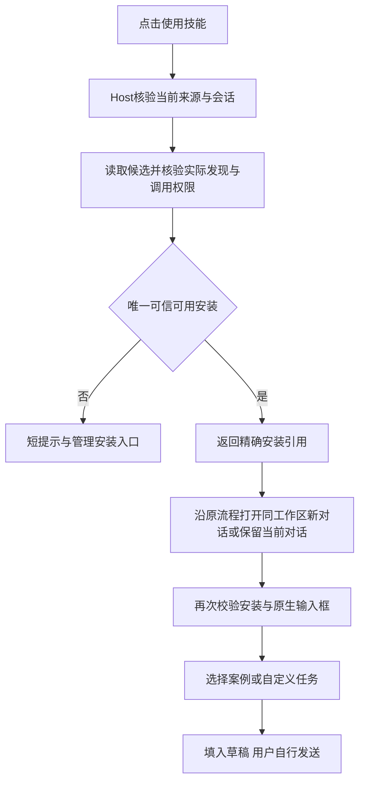

# 使用技能优先的页面与交互

本增量替代技能市场、已安装列表和默认详情中的位置下拉及并列维护按钮。安装位置、版本、启停和归属继续由原共享核心管理，不合并文件、不迁移安装，也不改变默认用户级安装。

## 1. 日常与管理分层

| 场景 | 主动作 | 次动作与状态 |
| --- | --- | --- |
| 库存已核实且无安装 | 安装 | 使用原安装确认，范围在高级选项中，默认用户级 |
| 有可候选的已启用安装 | 使用技能 | 管理安装；状态仅表达已安装，不冒充已核验可调用 |
| 全部安装停用 | 管理安装 | 简短“已停用”，不出现重复管理按钮 |
| 本地异常或库存不确定 | 管理安装或禁用使用 | 保留准确异常/未知，不能误显示未安装或自动重装 |
| 使用核验失败 | 保留管理入口 | 一条短错误，不自动启用、升级、换来源或选择其他不确定副本 |

市场与已安装默认按来源、namespace、slug聚合为一张技能卡；正常摘要不展示每位置版本、启停与范围下拉。详情突出文档、版本内容、官网入口和使用动作；使用针对本地实际安装，不能把远端所选详情版本当成已安装版本。两者不一致时标为“使用已安装版本”。

对话中的安装查询卡采用同样的技能级主动作和二级管理入口。用户明确请求更新、卸载或启停后的原确认、结果卡保留精确安装范围与版本，不因日常界面精简而省略授权对象。

## 2. 管理安装

“管理安装”从卡片进入对应技能详情，直接在详情右侧展示安装管理，不打开管理弹窗。市场与已安装详情共用这一层级；对话管理沿已有详情导航，搜索详情容器中同样内联展示。窄屏转为上下布局。每个位置独立一行展示范围、版本和真实状态。行内复用原有检查更新、升级、启用/停用、卸载以及明确使用该安装的能力。每行绑定自己的itemKey及来源上下文，不默认选择第一行或将失效目标改绑到另一行。

管理操作继续走不可变计划与真实确认；取消不写入，完成后刷新当前库存而不修改历史操作事实。异常、未知、待恢复和共享归属继续阻止不安全操作。所有位置都被删除时展示空状态。对话原查询的过期引用不恢复为新的写入授权。

## 3. 技能级只读选择

私有Host接口：`selectSkillUse(sourceRevision, namespace, slug, signal): SkillUseSelection`。ready仅返回定位用途的itemKey；blocked区分无安装、无可用安装、无法核验、多个可用安装和超时。该接口不是新LLM工具，不写文件、创建会话、修改输入框或执行技能。

选择只限当前来源、当前可信会话、用户及当前项目中可见的受管理安装。通过现有listInstalled与prepareSkillUse核验完整内容、DSH实际winner资源和用户调用权限，不按项目优先、版本最新、数组顺序或存在SKILL.md猜测。完整发现快照、安装记录与上下文身份必须稳定；唯一ready才返回。明确停用、被同名安装覆盖或不允许用户调用的候选可排除；其他未知证据不能当作不存在。多个ready（例如版本使用了不同实际技能名）必须进入管理，不能任选一个。

检查有候选数量、并发及总时限边界，取消或超时后停止后续检查。选择结果只是时点定位；随后仍沿用新对话创建和填入前的原严格预检，不把返回itemKey当成新的持久授权。服务、来源、会话、目录、安装版本或状态变化后失败，不静默重绑。

## 4. 明确目标的例外

管理面板内明确“使用此安装”、安装成功结果及已有精确位置操作回执继续使用原itemKey，不改成坐标级选择器。用户已明确选定目标时，不能静默使用同名赢家。主使用失败也不自动打开另一来源的技能。

## 5. 验收

- 日常市场/已安装/对话查询卡及默认详情不再展示范围下拉和维护按钮行；二级管理仍完整可操作。
- 单份启用、双份混合、全部停用、异常、未安装、多份不同版本，以及同名外部资源覆盖，显示与动作正确。
- 用户停用且项目真正可用、反向组合、两个真正可用、无法验证、来源/会话/服务/文件变化及超时均有选择契约测试。
- 新对话保持工作区；原对话草稿与附件不覆盖；选择案例不自动发送或调用模型；取消不填入。
- 二级管理确认显示准确目标，取消不改文件；在途和过期引用不能换目标。
- 真实DSH浅深主题、窄屏、管理面板及返回使用链路；本轮无需调用真实模型，实际执行记录另存verification.md。

安装与危险动作仍保留确认框；确认层不得被卡片操作区的层叠上下文约束。常规页面使用独立body弹层，原生dialog内的确认保留在对应top layer内。验证必须包含遮罩下背景按钮命中检查。
