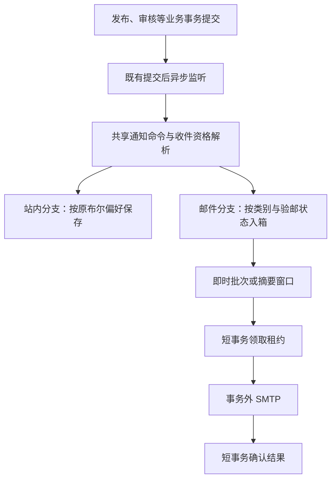

## Context

基线：`main@4811b96129802be5028d5e4bc1b7b6a158b5b7bb`。本方案已获实施授权，基础实现见 Draft PR #1004；默认60分钟、按用户恢复汇总、24小时临时故障恢复窗口及主动关闭后严格丢弃迟到旧事件已获用户确认。积压补充仍在实施，正式验收尚未冻结。

### 已核实的现状

| 事实 | 仓库依据 | 方案影响 |
|---|---|---|
| 只有 PUBLISH、REVIEW、PROMOTION、REPORT 四类 | `server/skillhub-notification/src/main/java/com/iflytek/skillhub/notification/domain/NotificationCategory.java` | 复用四类，不凭空宣称已有订阅类别 |
| 作者发布、订阅新版、订阅撤回均属于 PUBLISH | `server/skillhub-app/src/main/java/com/iflytek/skillhub/listener/NotificationEventListener.java` | 设置页将其说明为“发布与订阅更新”；当前类别粒度不能让两者分别设置频率 |
| 关闭 IN_APP 会提前返回；偏好缺省 true，接口仅支持 IN_APP | `notification/service/NotificationService.java`、`NotificationPreferenceService.java` | 邮件必须独立路由，默认 OFF，不能复用此默认值 |
| 通知监听器采用 @Async + @TransactionalEventListener | `NotificationEventListener.java` | 入口是提交后异步执行，不是业务事务内可靠 outbox |
| UserAccount 只有 email，没有邮箱验证状态或邮箱修订号 | `server/skillhub-domain/src/main/java/com/iflytek/skillhub/domain/user/UserAccount.java` | 旧账号不能直接推定已验证；地址变化需要可靠失效标记 |
| 外部 claims 的 emailVerified 未形成通用持久证明 | `auth/identity/IdentityBindingService.java`、`auth/entity/IdentityBinding.java` | 本方案不自动信任历史邮箱，先统一完成通知收件验证 |
| JavaMailSender、验证码重置密码、SMTP 部署配置已存在 | `auth/local/PasswordResetService.java`、`docs/19-smtp-password-reset-email-setup.md` | 复用传输，不复用密码重置验证码的用途和消费逻辑 |
| system_setting 有 JSON 值、版本及操作者 | `auth/settings/SystemSetting.java` | 普通全局配置复用表，但不能塞入 auth.local 的两个既有键 |
| 存在扫描任务数据库租约和 SKIP LOCKED 实现 | `app/task/ScanTaskOutboxDispatcher.java`、`infra/jpa/ScanTaskOutboxJpaRepository.java` | 参考领取方式，不复制其事务内网络发布模式 |
| 站内消息可被用户删除，已读/未读有清理策略 | `notification/service/NotificationCleanupTask.java` | 邮件不能依赖站内记录存在或已读状态来决定投递 |

表内缩写路径均相对于 `server/skillhub-* /src/main/java/com/iflytek/skillhub/` 对应模块；完整定位在 `verification.md` 中。

## Goals / Non-Goals

**Goals:** 支持用户按类别选择模式；控制邮件数量；复用现有部署能力；保护邮箱归属、空间权限和业务事务；为每次投递保留可解释状态。

**Non-Goals:** 强制注册验邮、邮箱验证码登录、自动身份合并、收件人任填、全站领域事件可靠化、短信/IM、可编程通知规则、按技能单独建配置、多种每日/每周调度、营销邮件和邮件打开追踪。

## Decisions

### D1. 类别是选择单位，邮件批次不是技能

沿用四类，**全部默认 OFF**，避免升级或平台开启时给旧用户自动订阅。用户可逐类选择：

| 模式 | 对用户的含义 | 数量语义 |
|---|---|---|
| OFF | 此类别不发邮件 | 不生成新邮件项；取消尚未发出的同类项 |
| IMMEDIATE | 发生后尽快发送，不等摘要窗口 | 一个有效通知实例一封；同技能不同事件也可能多封 |
| DIGEST | 等窗口结束后合并发送 | 同一收件人、同一窗口，所有摘要类别最多形成一个逻辑邮件批次 |

设置界面建议给 PUBLISH 标注“适合摘要”，其他三类标注“可选即时”；不自动替用户启用。REVIEW 还包含个人资料审核，邮件模板必须识别事件类型，不能全部叫“技能审核”。

示例：用户将 PUBLISH、REVIEW 设为 DIGEST，09:00—09:15 收到 12 个技能更新和 3 个待审，窗口结束合成 **一封、两个分节、15 条通知**。另一用户将 REVIEW 设为 IMMEDIATE，则其三条待审可产生三封，这由用户选择决定。验证码和密码重置属于安全邮件，不参与该业务摘要或偏好。

不采用“每技能一封摘要”：无法控制大量订阅的邮件数。暂不新增独立 SUBSCRIPTION 类别；若产品之后要求作者发布即时、订阅摘要，必须另行拆分类契约，不能偷偷按 eventType 覆盖用户选择。

### D2. 一个全局摘要窗口；按入箱时间分组，不追溯历史

默认窗口 60 分钟（用户已确认），后台允许在 5—1440 分钟内调整。该范围是待评审的新配置设计，不是既有参数。使用 UTC 固定窗口及可注入 Clock；界面、邮件展示明确时间和时区。

- 以邮件项实际持久入箱的时间确定窗口，业务发生时间另存用于展示。延迟到达的事件不回填已发送的过去窗口。
- 同一窗口所有 DIGEST 类别按收件人合并，不能按空间、技能或类别拆成多封，也不能跨用户混发。
- 摘要先封口固定成员，再发信；发送期间新增项不追加到已授权批次；明确临时失败后的同一 root 下一准备轮可按 D6a 受控补源。若入箱事务遇到封口，重新计算当前可接纳窗口，不能丢弃或重新打开旧批次。
- 每封建议最多展开 50 条，余下显示数量与**邮件批次自己的受保护详情入口**；统计和全部邮件项仍归属同一批次，不能为了分页再发几封。详情从邮件项分页读取，不依赖站内消息是否开启、存在或已读；每项仍按当前资源权限过滤，已失权/删除的项只显示本原始页的不可用数量，不计算全批精确可见总数。明细保留期后明确提示已过期，不承诺永久邮件历史。
- 空窗口不发空邮件；某项不再符合资格时剔除，剔除后为空则不发送。
- 改模式只影响之后的新事件；改成 OFF 还会撤销未开始发送的同类项。摘要转即时不把旧摘要批量重新即时发送。
- 改摘要周期不重分配已入箱项；原窗口与模式记录保留，符合恢复规则的待发摘要可合入执行父；之后新项使用新周期。UI 明示这一过渡，不宣称修改周期瞬间全量重排。

### D3. 复用 SMTP，独立收件验证；不把历史 email 当验证事实

本期建议所有账号均对**当前账号邮箱**完成一次通知收件验证，不自动恢复或推断外部历史验证事实。未来可以接入有来源和版本的持久可信事实，但不阻塞本功能，也不扩大成身份平台。

流程：读取当前邮箱 → 向该地址发送独立验证码 → 验证成功 → 用户选择邮件类别与模式。接口不接受任意收件地址，且从会话取 userId。

验证建议采用 6 位随机码、10 分钟有效、单次最多 5 次错误、60 秒重发冷却及每账号/来源限流；这些是新方案推荐值。只存安全哈希，不存明文码；验证码用途固定为通知收件验证，不得用于登录、重置密码或自动授权。

并发重发仅最新挑战可用；验证成功后消费挑战。挑战生成与发送分开为短事务及事务外 SMTP，失败不产生“已验证”状态，API 显示可重试错误。

为防止 A→B→A 地址变化重新激活旧证明，拟给 `user_account` 增加 `email_revision`：规范化地址实际变化时递增；同地址重存不递增。证明和挑战都绑定 userId、规范化邮箱、该修订号。所有现有写入路径（外部登录、账号合并、管理员初始化、本地初始化）通过同一受控变更入口，在事务内锁定并刷新当前账号行后读改写，不再直接用未锁的旧实体 setter 修改地址；不为了此事给全账号添加会影响无关字段的全局乐观锁。禁止用整条 user.updatedAt 代替邮箱修订号，验证并发更新不会丢修订。

账号合并不迁移通知验邮证明、订阅模式或旧队列给另一用户；被合并账号未发项取消，主账号保留自己的设置。主账号邮箱被替换时修订号递增，必须重验。没有邮箱的用户看到原因及现有账号资料维护入口，不新增任意地址转发。

### D4. 通道独立，并如实界定可靠入口

推荐保持当前业务提交后异步监听的入口；在公共通知编排入口先构造渠道无关的通知命令，再分别处理 IN_APP 和 EMAIL。站内的 early return 只能结束站内分支，不得结束邮件分支。

分支调用各自独立事务及异常边界：站内写入/邮件入箱某一路失败不通过同一回滚事务抹掉另一路。原业务事务已提交，SMTP 永不在发布/审核事务内调用。复用事件的收件解析、订阅资格与目标解析，不能复制两套逐渐漂移的权限逻辑。

**可靠性从邮件项成功持久化开始**：入箱之前若异步线程尚未执行进程就崩溃，邮件可能丢失；创建邮件表并不会修复这个现有窗口。记录入箱错误与监控，不承诺业务事件端到端至少一次。

替代方案：将通知意图写进原业务事务，可闭合该窗口，但要改业务事件入口及扇出成本，并明确入箱数据库故障对业务提交的影响。本次不默认引入这一更大改造；若评审要求端到端不丢失，应先修订该决策再实施，不能仅改报告措辞。

### D5. 数据模型：四张邮件表，业务规则放代码

以下名称、字段均为**拟新增**契约，具体迁移编号在实施时按最新 main 分配，不在方案中占号。所有用户 ID 延续 String/128；不新增 SQL CHECK，不以数据库枚举锁死状态机。主键、必要唯一键、FK 和索引属于结构约束。

| 表/变更 | 主要字段 | 结构与职责 |
|---|---|---|
| `user_account.email_revision` | 单调递增邮箱修订号 | 仅地址真实变化递增；旧值初始化 0，不给历史邮箱自动授信 |
| `notification_email_contact` | user_id、verified_email/revision/at、challenge_hash/revision/expires_at、失败次数、冷却时间、locale、version | user_id 唯一；每用户一个当前挑战；不存明文码；状态由当前账号及修订号推导 |
| `notification_email_preference` | user_id、category、mode、version、updated_at | user/category 唯一；缺省 OFF；不改旧布尔偏好表的含义 |
| `notification_email_item` | id、recipient_id、event_key、category/type、必要资源引用、occurred_at、enqueued_at、mode_snapshot、window、delivery_id、status | recipient/event_key 唯一；重复投递不新增；独立于站内消息删除；不保存包、正文、拒绝理由或凭证 |
| `notification_email_delivery` | id、recipient_id、kind、window_key、status、attempts、next_attempt_at、lease_until/token、结果码、accepted_at、created_at | 摘要 recipient/window_key 唯一；即时批次按 item 唯一；明确租约、已接受和未知结果 |

必须使用稳定的**事件发生实例身份**及不可变发生时间，不能用 recipient+skill 或仅 eventType+entityId：同技能不同版本必须都保留，重复分发同一事件才去重。实施时逐一枚举现有事件，能由不可变操作/版本/申请记录唯一标识的用其稳定键及时间；存在合法重复生命周期或缺少稳定时间的事件需在业务发布点增加一次生成、随事件传递的内部 eventId/occurredAt。每种事件的键规则先写测试再接入；禁止每次重试重新生成去重键或把发生时间改为重放时间。

需要 due/status、delivery_id、recipient/window、lease 等索引。已发送/抑制明细和批次建议保留 30 天、终态失败/未知记录 90 天后清理；保留策略必须可由部署参数调整。清理独立于站内 30/90 天规则，不能删除未完成队列。

去重不承诺永久：**新入箱只接纳发生时间距今 7 天内的内部事件**（推荐值，边界含第7天，超出拒绝且计数；显著未来时间亦拒绝）。保留唯一键的最短期限必须覆盖此接纳窗口及允许时钟偏差，配置校验不允许清理期限更短。30天后已清理的旧事件重放，会因原始发生时间超窗被拒，不新增永久账本。已入箱任务的正常重试或人工重试复用原记录，不重新走历史事件入箱、不受这个7天接纳条件误伤；明细已清理后不再支持历史人工重试。

### D6. 封口、租约、SMTP 与去重

1. 入箱检查平台开启、类别非 OFF、当前验邮有效及收件资格；写 item 的唯一键防重。
2. DIGEST 在同一数据库事务中创建/锁定窗口批次并附加 item；封口也锁同一批次。封口后的迟到项转当前开放窗口，不能追加到已发或正在发的集合。IMMEDIATE 为独立 item 创建批次。
3. 到期批次由 `FOR UPDATE SKIP LOCKED` 短事务领取为 CLAIMED，写租约 token 后立即提交；CLAIMED **尚未取得发送授权**。此时 worker 崩溃可在租约后安全重新领取，不在持锁事务中等网络。
4. worker 用第二个短事务完成最终资格检查及 `CLAIMED→SENDING`：按统一顺序锁定平台邮件设置、账号（涉及多账号时按ID排序）、contact、类别偏好和批次，刷新当前值并核验 token；检查账号 ACTIVE/非合并、当前邮箱修订与证明、类别未关闭，再读取当前订阅/管理资格，仅保留合格项，空批次为 SUPPRESSED。设置关闭、邮箱变更/合并、验证及偏好写操作遵循相同锁顺序，不允许交错读出半旧状态。
5. **提交 SENDING 是发送授权的线性点和不可撤回边界**：平台开关、账号、邮箱证明及邮件偏好的变更先提交时，后续授权必须拒绝；发送授权先提交时，即使真正 SMTP 调用尚未开始，之后的换址或关闭也不能承诺撤回该次已授权尝试。资源权限在授权事务内按快照检查，邮件仍是最小内容；详情访问始终重新鉴权。界面须解释“正在发送”的这项边界，不能宣称关闭后所有在途信必然消失。
6. 在事务外调用 SMTP，使用有限连接/读取/写入超时；完成后按租约 token 条件确认。过期 worker 不得覆盖新状态；SENDING 租约过期保守进入 UNKNOWN，不能像 CLAIMED 一样直接重新领取发送。
7. 明确临时失败在首次失败起的 24 小时恢复窗口内退避重试，永久拒绝转 FAILED；到达恢复截止时间停止新的自动发送尝试并可查；已经提交 SENDING 的尝试不能强改 FAILED，返回接受仍为 SENT，结果不确定仍为 UNKNOWN。每次重试均重新完成资格检查和发送授权。SMTP 接受后为 SENT/accepted，不叫“送达收件箱”或“已读”。
8. DATA 后超时、发送后进程崩溃等不能确定是否已接受的情况为 UNKNOWN；不盲目自动重发，管理员可显式重试并获知重复风险。固定 Message-ID 仅用于关联，不当作 SMTP 幂等保证。

一个逻辑摘要批次可能因管理员明确重试或 SMTP 不确定性出现重复；不能承诺 exactly-once。两实例竞争、封口与入箱并发、重复事件、取消/重试竞争均须有真实 PostgreSQL 集成测试。

### D6a. 积压恢复、有界处理与调度隔离

用户已确认：默认摘要窗口为 60 分钟，后台可调整；恢复时，同一用户积压的可确认尚未投递成功的到期摘要合为一封，保留原通知记录与发生时间。IMMEDIATE 不自动改为 DIGEST。SENT、SENDING、UNKNOWN 不自动合并或重发；FAILED 不因服务恢复自动复活。明确临时故障按用户确认的 24 小时恢复窗口退避重试，到期标记 FAILED；永久错误直接 FAILED；UNKNOWN 不自动重发。首次临时失败确定恢复截止时间，重启与补源不得延长；受限人工重试重新开启恢复尝试（清除旧恢复起点及截止，首次新 TEMP 再计 24 小时），审计旧截止与重置事实；UNKNOWN 还须原有重复风险确认。不新增额外重置开关，界面在重试前说明窗口重置。

**同用户互斥与固定恢复范围：** 所有 DIGEST 创建/领取、旧 CLAIMED 授权及人工重试都在现有 contact 行互斥内读取当前活跃 root；只做领取的子流程可从 contact→delivery 开始，完整资格操作仍按 policy→account→contact→prefs→delivery，禁止拿 contact 后再反取前级锁。活跃状态覆盖 PREPARING/PENDING/CLAIMED/SENDING/RETRY，租约过期继续原 root，不新建第二个。root 固定用户与邮箱修订；每次准备固定截止时间及源 ID 上限；仅收编同用户同修订、已到期、可确认未被接受的普通摘要源。普通源遇到活跃 root 时，不得独立授权，即使分段封源还没轮到该条。人工恢复另一旧 root 时如已有活跃 root，返回冲突，不绕过此门闩。

**来源不搬行：** 普通源标记 MERGED 并关联 root，原 item/eventKey/occurredAt/enqueuedAt 保持不变。组成员包含 root 自身原项与直属 MERGED 来源；计数/游标重算或增量更新必须幂等，不重复累计、不复活 SUPPRESSED。root 不再作为其他 root 的源，避免父链。可将最早的普通待发批次原地升级为 root。PREPARING 的租约、截止范围、来源游标、项游标均持久化，进程重启从原进度恢复。每次事务最多封源 100 个、检查项 100 个；每次调度只推进有限页，提交后让出执行器，不因海量积压持有全局锁或占用无限内存。新到达事件不无限追加到正在执行的准备范围。明确 TEMPORARY_FAILURE 后，下次重试准备开始时可为同一 root 重新固定范围，纳入后来到期的普通源，再有界准备；不新增第二个 root，不刷新既有最早恢复截止时间；新并入源继承最早截止，人工重置后已属同组来源的旧截止不得重新倒灌。来源中已超过恢复窗口的失败项不得借合并复活。

**资格快照与内容：** 不要求海量资源在同一事务给出精确可见总数。PREPARING 分块检查资源资格；最终短授权事务重查账号/邮箱证明/设置/偏好及最多 50 条预览的当前资源资格。邮件只展示原始记录数量/时间等最少信息，明确实际可见以受保护明细为准，不冒称所有原始记录当前均可见。无有效项不发空邮件；有界扫描尚未找到有效项且未扫描完成时继续 PREPARING，不能提前判空或静默丢弃剩余项。明细使用数据库原始游标 LIMIT 分页，再逐页按当前权限过滤；总数如展示必须标为原始记录数，不冒称全量精确可见总数。

**取消与保留：** 平台关闭、类别 OFF、账号停用等取消必须覆盖 PREPARING 父与 MERGED 源的未授权项，恢复开关不能使源项复活。人工重试 UNKNOWN 仍须重复风险确认；恢复合并不能借此自动重试 UNKNOWN。清理按整个恢复组的完成状态处理，未完成父及其来源和去重事实不得先删；失败与未知的保留限制仍适用。

**未来尝试取消屏障：** 在现有策略→账号→contact→偏好锁序内，平台关闭、类别 OFF、账号停用的同一短事务写持久取消边界。边界记录覆盖当时已入箱的 item，包括父批次处于 SENDING、来源已 MERGED 的项；重新开启不清除边界。已授权在途尝试保持 SENDING、租约、payload 与最终 ACCEPTED/UNKNOWN/TEMP 记账，只有后续准备与授权按有限候选 item 检查边界；TEMP 回 RETRY 也不得让旧项再获授权。关闭不能在全局独占锁内全量载入批次或一次更新所有 item；独立扫尾按有限页逐步将命中项持久抑制，扫尾重启可续，期间由边界保证安全。item 的数据库 ID 边界必须与入箱和关闭事务锁序一致，并用真实 PostgreSQL 竞争测试验证未提交入箱不会落到屏障之外。普通 SMTP 故障恢复不产生关闭屏障；接纳水位只处理新入箱迟到事件，不代替此取消屏障。

恢复父批次因无合格项或关闭而终结时，只更新有条件租约的批次状态；不得随之一次更新所有来源项。有限页扫尾负责物理项状态，终态父和取消屏障在此期间作为详情与再次授权的逻辑过滤条件；已 SENT 的历史按原样保留。人工重试不清除取消边界，只能处理未被边界取消的新合法项。

**线程、锁与调度：** `@Scheduled` 只做非阻塞触发，不在公共定时线程执行 SMTP 或数据库扫描。使用独立、容量有界、拒绝时不回落到调用线程的邮件执行器；重复触发不无限堆任务，按实际空闲容量领取，关闭后不继续领取。不能以新增默认 TaskScheduler 改变既有任务归属。平台策略读侧使用共享锁、修改侧独占锁，保留关闭与最终授权的先后顺序；禁止重任务持全局独占锁。即时与摘要必须有明确的有限轮转，不能让旧摘要耗尽每轮全部领取额度；同一用户不得在一个领取轮次独占所有额度。此为公平调度，不承诺固定送达延迟或无限容量。

未经产品确认，不自动丢弃过旧邮件、不改变 IMMEDIATE 订阅选择；容量超限、供应商长期故障及有限重试耗尽必须在投递状态和积压观测中可辨认，不以“已入队”冒充“已投递”。

### D6b. 主动关闭与延迟事件的接纳水位

用户明确选择严格不补历史：平台主动关闭后重新开启，只接收重新开启后发生的业务事件；关闭期间发生但积压到重新开启后才到入口的事件不发送邮件。与 SMTP 故障自动恢复不同，站内通知仍按原规则运行。

持久记录平台 enabledSince、类别从 OFF 转入启用的 enabledSince、收件资格的 eligibleSince（验邮及账号恢复的最新有效时刻）。新入箱在统一锁内比较原始 occurredAt 与三者最大值，小于水位拒绝，等于边界允许；模式互换、摘要周期或URL修改不刷新水位。对缺水位的既有设置只在初始化持锁补一次基线，不能每次读取抬高水位。

水位只控制新入箱，不用重新开启/重新读取的时刻误杀 SMTP 故障期间已合法入队且仍符合账号/邮箱/偏好的恢复组。拒绝迟到事件不改原始事件时间、不清站内记录、不绕过原7天接纳及允许时钟偏差规则。时间判断使用同一可注入 Clock，并验证多实例等待锁后的值。

### D7. 安全、邮件内容与权限

同一邮箱恰好出现在不同账号时，也不能合并账号或混合摘要，聚合键是平台 userId；不使用 CC/BCC 向多人广播一份含混合内容的摘要。

默认标题和邮件正文只包含类别、时间、数量以及最少必要信息，不复制站内 bodyJson、审批意见、举报理由、个人资料字段或私有技能详情。详情链接要求重新登录并按当前权限检查。可展示资源名时必须发送时重新检查可见性；不能把入箱时的一次权限检查当永久许可。邮件一旦被服务器接受无法收回，正文保持最小化。

链接只由管理员配置的可信站点根地址与服务器白名单路由构造，不读取 Host、客户端 returnTo 或事件中的任意完整 URL；处理子路径部署、路径编码和中英文模板。每用户单收件人，日志不打印验证码、完整邮件正文或凭证，运维页面收件地址脱敏。

### D8. 配置、API 与页面

复用 `system_setting`，拟新增独立组 `notification.email`，由 app 适配器接入现有设置仓储，notification 不依赖 auth。**这些键均为拟新增**：enabled=false、digestWindowMinutes=60、publicBaseUrl。参数仅给空库初始值，之后以数据库/超级管理员页面为准，关闭后抑制未发项、不补发关闭期间历史。

SMTP host/port/credentials/TLS 继续用部署侧 `spring.mail` 体系，补齐有限网络超时；发件人使用通知专属配置，不挪用 `auth.password-reset` 名义。重试/租约/轮询/批量上限是部署技术参数，不全部堆进用户设置。正常关闭不需要 SMTP 可用；开启前校验必要配置，保存设置不做无界网络探测。

候选 API（均非当前已存在接口，实施前更新 OpenAPI）：

| 接口候选 | 用途/权限 |
|---|---|
| `GET/PUT /api/v1/notification-email-preferences` | 当前用户四类模式；新增并行邮件契约，旧站内 API 不变 |
| `GET /api/v1/notification-email-contact` | 当前邮箱脱敏、验邮是否有效、语言、禁用原因；不返回挑战哈希 |
| `POST /api/v1/notification-email-contact/verification-code` | 向当前账号邮箱请求码，认证+CSRF+限流，不接受目标邮箱/目标 userId |
| `POST /api/v1/notification-email-contact/verify` | 消费当前挑战；过期、旧挑战、换址、错误次数超限分别拒绝 |
| `GET /api/v1/notification-email-deliveries/{id}` | 仅收件账号查看自己的邮件批次与分页有效项，独立于站内消息；资源逐项重新鉴权，过期返回明确过期结果 |
| 现有系统配置资源增加通知组 | 仅 SUPER_ADMIN；普通用户最多读取非敏感可用性 |
| 管理投递列表/受限重试接口 | 仅 SUPER_ADMIN，脱敏、分页、审计，不允许借重试改变收件人或内容 |

`/api/web` 别名按项目统一规则同步。服务端从会话确定主体，不相信 payload 的角色或账号。新增枚举只影响新增邮件契约，不让老站内客户端遇到未知 EMAIL 通道。需更新生成 Web 类型和中英文资源。

页面：沿用“通知设置”，站内列保持开关，邮件列使用“关闭 / 即时 / 摘要”选择；顶端显示验邮状态和操作；旁边说明摘要周期。平台关闭时说明不可用，不假装能成功开启。邮件摘要链接打开独立批次明细视图（候选路由 `/dashboard/notifications/email/{id}`），分页、空/已失权/过期均有明确反馈，普通管理员不能借管理列表读取其他用户邮件内容。系统配置只放启停、周期、站点地址等普通设置，SMTP 密钥不入后台。

### D9. 模块与实现边界

- notification：类别模式、contact/item/delivery 模型、仓储和发送端口、摘要/状态规则，不读取 auth settings、不直接访问 Web 会话。
- infra：上述仓储适配及 Spring Mail 发送实现；使用现有受管理依赖，新增直接依赖仅为模块正确声明，不引入厂商 SDK。
- app：从已有通知事件解析共享命令、各渠道独立编排、邮箱修订号调用链协调、controller/DTO、系统配置适配、调度和目标解析。
- domain/auth：仅邮箱修订号规则及必要的内部事件发生身份；禁止通过通知验证改账号身份、角色或登录状态。
- 不修改 CLI、DSH、技能包格式、审核准入和命名空间权限。共享代码抽取须证明原站内通知接收者、分类、内容与清理规则不变。

## Risks / Trade-offs

- [业务提交到异步入箱前可能丢失] → 本次明确继承并监控此边界；若产品要求不丢，先改方案，不能伪称 outbox 修复入口。
- [即时类别仍可能多封] → 用户明确选择；PUBLISH 推荐摘要，不把该类别的全部通知偷偷降级。
- [PUBLISH 混合作者与订阅更新] → UI 明确范围；本期不额外拆类别，后续有需要再定契约。
- [SMTP 发送不确定与租约回收] → UNKNOWN、人工受限重试及风险提示；不宣称恰好一次或保证进入收件箱。
- [邮箱更新/账号合并/权限变化] → 修订号、发送时资格复核、最小正文；已接受邮件无法撤回。
- [摘要聚合并发与过大窗口] → 同批次锁、固定成员、唯一键、最大展示条数、数据库索引与负载测试。
- [设置关闭或格式变化] → 默认关闭、新接口保持兼容、取消未发而不补历史；旧客户端不受影响。

## Migration Plan

1. 最新 main 上分配未占用迁移号，增加表、结构索引和 email_revision=0；不新增 SQL CHECK，不为旧邮箱自动生成证明或偏好。
2. 应用先以 enabled=false 发布，既有站内通知和密码重置回归必须通过；新后台/API 与生成类型同步。
3. 使用本地 SMTP 捕获器覆盖即时/摘要/错误路径；多实例、可控时钟、真实 PostgreSQL 验证封口及去重。部署方显式配置后才可启用。
4. 回退先关闭邮件、停止并等待发送 worker 退出，按已发/未知状态保留审计，不删除表以“回滚”。旧应用不维护 email_revision，因此回退前须通过受控维护操作失效全部通知验邮证明/挑战、抑制未发项；重新升级后保持关闭，用户重验并显式启用，不恢复旧证明。此操作只失效新增通知资格，不删除业务、站内或密码重置数据。以“新应用验邮→回退旧应用改址→重新升级”验证不会用旧证明发信，不能只说旧应用忽略新增列就安全。
5. 实施完成后补精确 SHA 验收结果；开发反馈与正式运行验收分别记录，不把结构校验、旧 SHA 或计划项勾选为开发验收完成。

## 评审状态与资料

本次提交物是可评审方案，不是已批准实施计划。15 分钟、50 条、验证码阈值和保留天数为推荐初值；业务可靠入口及历史邮箱不自动授信的取舍在本文件显式列出，批准前不得悄悄变成另一套保证。

- [Spring 事务事件阶段](https://docs.spring.io/spring-framework/reference/data-access/transaction/event.html)：默认 AFTER_COMMIT 及异步入口不能代替持久意图；此引用只说明通用语义，不要求升级仓库 Spring 版本。
- SMTP 网络超时参数按实际依赖版本的 Spring Mail/Jakarta Mail 文档核对后写入部署文档；本方案未将未核实的新环境变量写成既有配置。
- 完整需求、场景及计划测试见两个 delta spec 与 `verification.md`；实施拆解见 `tasks.md`。
