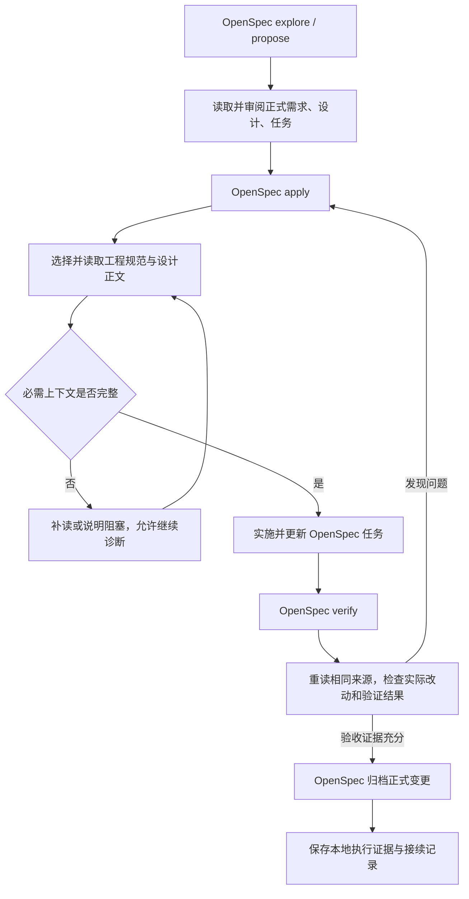

# OpenSpec + Trellis 规范上下文稳定性改造实施方案

状态：稳定版接入已开始实施，基础配置和原生入口已落地；完整业务试点与宿主事件验收尚未完成。
日期：2026-11-10。

## 1. 目标与交付判断

目标是让 Agent 在实施和验证时实际取得适用的工程规范正文，并能发现漏读、资料缺失和
证据过期。OpenSpec 保持开发主流程；Trellis 提供工程规范、上下文支持和本地接续能力。

验收必须分别回答：

1. **选对没有：**本任务涉及哪些需求、领域、专题和设计来源，为什么适用？
2. **送达没有：**正文是否出现在实际模型输入或成功读取的工具返回中，缺失与截断是否解决？
3. **落实没有：**哪些源码、测试、检查或页面验证证明实现符合需求及规范？

配置有效不等于正文送达；正文送达不等于模型理解或实现遵循。哈希和加载清单用于核查
来源与版本，不单独作为读取或业务正确的证明。本方案不承诺模型百分之百遵从文字规则。

### 1.1 范围

- 当前 SkillHub 的 Codex 接入、OpenSpec 原生工作流与 Trellis 工程规范。
- 后端开发、前端页面/组件开发及跨层变更。
- 主会话、显式选择的子 Agent、中断恢复和上下文压缩后继续。
- 干净克隆可读规范，以及可选自动化的安装、诊断、更新和降级。

### 1.2 非目标

- 不开发新的工作流引擎、数据库或并行任务调度器。
- 不复制 OpenSpec 的需求、设计、任务列表到第二套 Trellis 规划包。
- 不为小改动强制创建 OpenSpec change 或 Trellis 任务。
- 不修改模型核心，不把 hook 描述为全工具写入沙箱。
- 不自动修改信任记录，不绕过宿主审批，不将 Figma 作为默认门禁。
- 不在本变更中重做产品前端；设计系统任务用于验证规范链路。

## 2. 现状与证据边界

以下为实施前基线，不是本方案的完成状态：

| 项目 | 已观察事实 | 尚不能据此推断的结论 |
|---|---|---|
| OpenSpec | 本机 CLI 已由 1.12.0 升级到 1.17.0；项目使用 spec-driven | 不代表项目已生成或启用原生 apply/verify 入口 |
| 项目配置 | `openspec/config.yaml` 当前仅配置 schema | 尚未把工程规范读取要求接入原生指令 |
| 原生上下文 | 隔离项目实测 context、apply guidance 进入 CLI 输出 | 引用路径不会自动展开文件正文 |
| 入口 | 实际 Codex CLI 对照测试中，同目录 override 优先，普通 AGENTS 正文未同时自动加载 | 不代表当前对话从未取得过项目规则；显式读取或用户输入仍可提供正文 |
| 启动 | 已观察到会话建立后才同步本地工具；旧线程与新诊断进程的 hook 列表不同 | 时序证据尚不足以解释全部配置加载差异 |
| Trellis 稳定版 | 本机与 npm latest 均为 0.6.17 | 不自动为所有主会话投递专题规范 |
| Trellis beta | 0.7.0-beta.4 发布包已做完整性核验与六项隔离 hook 探针 | 未安装到主环境，未证明宿主真实触发与执行拒绝 |
| 规范 | 当前工作区有 39 篇规范，尚无 paths 声明 | 仅安装 beta 不会获得路径匹配效果 |
| 已有修补 | 13 项本地投递回归通过，规范检查为 39 文档/281 链接 | 不是本次完整工作流或业务遵循的验收 |

本机诊断原始结果随本地任务记录保留，不作为开源使用者必须取得的运行依赖。

## 3. 职责与唯一来源

| 内容 | 权威来源 | 其他位置如何使用 |
|---|---|---|
| 本次范围、行为变化、设计取舍、验收 | OpenSpec change | Trellis 和 Agent 引用原文件 |
| 正式任务与完成状态 | OpenSpec tasks 产物，以 CLI 返回的实际位置为准 | 不维护另一份正式 checkbox 列表 |
| 长期工程约定 | `.trellis/spec/` | AGENTS 保留少量关键摘要与路由 |
| 产品、架构与业务契约 | `docs/` 和已有正式 spec | 按适用范围读取，不用临时执行说明改写 |
| 当前任务关联、上下文来源、接续与执行证据 | 已有本地 Trellis 任务/会话记录，按需存在 | 不复制正式需求，不新增平行状态机 |
| 实际质量结果 | 测试、lint、评审与浏览器/业务验证 | 记录命令、版本、范围、结果与限制 |
| 正式规格归档 | OpenSpec 原生 archive/sync 流程 | 本地证据归档单独保存，不替代正式规格更新 |

小改动无需任务记录也能读取规范。已有关联 OpenSpec 的变更不重新走 Trellis brainstorm、
PRD、design、implement 规划审批；执行中发生真正范围变化时回到相应 OpenSpec 产物。

## 4. 目标执行流程



图中的步骤是项目工作约定，不额外新增一套持久化阶段枚举。默认主会话实施；仅在明确
选择委派时使用子 Agent。阶段之间延续已有授权，不反复请求“是否继续”。提交、推送、
部署、信任与本机全局配置变更仍按其各自授权边界处理。

## 5. 规范如何真正进入上下文

### 5.1 主会话

1. 宿主按实际规则发现并加载 AGENTS 指令。检查覆盖顺序与上下文预算。
2. OpenSpec 原生入口调用 `status`、`instructions apply`，把当前产物、任务和项目 context
   返回给 Agent；CLI 字段以实际 schema 与版本为准。
3. Agent 根据根索引、需求和实际影响选择领域及专题，并调用读取工具取得正文。
4. 读取输出完整，或所有被截断部分已补读，才可以认为该组必需资料已送达。
5. 进入实施；规范集随影响范围变化而调整，不预加载整个规范目录。

### 5.2 子 Agent

1. 主会话明确提供本次任务/OpenSpec 关联及适用规范来源，不能借用其他会话的活动任务。
2. 已有 implement/check JSONL 可直接引用 OpenSpec 原文与工程专题；不是只放目录索引。
3. 宿主原生 hook 已加载且可信时，由脚本读取正文并返回 additionalContext。
4. 无 hook、无有效父任务、输出溢出或资料未内联时，子 Agent 显式读取同一组原文。
5. 不以继承父会话或注入标记推断正文完整；不能假定子 Agent 已看到父会话工具输出。

### 5.3 可观察证明

| 情况 | 可以证明什么 | 不可以证明什么 |
|---|---|---|
| CLI 返回文件路径 | 来源位置已解析 | 文件已读取 |
| 读取工具返回完整正文 | 该次工具返回向模型提供了正文 | 模型已正确应用所有规则 |
| hook 列表显示可信启用 | 该线程配置中存在可运行 hook | 对某次事件已实际执行 |
| 真实 hook 事件及模型输入含正文 | 该次事件已提供对应正文 | 业务实现已经正确 |
| manifest/hash | 来源集合及内容版本可核查 | 读取已完成或语义遵循 |
| 针对性行为测试与人工/浏览器评审 | 对应输入、环境、范围内的规则得到验证 | 未测试环境、部署或全部规范通过 |

## 6. 按任务选择规范

源文件入口使用仓库相对路径，不将本机私人路径写入公共契约。

| 任务类型 | 基础读取 | 条件性追加与检查 |
|---|---|---|
| 后端接口 | [根索引](../../../.trellis/spec/index.md)、[后端入口](../../../.trellis/spec/backend/index.md)、OpenSpec 当前产物 | 接口、权限、模块、事务、数据库、错误、日志按实际变化选择 |
| 页面/共享组件 | [前端入口](../../../.trellis/spec/frontend/index.md)、OpenSpec 页面行为与设计 | 设计系统、状态、交互、组件契约和实际主题值；纯显示文案不强制加载全部设计资料 |
| 跨层变更 | 受影响领域取并集 | API 消费方、生成类型、状态与持久化语义 |
| 验证 | 实施采用的适用正文及[测试入口](../../../.trellis/spec/testing/index.md) | 需求/场景覆盖、完整改动、失败分支与影响选测 |

领域索引负责路由，专题正文才是实施依据。选择不能仅靠文件扩展名；例如后端 API 变化
可能同时影响前端请求类型。检查发现清单与实际 diff 不一致时，先补充适用来源。

### 6.1 设计系统

- 主题读取实际 token/样式来源；组件读取所用组件的完整契约；页面读取状态与组合规范。
- 保留已有业务、权限、接口与组件兼容性，不从原型推断后端能力。
- 设计库缺失时，依赖该库的设计任务未准备好；其他无关任务仍可继续。
- 本地库不默认进入公共仓库。缺少内部资产的新克隆必须能明确诊断，不能伪称采用了设计库。
- Figma 默认关闭；明确选用画板时使用 figma-web-bridge，作为可选证据渠道。

## 7. OpenSpec 原生配置与入口改造

### 7.1 项目 context 与 apply guidance

对已验证的 OpenSpec 1.17.0，拟在 `openspec/config.yaml` 中采用：

```yaml
schema: spec-driven

context: |
  实施和验证前，读取 AGENTS.md 与 .trellis/spec/index.md。
  根据需求和实际影响选择并读取适用的领域、专题正文。
  实现与验证使用相同适用规范，验证追加 .trellis/spec/testing/index.md。
  页面设计任务还需读取实际主题、组件契约和设计规范。
  缺失、截断或未内联的必需资料先补读，不得宣称已完整加载。

operations:
  apply:
    guidance:
      - 可使用已安装的 trellis-before-dev 完成规范读取；不可用时显式执行相同读取步骤。
```

这是拟议配置，不是已应用结果。`context` 提供项目指令正文，不自动展开外部文件。
`operationGuidance` 是附加指导，不是强制执行器。`rules` 只约束匹配产物的生成，
不能用 `rules.tasks` 代替实施读取。当前版本不支持 `operations.verify`。

### 7.2 原生入口安装与更新

- 先检查实际安装结果；CLI 已安装、update 无差异不等于项目已有 apply/verify Skills。
- 当前 core profile 包含 propose/explore/apply/update/sync/archive；verify 需另行启用。
- 在隔离目录预览适用版本生成的文件与更新行为，确认原生入口可见且读取步骤存在。
- 保留现有用户配置。若启用 verify 需要改变全局 profile，先展示跨项目影响并另行确认；
  不通过未验证配置字段假造项目级 profile。
- 更新生成文件后检查适配仍存在。定制步骤的权威说明保留在项目工作流规范，不在多处复制规范正文。

### 7.3 verify 必须单独衔接

原生 verify 会取得 apply 上下文并读取规划产物，但不能假定它自动执行 apply guidance。
适配需明确完成以下只读评审步骤：

1. 读取当前项目 context 中的工程规则要求与实际规范正文。
2. 读取当前 OpenSpec 产物；不把 apply 的 all_done 或任务勾选当成验证结论。
3. 与实施来源对齐，规范或契约变化后重读；新发现的影响领域追加专题。
4. 对照源码和验证结果检查完整性、正确性、一致性；分别报告失败、未验证和不适用。
5. 发现问题回到 apply 修复，再执行验证；不在 verify 中默认改产品代码或归档。

现有 trellis-check 允许修复机械问题，不能直接整段嵌入只读 verify。复用其规范选择、
范围审查、选测和报告原则；修复动作留在 apply。运行验证命令前仍检查其数据和服务副作用。

## 8. 指令入口、启动与本地模板

### 8.1 AGENTS 覆盖

同目录 override 优先的行为已由实际 CLI 对照验证。目标是恢复 AGENTS 主入口，保留本机
工作流说明但移出自动覆盖文件。任何 AGENTS 变更先展示具体 diff 并按用户规则取得批准。

不批量修改其他 worktree，不删除本地说明，不覆盖用户已有定制。迁移前备份，迁移后重新
构建提示输入，证明项目核心规则正文出现；该检查仍不是实际任务遵循的证明。

### 8.2 启动准备

- 新工作区尽量在 Agent 启动前准备可选集成，不只依赖 SessionStart 临时生成项目 hook。
- SessionStart 补齐工具时明确输出降级状态；同步成功不冒充该线程已加载新 hook。
- 用宿主实际 hook 列表核对当前线程，不能用独立进程的配置代替。
- 无法自动投递时显式读取正文，允许继续已具备依据的授权工作。
- 不自动重启宿主、不修改信任记录；新会话与事件验收单独执行。

### 8.3 本机模板

只发布经审阅的工具和规则变化，排除任务、会话、journal、凭证与私人报告。模板发布显式
进行；不使用一次全量发布夹带本轮无关设计改动。已跟踪规范按分支维护，不静默同步覆盖。

## 9. 可选路径注入：独立阶段

Trellis 0.7.0-beta.4 的原生路径注入可作为增强，但不列为稳定版基础交付的必需条件。

拟议规范声明示例：

```markdown
---
name: backend-conventions
paths:
  - server/**
---
实际适用于这些路径的后端工程规范正文。
```

```markdown
---
name: shared-ui-contracts
paths:
  - web/src/shared/ui/**
---
共享组件、主题与交互约束的正文或明确补读要求。
```

只对真正适用的规范声明路径。专题应进一步缩小范围，不为提高命中数给所有文件添加全仓库通配。

已观察的机制：首次全文投递返回 deny；同会话重试去重；内容变化和 compact reset 后重投。
但错误可能放行，Shell 非结构化写入和 Codex 只读验证不在该 hook 的当前覆盖范围内。
路径匹配也不能判断业务语义和全部跨层影响。

采用前要求：

- 明确选择候选版本并记录依赖、变更与回滚方法。
- 当前宿主确认 hook 可信启用；不得预写 trust 记录。
- 用真实工具调用验证正文进入模型输入，以及 deny 是否实际阻止首次修改。
- 验证主/子会话隔离、压缩、无匹配、长规范、损坏配置及不覆盖的写入路径。
- 未通过时关闭可选增强，保留显式读取路径；不将失败包装为强制保障。

## 10. 代码与文档改动清单

下面是实施目标，不表示本轮已修改：

| 位置 | 类型 | 计划改动 | 验收 |
|---|---|---|---|
| `AGENTS.md` 与本机 override | 已有/本地 | 精简重复入口，恢复正文默认发现；保留核心摘要和路由 | 提示构建对照、无丢失迁移、审批记录 |
| `openspec/config.yaml` | 已有/共享 | 增加项目 context 与 apply guidance | 原生 CLI 输出、无未知字段、路径不误报为正文 |
| `.trellis/spec/workflow/openspec.md` | 已有/共享 | 明确 OpenSpec 主流程、Trellis 规范支持、verify 只读原则 | 与正式需求/入口一致，无第二份任务列表 |
| `.trellis/spec/workflow/development-flow.md` | 已有/共享 | 实施与验证采用相同来源，降级和恢复要求 | 链接和重复摘要一致 |
| 本地 OpenSpec apply/verify 入口 | 待生成/本地 | 原生流程上衔接规范读取；验证不默认修复 | 可发现、真实执行、更新后保留 |
| 本地 Trellis Skills/Agent/hook | 已有/本地 | 使用 OpenSpec 原文；缺失、截断、父任务和来源变化明确处理 | 原生事件与显式读取分别验收 |
| `.trellis/spec/backend/`、`frontend/` | 已有/共享 | 必要时补充明确适用范围；路径声明仅在选用增强时添加 | 后端/页面/跨层代表案例 |
| `scripts/check-engineering-specs.py` 和相关测试 | 已有/共享 | 在确有可重复检查需求时扩展；不先造通用上下文引擎 | 正常/拒绝/跳过输入均有断言 |
| `.github/workflows/pr-scripts.yml` 或独立检查 job | 已有或新增/共享 | 相关变动触发文档/上下文回归，正确传播失败 | workflow 触发条件和实际运行分别检查 |
| `CONTRIBUTING.md` | 已有/共享 | 默认可读规范、可选自动化与验证边界 | 干净克隆可按文档执行 |
| 本机同步/发布模板 | 已有/本地 | 显式迁移覆盖入口，保留用户修改 | 隔离新工作区与已定制工作区测试 |

只有在实施证明现有机制无法复用、存在稳定重复逻辑时，才另行提出共享辅助脚本。
新命令、文件或配置字段必须标记为新增并经过实际验证，不把本方案中的示意当成现有能力。

## 11. 分阶段实施与退出条件

### M0：冻结基线和授权范围

- 记录工具版本、项目状态、适用 schema、实际入口和当前线程 hook。
- 对待修改的本地入口/生成文件保存可恢复副本；保留其他工作。
- 确认 AGENTS、全局 profile、beta、模板发布等操作的独立授权。

退出条件：能区分已观察事实与未验证项，未把审批缺口当成代码故障。

### M1：稳定版实施链路

- 生成并核对原生 OpenSpec 入口，接入项目 context/apply guidance。
- 实施阶段选择专题并取得正文；无自动化时执行显式读取。
- OpenSpec 产物成为唯一正式需求和任务源。

退出条件：主会话在真实 apply 中获得需求和适用规范；缺资料测试不会误报准备完成。

### M2：验证、恢复与来源变化

- verify 显式重读相关产物与工程规范，保持报告式评审。
- 中断、换会话、压缩后重新核对来源；子 Agent 不依赖未证明的继承。
- 来源或实现变化后重新判断检查是否适用，不强行让无关改动使全部检查失效。

退出条件：验证可发现漏读、需求未落实和过期证据，不自动修改产品代码或归档。

### M3：可移植性和 CI

- 在无个人配置的新目录检验基础路径及可选集成。
- 扩展必要回归和 CI，检查文件触发条件与失败传播。
- 当前 PR Scripts 使用 Node 21，而 OpenSpec 1.17.0 要求 Node >=22.12.0。
  若该 job 需运行原生 CLI，应为对应 job 使用受支持 Node；不顺手全局升级产品运行时。
- 新克隆缺设计库或未安装可选工具时给出真实结果，不要求私人路径。

退出条件：共享基础可独立使用；个人配置不会成为 CI 或公共规范的隐式依赖。

### M4：可选路径注入

明确选择采用或暂不采用；后者记录为不适用，不阻塞 M1–M3 的稳定版验收。
采用时完成第 9 节真实宿主测试，不把 Python 输出测试当成宿主拒绝修改的证明。

### M5：两个真实任务试点与交付

- 试点复用后续已授权的真实任务；批准本方案不等于授权新增产品需求。
- 后端任务：选择真实且范围明确的接口/业务行为改动，核对成功和拒绝场景。
- 页面任务：选择真实页面或组件改动，核对主题、组件、状态、焦点、小屏及完成态。
- 各包含一次恢复和一次可观察失败修复；不为制造成功率而选择只能静态证明的样例。
- 输出任务依据、读取证据、检查结果、人工修正和限制；无对照数据时不宣称效率提升。

退出条件：基础链路有实际案例，且交付清楚区分实施、验证、提交、合并、部署与生产状态。

## 12. 验收矩阵

| ID | 场景 | 预期观察 |
|---|---|---|
| A01 | 干净克隆、无本机 Trellis | AGENTS 和共享规范可读；不依赖私人工具 |
| A02 | AGENTS 与 override 同目录 | 对照测试准确显示加载行为；经批准迁移后正文出现 |
| A03 | 原生 apply | 当前 OpenSpec context、产物和选定规范正文实际送达 |
| A04 | 后端任务 | 适用接口/权限/事务等正文可核查，代码和测试对应需求 |
| A05 | 页面任务 | 实际主题、所用组件契约及页面规范可核查，浏览器结果符合验收 |
| A06 | 跨层变更 | 来源集合覆盖实际影响，不只按单一目录判断 |
| A07 | 必需文件缺失 | 明确缺失；不进入依赖该资料的修改；允许诊断和无关工作 |
| A08 | 正文截断或未内联 | 显式补读完整内容；标记和路径不能单独通过 |
| A09 | hook 未加载/未信任 | 不伪称自动送达；显式读取仍可完成规范准备 |
| A10 | 实现/检查子 Agent | 使用本任务来源，不借用其他会话，不假设父会话正文已继承 |
| A11 | 中断恢复/压缩 | 重核当前产物和规范，缺少正文时重新取得 |
| A12 | 规范或设计来源变化 | 重读受影响正文，更新来源记录并重核相关实现 |
| A13 | verify 发现问题 | 报告问题并回到 apply；verify 不默认修复或归档 |
| A14 | 验证命令失败 | 保留真实失败，不标记已验证完成 |
| A15 | 验证后实现发生变化 | 重新核对证据范围，不用旧成功证明受影响的新实现 |
| A16 | 工具更新 | 预览和保留定制；apply/verify 入口与读取适配仍可发现 |
| A17 | 新克隆缺少设计库 | 依赖设计库的任务明确未准备好，不伪造符合设计系统 |
| A18 | beta 首次路径命中 | 若选用，真实宿主正文投递和首次修改拒绝均有证据 |
| A19 | Shell 写入/无匹配路径 | 准确声明路径 hook 未覆盖；基础规范读取仍存在 |
| A20 | CI 回归故意失败 | 错误被检出且 job 正确失败；必要路径能触发检查 |
| A21 | 两个真实任务 | 规范送达与行为遵循分别有证据，未验证环境明确列出 |

### 12.1 验证命令

以下命令已在当前版本确认存在，从仓库根执行；示意 change id 需替换为实际目标：

```bash
openspec --version
trellis --version
openspec status --change harden-agent-spec-context --json
openspec instructions apply --change harden-agent-spec-context --json
openspec validate harden-agent-spec-context --strict --no-interactive
python3 scripts/check-engineering-specs.py
openspec update --dry-run --json
trellis update --dry-run
```

对本轮文档，只运行相关文档/原生 schema 检查。正式实现后的前后端检查遵循已有
[影响矩阵](../../../.trellis/spec/testing/index.md)，不因改了工作流就启动全部产品服务。
`codex debug prompt-input` 是提示构建检查，不创建模型任务；输出可能包含个人指令，
测试只保留必要断言，不把完整提示或会话原文提交到仓库。

## 13. 风险、恢复与回滚

| 风险 | 处理与回滚 |
|---|---|
| 生成更新覆盖定制 | 先预览、保存单文件副本；发现漂移恢复对应文件，不 reset 工作区 |
| override 迁移丢失本地约定 | 保留原文与备份，改为按需读取；失败恢复对应入口，记录遮挡边界 |
| context 过长或被忽略 | 保持简短路由，校验原生输出；正文按需读，不复制整库 |
| hook 不触发或失败放行 | 诊断当前宿主，显式读取兜底；可选增强退出，不冒充硬门禁 |
| 清单遗漏适用专题 | 根据需求与实际 diff 复核领域；真实案例检查语义覆盖 |
| verify 意外修改代码 | 保留报告式验证；修复回到 apply；检查实际工作区 diff |
| beta 引入不稳定 | 先隔离测试，记录版本；恢复原 hook 配置和运行工具，保留共享规范与任务证据 |
| 私人资料进入公开仓库 | 公共文档只用相对路径和公开来源，任务/状态/设计内部资源按原约定忽略 |
| 形式检查被当成质量证明 | 报告配置、送达、行为三层结果，缺少业务证据时保持未验收 |

回滚仅针对本次引入的明确文件与版本，不自动删任务、清理 worktree、改写历史或移除
用户其他工具。OpenSpec 归档正式规格和本地证据归档分别验证，均不授予提交、合并或发布权限。

## 14. 本轮文档交付与后续边界

本 change 的 proposal、design、tasks、spec 是本次改造的正式规划来源；本地 Trellis 只
记录执行和验证。本轮完成文档及结构检查，不勾选实施任务，不表示用户已经批准所有入口、
全局配置、beta 或模板发布操作。实施时按 tasks 推进，已有授权继续沿用；新的实质性决策
才单独确认。

本机 OpenSpec 1.17.0 的 status 可以在规划产物齐备时返回 isComplete=true；本方案不得
据此认定实施完成。需另外检查 instructions apply 的任务进度、实际实现及验收证据。

## 15. 调研来源

- [OpenSpec 项目配置](https://github.com/Fission-AI/OpenSpec/blob/579fcac57ae00c2dff38f971b6d88b6f1f098b8a/docs-lab/reference/configuration/config-yaml.md)：context、rules、operations 的职责与边界。
- [OpenSpec apply](https://github.com/Fission-AI/OpenSpec/blob/579fcac57ae00c2dff38f971b6d88b6f1f098b8a/skills/openspec-apply-change/SKILL.md)：读取原生产物上下文并实施任务。
- [OpenSpec verify](https://github.com/Fission-AI/OpenSpec/blob/579fcac57ae00c2dff38f971b6d88b6f1f098b8a/skills/openspec-verify-change/SKILL.md)：报告式核对需求、设计与实现，不能将任务勾选等同验收。
- [Trellis 稳定版上下文注入源码参考](https://github.com/mindfold-ai/Trellis/blob/f089cb3286071199e84118dee86b6d76aab032f1/packages/cli/src/templates/shared-hooks/inject-subagent-context.py)：清单、产物与原生子 Agent 投递。
- [Trellis beta 发布包](https://www.npmjs.com/package/@mindfoldhq/trellis/v/0.7.0-beta.4)：路径匹配增强；本机只做隔离源代码与输出验证。
- [Codex 指令组装](https://github.com/openai/codex/blob/36e074a2fb365aa788886495c82e6ea612226cd9/codex-rs/core/src/agents_md.rs)：实际发现、读取和预算处理。
- [OpenCode 运行时投递](https://github.com/anomalyco/opencode/blob/5f76acb12572932297cbce81bd0026e59b16e7ac/packages/core/src/session/instructions.ts)：正文与来源进入持久会话消息。
- [GSD 验证入口](https://github.com/gsd-build/get-shit-done/blob/bdcaab2c752d9a33a1a1ca9acf3a3c81fb991815/agents/gsd-verifier.md)：验证端独立读取与源码证据。
- [Superpowers 完成前验证](https://github.com/obra/superpowers/blob/22f0b463e7a5e579904dd6211a520321035526f7/skills/verification-before-completion/SKILL.md)：验证纪律，不等于全规则程序强制。
- [spec-superflow 完成检查](https://github.com/MageByte-Zero/spec-superflow/blob/fb5d4d535ed2abcf83615dee9e324b447fbd5875/scripts/lib/cmd-workflow.mjs#L225)：实际命令、审查快照与完成证据检查。

上游提交固定到调研时点；安装行为与能力仍以实际采用的发布版本和宿主验收为准。


## 稳定版实施决策（2026-11-10）

采用 OpenSpec 1.17.0 与 Trellis 0.6.17，不采用 beta 路径注入。原生 core profile 不默认生成 verify，且 update 会覆盖 Skill 项目适配，因此增加 scripts/setup-agent-workflow.py：在隔离 profile 生成原生 7 个入口，仅给 apply/verify 加读取共享工作流的薄前言，并检测漂移、保护手工修改。它不拥有第二套上下文或正式任务模型，也不证明运行时正文送达或模型遵循。独立 Agent Workflow CI 使用 Node24 和固定 OpenSpec 版本；远端运行尚待提交后验证。真实后端/页面试点、换会话恢复及可选子 Agent 验收仍未完成。


## 本机同步修复实施（2026-11-10）

复用既有 publish/sync/wt-new/SessionStart，未建立第二套上下文流程。工具发布加入 continue、注入脚本、Agent 提示词和 inline 配置；本轮仅 tooling-only 发布，模板规范未变。模板记录当前及历史 stock 哈希，工作区记录已安装哈希：缺失补齐、已知未定制旧版备份升级、未知工具定制拒绝覆盖；工作区配置/说明中的自选内容保留。SessionStart 按内容检查旧版，已有共享 setup 时衔接 OpenSpec 生成/检查，不复制另一工作区的生成入口、正式产物或任务。旧分支缺共享脚本时明确跳过，不静默改写分支源码；工作区更新加锁。本机脚本和模板保留本地，公开使用仍依靠仓库中的 setup/check。


## 自动需求澄清补充（2026-11-10）

需求分析有实质歧义时复用既有 grill-with-docs → grilling + domain-modeling，Agent 主动选用；原本禁止隐式调用的本机 Skill 策略已调整并验证。已明确的小修跳过访谈，入口准备由 Agent 负责。澄清结论不建立第二套正式需求，仍写回 OpenSpec，词汇/ADR 按已有懒创建约定处理。新会话自然语言路由与四份完整正文已取得真实工具结果证据；全局 hook 双来源声明告警与自动投递未验收单独保留，不据此宣称强制遵守或整个 harness 验收完成。


## 设计系统修复实施

投影从库内静态 :root/.dark 自定义属性完整生成，不以手改六项作为最终方案；不支持的条件 token 块或别名表达式明确拒绝，不冒充通用 CSS 计算引擎。theme/component 读取与 check 共同校验全投影/源哈希，组件输出实际解析值，分段输出保留完整契约和同一 payload 身份。

复用本机 publish/sync，在 .trellis/scripts 准备分支内 reader 的本地副本，设计 Skill 进入现有工具清单；私有资源存为用户目录下内容快照，逐文件校验后自动定位，保持不入 Git、不复制任务。产品仅采用必要主题值及基础控件比例/焦点，保持既有业务和 Radix 行为；全44组件迁移不因本次基础映射自动完成。

## 跨领域正文送达修复（2026-11-11）

复用现有领域索引和任务来源清单，不引入另一套规划。scripts/context_pages.py按字符及序列化UTF-8预算分页，工程read-context与设计reader共用，默认1800/上限2400字符，续页必须固定payload哈希；一个分页单独返回，避免多结果JSON包装再次截断。

read-context check支持既有JSONL文件清单或包含file/design查询的JSON来源清单；从Codex原始response_item工具返回核对当前正文/分页，默认排除最近compacted之前记录，也可按阶段追加行号界限。它不将加密压缩项、用户/助手自述、路径或hash当正文，不证明模型理解或宿主写入硬拦截。缺日志保留未验证并显式补读，不修改信任。

本机SessionStart只投递精简路径/来源摘要与补读指引，AGENTS原生加载保持不变。Skills及共享OpenSpec策略关联同一有界读取规则；旧分支缺共享策略时明确报告不完整，现有本机同步仅补工具，不覆盖分支规范。全部领域规范按当前GitHub实践盘点，结构拆分依据任务触发与语义，不为凑长度拆碎。

## 原生验收后的必要关联补充

实测证明小分页不自动保证选全适用专题。规范可在“必需上下文”节用本地Markdown链接和JSON设计查询声明小范围必要关联；审计只展开显式声明，不递归全部参考链接。设计采用专题先声明视觉/组件/质量/测试及状态/无障碍底线，后端等专题按真实任务关系维护，不机械要求所有资料。只读调用可内联提供来源，默认从CODEX_THREAD_ID定位当前唯一日志，避免因不能写清单而省略校验。functions.exec多页循环用notify逐页即时返回，防止累计结果被外层再次截断。
